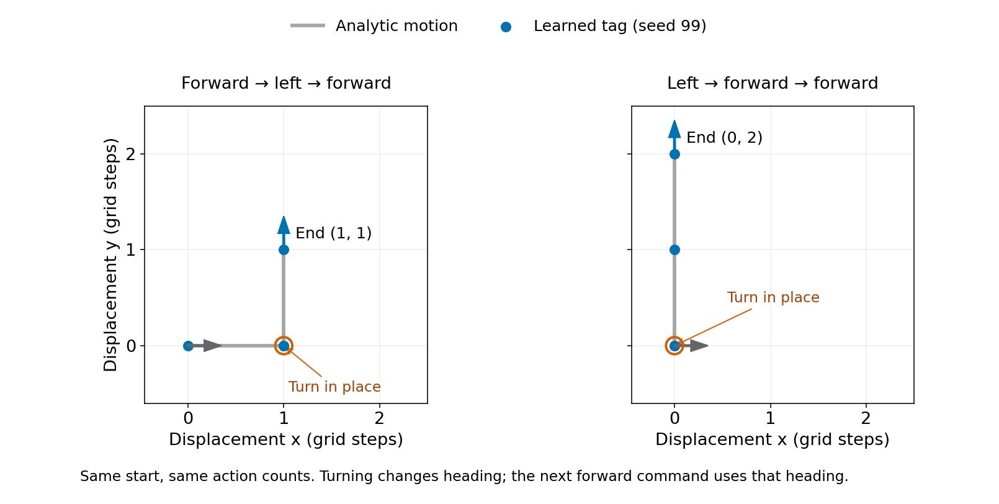

# Why action-conditioned CA3 tags can learn position and heading

**Documented 12 November 2026.** This note explains the robotics connection behind the [learned CA3 transport experiment](../06_experiments/ca3_goals/parallel_action_register_probe_20261111/low_rank_recurrence/README.md). Its central point is simple: **“forward” is defined relative to the agent, so its effect in a fixed reference frame depends on heading.** A memory that composes movements must retain that heading, even when its supervised output is only position.

The successful synthetic model learned the corresponding motion rules in an arbitrary linear coordinate system. We supplied four tag channels and endpoint supervision; the model learned how to use those channels. It did not discover the channel count or receive a separate heading-prediction target. Initial heading was encoded by the task's anchor identity, as specified in the experiment report. This is not yet a complete sensory world model.

## 1. The missing state variable is heading

Imagine two agents at exactly the same position. One faces east, the other north. Give both the same command, “forward one step.” Their next positions differ. Position alone therefore cannot determine the outcome of the action.

Write position as $p=(x,y)^\top$ and heading angle as $\theta$. In the agent's own body frame, forward is always along its first axis. In a fixed frame, it is along $(\cos\theta,\sin\theta)^\top$. This body-frame versus fixed-frame distinction is standard mobile-robot kinematics; see [Motion Model for the Differential Drive Robot](https://www.roboticsbook.org/S52_diffdrive_actions).

For a pure forward command of distance $d$:

$$
p'=p+d\begin{pmatrix}\cos\theta\\\sin\theta\end{pmatrix},\qquad \theta'=\theta.
$$

For a pure turn through angle $\delta$:

$$
p'=p,\qquad \theta'=\theta+\delta.
$$

Turning in place changes orientation, not the position already reached. Rotating the entire position vector about the landmark would be a different physical operation. These are kinematics, meaning geometric rules of motion; no forces, masses, inertia or wheel-slip dynamics are being modeled here. Our toy uses separate forward and turn commands, so these discrete updates are appropriate. They are not an Euler approximation for an arbitrary simultaneous moving-and-turning command.

## 2. A different representation makes the updates linear

The state $(x,y,\theta)$ makes forward prediction nonlinear because the update contains sine and cosine. Instead, store the heading vector

$$
h=\begin{pmatrix}\cos\theta\\\sin\theta\end{pmatrix},\qquad \xi=\begin{pmatrix}p\\h\end{pmatrix}\in\mathbb R^4.
$$

Then the same commands become

$$
\text{forward:}\quad(p,h)\mapsto(p+d h,h),
$$

$$
\text{turn:}\quad(p,h)\mapsto(p,\mathcal R_\delta h),\qquad
\mathcal R_\delta=\begin{pmatrix}\cos\delta&-\sin\delta\\\sin\delta&\cos\delta\end{pmatrix}.
$$

For a fixed action these are ordinary linear maps:

$$
F_d=\begin{pmatrix}I_2&d I_2\\0&I_2\end{pmatrix},\qquad
L_\delta=\begin{pmatrix}I_2&0\\0&\mathcal R_\delta\end{pmatrix}.
$$

This is a **lifted representation**: use an extra coordinate to make the update simpler. Four stored numbers do not mean four independent physical degrees of freedom. Since $h_x^2+h_y^2=1$, the physical pose still has three degrees of freedom. Redundant vector or matrix representations of orientation are standard in robotics; [Planar Geometry](https://www.roboticsbook.org/S61_driving_state.html) introduces this motivation and rotation matrices.

The model is linear in its state for each fixed action. It is not one fixed linear map for all actions: the chosen action selects which operator acts on the state.

## 3. Why action order matters

Start at $p=(0,0)$, facing east with $h=(1,0)$:

| Command | Position $p$ | Heading $h$ |
| --- | --- | --- |
| Start | $(0,0)$ | $(1,0)$, east |
| Forward | $(1,0)$ | $(1,0)$, east |
| Left | $(1,0)$ | $(0,1)$, north |
| Forward | $(1,1)$ | $(0,1)$, north |

If the left turn occurs first, both forward steps point north and the endpoint is $(0,2)$. The counts are identical; the turn changes the direction in which a subsequent forward command acts.

Grey paths are analytic motion; blue positions and heading arrows come from the recovered operators of checkpoint seed 99. Orange circles mark turns in place. These are two constructed examples for explanation, not additional held-out accuracy measurements. All three successful checkpoints are inspected separately in the experiment report.

With column-vector states, actions act from right to left in a product:

$$
\text{forward then left:}\quad \xi'=L_{\pi/2}F_1\xi,
\qquad
\text{left then forward:}\quad \xi'=F_1L_{\pi/2}\xi.
$$

The products differ. Two planar rotations about the same origin commute with each other, and two translations commute with each other. A local turn and a local forward movement generally do not. The relevant interaction is between orientation and translation, not a claim that all planar rotations fail to commute.

## 4. Robotics calls this pose composition in SE(2)

A robot pose can also be written as a homogeneous matrix, placing rotation and translation together:

$$
G(p,\theta)=\begin{pmatrix}\mathcal R_\theta&p\\0&1\end{pmatrix}.
$$

The collection of planar rigid poses is called $SE(2)$. For commands expressed in the agent's body frame,

$$
G'=G A_a.
$$

For forward, $A_F$ has identity rotation and body translation $(1,0)^\top$, so multiplication gives $p'=p+\mathcal R_\theta(1,0)^\top=p+h$. For an in-place turn, $A_L$ has rotation $\mathcal R_{\pi/2}$ and zero translation, so position stays fixed and orientation changes. The order of these body commands matters. The [coordinate-transformations chapter of Robotic Systems](https://motion.cs.illinois.edu/RoboticSystems/CoordinateTransformations.html) explains composition of rotations and translations.

Our four-number $(p,h)$ state is another way to compute the same planar commands. It is not itself a $3\times3$ homogeneous matrix. No Lie-group background is needed to understand the worked example; $SE(2)$ is the robotics name for its underlying pose-composition structure.

## 5. Why rank 2 matches this solution

Rank in our experiment means the rank of the **correction** $T_a-I$, not the rank of $T_a$ itself. For a nonzero forward step and a quarter turn:

$$
F_1-I_4=\begin{pmatrix}0&I_2\\0&0\end{pmatrix},\qquad
L_{\pi/2}-I_4=\begin{pmatrix}0&0\\0&\mathcal R_{\pi/2}-I_2\end{pmatrix}.
$$

Both corrections have rank 2. Forward must support two independent displacement directions as heading varies; turning changes the two heading components.

For one isolated tag with a fixed linear position readout $p=Cz+b$, a per-action rank-one correction gives

$$
T_F=I+b_F v_F^\top,\qquad
\Delta p=C b_F(v_F^\top z).
$$

All position changes lie along the one fixed direction $C b_F$. That cannot implement forward motion along both horizontal and vertical headings in this single-tag linear realization. Rank 2 is therefore a natural fit for the recovered planar motion representation.

There are two qualifications. First, we tested **shared** rank 1, not per-action rank 1. Shared rank-one maps have the form $T_a=I+\alpha_a K$ with one common rank-one $K$; they commute, so action order is lost during a silent interval. Second, per-action rank-one maps can already be order sensitive. For example,

$$
S_1=\begin{pmatrix}1&1\\0&1\end{pmatrix},\qquad
S_2=\begin{pmatrix}1&0\\1&1\end{pmatrix}
$$

each differ from identity by rank 1, but $S_1S_2\ne S_2S_1$. Thus “rank 1 cannot store order” is false in general. We have an explanation of this recovered single-tag linear solution, not a universal lower bound over nonlinear readouts, multiple interacting traces or other state encodings.

## 6. Why the raw weights did not immediately look mechanical

The learned channels have no fixed semantic labels. For any invertible coordinate map $Q$, the change $\xi=Qz$ turns a learned action matrix into

$$
\widetilde T_a=Q T_a Q^{-1}.
$$

Its entries can look very different while describing the same input-output computation. A linear readout changes correspondingly. Raw dense matrices therefore need not resemble the neat blocks above.

We used the learned east-anchor position readout $C$ to construct a physically motivated map, without fitting any additional pose labels at inspection time:

$$
Q=\begin{pmatrix}C\\C(T_F-I)\end{pmatrix}.
$$

The first two coordinates read position, up to a constant origin offset. The second two measure how much one forward step changes decoded position: that is a candidate heading vector. Its interpretation is then tested by whether forward leaves it unchanged and left/right rotate it correctly.

This is also an observability idea. Stacking $C$ and $CT_F$ describes the position readout now and after a forward probe. Subtracting the first block from the second gives $C(T_F-I)$, so it has the same identification power as $Q$. If $Q$ is invertible, these two observable quantities identify all four tag coordinates. The inspector rejects a singular $Q$ instead of forcing a position/heading interpretation.

The upper blocks of the transformed forward matrix follow from this construction. They are not independent evidence. Its lower blocks and **all blocks of the left/right matrices** are independent checks. These checks passed in all three successful fits, with well-conditioned maps and matrix errors below $4\times10^{-6}$. See [the numerical inspection and reproduction command](../06_experiments/ca3_goals/parallel_action_register_probe_20261111/low_rank_recurrence/README.md#recovered-kinematics-inspected-12-november-2026).

To put the decoded origin at the landmark encounter, subtract the first two components of $Qc_0$. This constant offset does not change the canonical action rules. The recovered initial heading is approximately $(1,0)$ in the encounter's reference frame. The other landmark readouts approximately rotate that frame by their initial-heading labels. These are landmark-relative states, not a claim that every tag directly stores world coordinates.

## 7. Connection back to CA3 and the world-model question

Using the agreed notation, $X$ is CA3, $u$ is DG input and $a$ is action. The scalar component $X^{(0)}$ retains the original landmark and age structure. For an isolated landmark contribution, the added tag evolves as

$$
X^{(\mathrm{tag})}_{t+1}[i,k]
=T_{a_t}X^{(\mathrm{tag})}_t[i,k-1]
+u_{t+1}[i]\mathbf1[k<R]c_0.
$$

The temporal shift answers **which landmark, how long ago?** The action-conditioned tag can additionally answer **how has the agent moved since that encounter?** In the synthetic task, the latter becomes position and heading relative to the encounter frame. More generally, the tag could encode whatever action-dependent predictive variables a task demands.

This explains the longer-word result mechanistically. A model that tracks position and heading can repeatedly apply the same local motion rules instead of learning a separate lookup for every word. For example, $F_1=I+N$ with $N^2=0$, so $F_1^n=I+nN$: repeated forward moves accumulate displacement at unchanged heading. Quarter turns satisfy $L_{\pi/2}^4=I$. The learned matrices approximate these rules; finite-word accuracy does not establish error-free arbitrary-horizon prediction.

The pose interpretation is for an isolated event contribution. Summing tags from repeated DG events can superpose several encounter-relative states; that sum is not automatically one valid robot pose. Landmark ambiguity, unknown initial orientation, noise, expiry and repeated-event interference need separate tests. The temporal shift still controls memory expiry; the motion operators do not replace it.

The concrete lesson is **representation can make a complicated-looking prediction problem into simple action-conditioned updates**. Our evidence is limited to a noiseless task with endpoint supervision. A complete IntrMotiv world model still needs learned future-DG/observation prediction, any changing bypass inputs, and validation of recursive counterfactual use.
