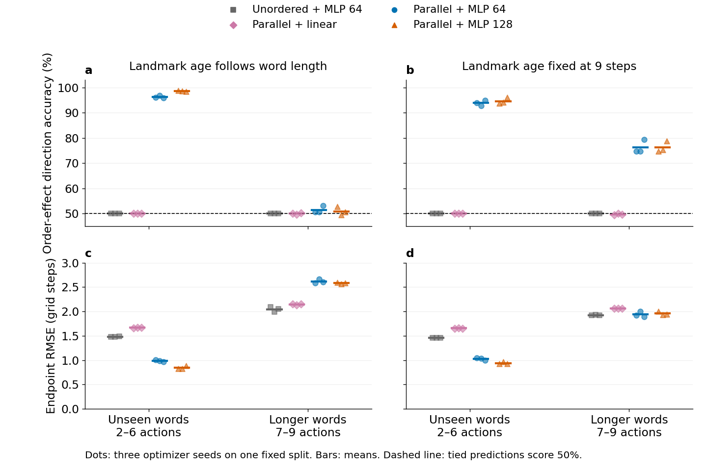

# Parallel action register: landmark binding and unseen action sequences

**Result, 11 November 2026:** an unchanged DG/CA3 register plus a parallel action register and a small nonlinear readout can associate landmark identity with action order and generalize to unseen words at trained lengths. This does not establish reliable longer-horizon simulation. Even with landmark age matched, longer-word endpoint predictions are little better than an unordered-action control.

This is a synthetic supervised readout probe, not a result from a trained IntrMotiv agent. It tests the architectural claim from the discussion: whether two aligned histories contain a usable landmark-relative action association without mixing DG channels or attaching action tags to every landmark trace.

## What was held fixed and what was learned

The original CA3 update is unchanged, using the existing pure [state adapters](../../../exports/intrmotiv_prediction_starter/intrmotiv_transfer/state.py):

$$
S_{t+1}=\operatorname{Shift}(S_t)+\operatorname{Inject}(d_{t+1}).
$$

The configuration uses 16 DG channels, injection width 8 and register width 71. A parallel 71-slot register stores the actual preceding action as a one-hot vector, with no DG-channel mixing. For fitting only, analytically constant-zero coordinates are removed: five used DG channels over 20 potentially nonzero slots, plus 12 observed actions over three channels. This gives 136 inputs; it changes no register contents or available information.

Only a readout is learned. The primary model is one ReLU hidden layer of width 64, with 8,898 parameters including the two-dimensional output. A prespecified width-128 sensitivity check has 17,794 parameters. Both are trained for 300 epochs with Adam, learning rate 0.001 and batch size 256. Checkpoints are selected by validation MSE every ten epochs, never by test results. Targets are displacement divided by four during fitting; all reported errors are restored to grid-step units. Some selected checkpoints are at the final budget, so optimization saturation is not established.

## Task, controls and split integrity

A nuisance landmark is observed at time zero. A subsequent anchor landmark specifies one of four initial headings. Forward moves one grid step; left and right turn 90 degrees. The target is the two-dimensional displacement **since that anchor**, after a sequence with no further DG events. Earlier actions remain in memory as nuisance history. Final heading is not evaluated. No pose, outcome, target label or supplied action tag enters the model inputs.

The readout must combine landmark identity, its temporal position and ordered actions: the same word gives rotated endpoints under the four landmarks. For example, forward–left and left–forward have identical action counts but different displacements. Every evaluated matched pair has exactly identical full CA3 tensors, identical nuisance prefixes, identical anchor identity/age, and identical action counts; only action order differs. Pairs with identical true endpoints are excluded.

Complete action words are split together across all four landmarks. There are 765 training, 162 validation and 162 held-out words of lengths 2–6, each evaluated under four initial headings. The longer test samples 240 words at each of lengths 7, 8 and 9, giving 720 words / 2,880 examples. No complete word crosses a split. There are 1,448 matched held-out pairs and a fixed subsample of 10,000 matched longer-word pairs per protocol. Pairs share words and are not independent statistical replicates.

Controls are landmark-only MLP, action-only MLP, a linear joint readout, and a width-64 MLP receiving landmark memory plus **unordered post-anchor action counts**. The unordered control is given correct temporal segmentation, so its failure cannot be blamed on counting actions before the anchor. Information ablations have different input/parameter counts; these are not parameter-matched architecture comparisons. A zero predictor provides a further endpoint baseline.

An exact interpreter reads only the two registers, recovers the anchor and intervening actions, and computes every endpoint correctly. This verifies information sufficiency and causal alignment. It has known dynamics and is an oracle, not a learned competitor or a comparison against learned per-trace tags.

## Results

Values below are means over optimizer seeds 8, 99 and 123 on **one fixed generated split**. These are fitting repeats, not independent environment or data-split replications. Per-seed values and ranges are in [summary.json](summary.json); all controls are retained in [metrics.csv](metrics.csv).

“Direction” means that the predicted endpoint difference between two matched orders has positive dot product with the actual difference; tied predictions receive 50%. It measures sensitivity in the correct direction, not accurate magnitude. “Endpoint correct” means both coordinates round to the true integer endpoint. RMSE is the square root of mean squared Euclidean endpoint error.

### Primary: landmark age equals word length

| Readout | Unseen 2–6 actions: direction | Endpoint correct | Endpoint RMSE | Longer 7–9 actions: direction | Endpoint correct | Endpoint RMSE |
| --- | ---: | ---: | ---: | ---: | ---: | ---: |
| Landmark only, MLP 64 | 50.00% | 13.27% | 1.664 | 50.00% | 9.14% | 2.086 |
| Actions only, MLP 64 | 50.00% | 14.20% | 1.739 | 49.78% | 9.31% | 2.123 |
| Unordered counts + DG, MLP 64 | 50.00% | 14.87% | 1.482 | 50.00% | 8.83% | 2.044 |
| Parallel registers, linear | 50.00% | 13.32% | 1.664 | 49.93% | 7.93% | 2.144 |
| Parallel registers, MLP 64 | **96.25%** | **35.39%** | **0.987** | 51.46% | 5.80% | 2.617 |
| Parallel registers, MLP 128 | **98.55%** | **48.97%** | **0.846** | 50.89% | 5.42% | 2.580 |
| Zero endpoint | 50.00% | 14.20% | 1.739 | 50.00% | 9.31% | 2.122 |
| Known-dynamics register interpreter | 100% | 100% | 0 | 100% | 100% | 0 |

The 64-unit model's held-out direction accuracy ranges from 95.93% to 96.75% across fit seeds; the 128-unit model ranges from 98.34% to 98.83%. The longer-word test also moves the anchor into previously unseen age slots, so that failure cannot isolate action-composition depth.

### Supplemental control: landmark age fixed at nine steps

This control was added after observing the primary extrapolation failure. It uses the same word splits, capacities and fit budget, but interleaves explicit no-op slots so all anchors are nine steps old. All suffix action positions have training support. No-ops are encoded as zero vectors using the existing sentinel convention; the task has no resets inside a sequence. Words still contain 2–6 non-no-op actions for training and 7–9 for the longer test. This removes unseen anchor age, while retaining a shift in action count and composition depth. It is not a fully distribution-matched causal isolation of depth.

| Readout | Unseen 2–6 actions: direction | Endpoint correct | Endpoint RMSE | Longer 7–9 actions: direction | Endpoint correct | Endpoint RMSE |
| --- | ---: | ---: | ---: | ---: | ---: | ---: |
| Unordered counts + DG, MLP 64 | 50.00% | 15.23% | 1.460 | 50.00% | 10.69% | 1.922 |
| Parallel registers, linear | 50.00% | 13.63% | 1.655 | 49.69% | 8.81% | 2.062 |
| Parallel registers, MLP 64 | **93.90%** | **32.36%** | **1.024** | **76.22%** | 10.94% | 1.937 |
| Parallel registers, MLP 128 | **94.57%** | **36.16%** | **0.939** | **76.29%** | 10.57% | 1.957 |

For longer words, direction ranges are 74.69–79.26% for width 64 and 74.68–78.84% for width 128. However, neither model beats the unordered control on endpoint RMSE. The nonlinear readout carries some useful order information beyond training lengths, without reliably composing an accurate displacement.



The figure shows individual fit seeds and their mean; no confidence intervals or significance claims are made. Editable vector exports: [SVG](generalization.svg), [PDF](generalization.pdf). [Figure manifest](figure_manifest.json) records the scalable font, input hashes and plotting transformation.

## Interpretation and next decision

**Demonstrated:** aligned parallel registers preserve enough information for the task; a small nonlinear head learns landmark–action binding and order effects on unseen complete words within trained lengths. Explicit per-trace tags are not necessary for this result. Linear concatenation and an unordered action summary do not suffice in this task.

**Limited:** accurate longer-word composition is not established. Doubling hidden width does not resolve the age-matched longer-word endpoint failure at this budget. This is evidence about these finite fits, not an impossibility result for nonlinear readouts. The anchor-to-heading mapping is synthetic, there is no noise or learned visual encoder, and only one split has been tested.

**Not tested:** learned action-dependent tags, goal-conditioned worker behavior, reward transfer, future DG generation, predicted bypass inputs, recursive model rollout, or DMLab intervention accuracy. There are no empirical place fields, trajectories, learned graphs or goal-control results in this diagnostic; these are outside its synthetic readout scope. A model that decodes endpoint displacement from a complete history is not yet an internally rolled-out world model.

The next discriminating comparison is a shared action-composition mechanism versus this parallel-register baseline under the same word split and endpoint objective. If per-trace tags are tested, their transforms must be learned with matched supervision; the perfect known-dynamics interpreter must not be presented as a fair learned-tag result. Integrating parallel registers into the live worker can remain a separate decision.

## Reproduce and verify

Run from the IntrMotiv root with the desktop `SF_git` environment:

```bash
/home/xiaoxiong/miniforge3/envs/SF_git/bin/python -m pytest -q hpc_runs/test_parallel_action_register_probe.py exports/intrmotiv_prediction_starter/tests/test_handoff_contracts.py
/home/xiaoxiong/miniforge3/envs/SF_git/bin/python hpc_runs/parallel_action_register_probe.py --config 06_experiments/ca3_goals/parallel_action_register_probe_20261111/config.json --output 06_experiments/ca3_goals/parallel_action_register_probe_20261111
/home/xiaoxiong/miniforge3/envs/SF_git/bin/python hpc_runs/parallel_action_register_probe.py --config 06_experiments/ca3_goals/parallel_action_register_probe_20261111/age_matched/config.json --output 06_experiments/ca3_goals/parallel_action_register_probe_20261111/age_matched
MPLCONFIGDIR=/tmp/intrmotiv-matplotlib /home/xiaoxiong/miniforge3/envs/SF_git/bin/python hpc_runs/summarize_parallel_action_register_probe.py --directory 06_experiments/ca3_goals/parallel_action_register_probe_20261111
```

Validation: **20 focused contract tests passed**. Both generated-dataset audits passed word disjointness, exact register-only oracle reconstruction, and equality of full landmark tensors / action counts for every evaluated matched pair. Saved predictions reproduce the scalar metrics. The scientific figure was rendered and inspected. Source and configuration hashes, library versions and the explicit claim boundary are in [provenance.json](provenance.json) and the [age-matched provenance](age_matched/provenance.json).

This probe uses `intrmotiv/synthetic-readout-probe/v1`, not `intrmotiv/study/v1`. The [standard workflow](../../../04_implementation/standardized_study_workflow.md) coordinates Sample Factory training and manifest-driven telemetry; neither backend applies to this exhaustive synthetic, CPU-only supervised test. No training jobs were submitted, and no runtime/checkpoint files were modified. The small configs here are the source of truth for the two offline fits; do not turn their run lists into a second SF submission workflow.

Reusable experience: the existing adapters preserved CA3 semantics and avoided a new recurrent implementation. Complete-word splitting prevented cross-heading leakage. The register-only interpreter distinguished missing information from readout failure. Matching landmark age was necessary to interpret length extrapolation. Reuse the saved predictions for new summaries and figures; do not repeat fitting merely to change presentation.
