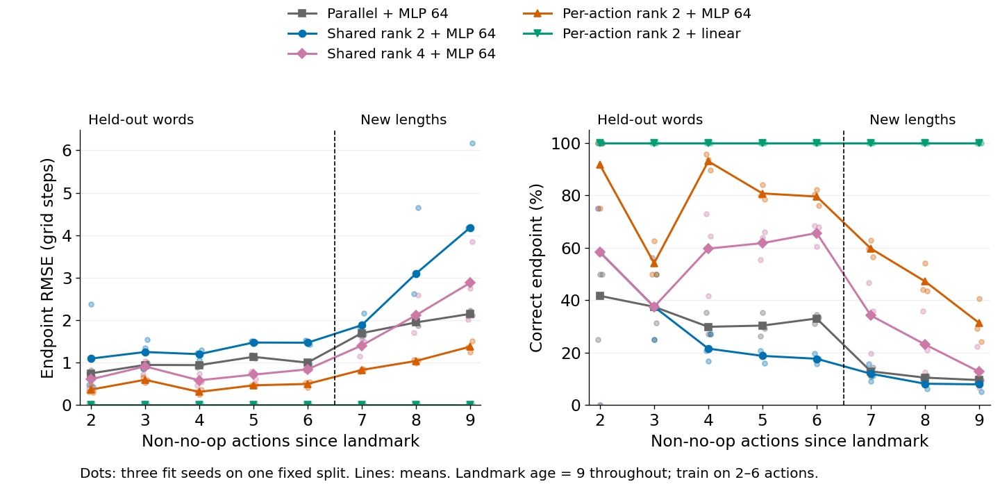

# Learned low-rank CA3 recurrence versus parallel action history

**Result, 11 November 2026:** the exact shared-factor rank-2 proposal did not improve longer-word endpoint prediction. A small relaxation, giving each action its own rank-2 factors, did improve it. With a linear endpoint readout, that recurrence achieved **100% rounded endpoint accuracy on all 2,880 held-out 7–9-action examples in each of three fit seeds**, after training only on words with 2–6 actions. Mean longer-word endpoint RMSE was $3.50\times10^{-6}$ grid steps. The saved parallel-register MLP-64 baseline achieved 10.94% and RMSE 1.937.

This is a learned synthetic action-composition result, not a demonstration of future DG generation, closed-loop planning or DMLab control. The successful model relaxes the shared factors in the original proposal; shared rank 2 and per-action rank 2 must not be reported as the same architecture.

## Matched task and supervision

This comparison uses exactly the [fixed-age parent task](../README.md#supplemental-control-landmark-age-fixed-at-nine-steps). The parent [configuration](../age_matched/config.json), complete-word split, row order, endpoint targets, action counts and matched counterfactual pairs are unchanged. The generated dataset SHA-256 is `f4c119554f8359569bf46f28d7b16c7fbf1d69a50944551878b317a0712d0496`.

An anchor DG landmark specifies one of four initial headings. Forward moves one grid step; left/right turn by 90 degrees. The output is displacement since the anchor, after a silent sequence. Earlier actions and a nuisance landmark remain in memory. Training words have 2–6 non-no-op actions; longer test words have 7–9. All anchors are nine time steps old, with no-ops interleaved where needed. Every suffix action position has training support. The model never receives pose, endpoint, action tags from an oracle, or true action-transition matrices as input.

There are 765 training, 162 validation and 162 held-out words at trained lengths, plus 720 longer words, each under four landmark identities. Complete words never cross splits. The held-out and longer matched comparisons contain 1,448 and 10,000 pairs respectively; pairs share examples and are not independent replications.

All new variants inherit the same Adam learning rate 0.001, batch size 256, 300 epochs, target scaling, fit seeds 8/99/123 and validation-only checkpoint selection every ten epochs. Supervision is **endpoint displacement only**, backpropagated through action-conditioned recurrence. No auxiliary kinematic targets, pretrained transition matrices, clipping, spectral constraints or test-set tuning are used. Existing baseline predictions are copied byte-for-byte from the parent archive rather than retrained. Recurrent training costs more computation at this fixed update budget.

## Recurrence and readout

Use $X$ for CA3 state, $u$ for DG input and $a$ for action. Each landmark/age entry now has its original scalar channel $X^{(0)}$ plus a four-dimensional tag $X^{(\mathrm{tag})}$:

$$
X^{(0)}_{t+1}[i,k]=X^{(0)}_t[i,k-1]+u_{t+1}[i]\mathbf 1[k<R].
$$

$$
X^{(\mathrm{tag})}_{t+1}[i,k]
=T_{a_t}X^{(\mathrm{tag})}_t[i,k-1]
+u_{t+1}[i]\mathbf 1[k<R]c_0.
$$

The shifted term is zero at $k=0$. The fixed nonzero initial tag is $c_0=(1,0,0,0)^\top$. The first channel is exactly the old CA3 register. Actions transform only tag coordinates, never landmark identities or age slots. No-op uses the identity. Injection width is 8, register width 71 and original DG width 16, as in the parent diagnostic.

The shared-factor proposal is

$$
T_a=I+B\operatorname{diag}(e_a)A.
$$

Shared ranks 1, 2 and 4 are tested. Rank 1 is an order-blind negative control: with identity base and one shared correction direction, the maps commute. Rank 4 is a capacity control at the full four-dimensional tag width. The alternative retains low-rank corrections but gives each action separate factors:

$$
T_a=I+B_aA_a,\qquad \operatorname{rank}(B_aA_a)\leq2.
$$

All factors are initialized near identity and learned from scratch. Here “LoRA” refers to a low-rank correction of a fixed identity base; there is no pretrained world-model matrix being adapted.

The endpoint head reads original scalar CA3 features plus the normalized sum of tags over age slots for each used landmark. It does not receive the raw action register. Heads are either one ReLU layer of width 64 or a linear map. Because no trace expires within this task, the normalized tag sum can be evolved exactly without materializing every age slot:

$$
\bar X^{(\mathrm{tag})}_{t+1}[i]
=T_{a_t}\bar X^{(\mathrm{tag})}_t[i]+u_{t+1}[i]c_0.
$$

The fast path is guarded by the condition that the elapsed time plus injection width fits within the register. It is checked against full landmark-by-age-by-tag execution, including overlapping DG injections. The original scalar CA3 temporal features are still supplied unchanged. This shortcut is not valid after trace expiry; it is not a new general memory-expiry rule.

## Results

Means below are over three optimizer seeds on one fixed synthetic split. “Correct endpoint” means both predicted coordinates round to the true integer coordinates. RMSE is root mean squared Euclidean endpoint error in grid steps. Direction accuracy asks whether a predicted difference between matched action orders points in the correct direction; ties score 50%. Direction and accurate displacement are distinct claims.

| Model | Learned parameters | New 2–6-action words: correct endpoint | Endpoint RMSE | Longer 7–9-action words: correct endpoint | Endpoint RMSE | Longer-word direction |
| --- | ---: | ---: | ---: | ---: | ---: | ---: |
| Unordered counts + MLP 64 | 6,786 | 15.23% | 1.460 | 10.69% | 1.922 | 50.00% |
| Parallel register + MLP 64 | 8,898 | 32.36% | 1.024 | 10.94% | 1.937 | 76.22% |
| Parallel register + MLP 128 | 17,794 | 36.16% | 0.939 | 10.57% | 1.957 | 76.29% |
| Shared rank 1 + MLP 64 | 7,885 | 14.35% | 1.612 | 9.16% | 2.051 | 49.77% |
| Shared rank 2 + MLP 64 | 7,896 | 18.93% | 1.446 | 9.32% | 3.208 | 62.53% |
| Shared rank 4 + MLP 64 | 7,918 | 63.63% | 0.799 | 23.33% | 2.218 | 94.79% |
| Per-action rank 2 + MLP 64 | 7,922 | 80.30% | 0.480 | 46.10% | 1.103 | 98.07% |
| **Per-action rank 2 + linear** | **290** | **100%** | $1.84\times10^{-6}$ | **100%** | $3.50\times10^{-6}$ | **100%** |

The last model has 48 recurrent factor parameters and 242 linear-readout parameters. The MLP tag heads have the same width as the primary parallel baseline and slightly fewer total learned parameters. The per-action factors and shared rank-4 factors have similar counts, 48 versus 44.

Longer-word endpoint accuracy ranges across seeds are 7.43–11.56% for shared rank 2, 12.92–35.00% for shared rank 4, 41.39–52.64% for per-action rank 2 with MLP, and 100% in all seeds for per-action rank 2 with linear readout. The linear model's per-seed longer-word RMSE ranges from approximately $3.10\times10^{-6}$ to $3.92\times10^{-6}$. See the exact [per-seed metrics](metrics.csv), [aggregate values and ranges](summary.json), and [per-length metrics](metrics_by_length.csv).



Lines are unweighted optimizer-seed means; dots show each seed. The vertical boundary separates trained word lengths from unseen lengths. Word counts per length 2–6 are 1, 4, 12, 36 and 109; each longer length has 240 words. No confidence intervals or significance tests are claimed. [SVG](length_generalization.svg), [PDF](length_generalization.pdf), and [figure provenance](figure_manifest.json) are retained.

## What this changes in the interpretation

The rank-2 shared-factor suggestion permitted noncommuting action maps, but that alone did not yield useful compositional dynamics. Its action-dependent changes all lie in the common range of $B$; reachable tag states lie within the span of $c_0$ and those columns. Separate factors remove that common-range restriction while retaining rank-2 corrections per action. The matched MLP-64 comparison supports this relaxation empirically; it does not prove that expressivity alone explains every optimization difference.

The linear-readout result is especially useful: accurate composition can be carried by the recurrent transition, with a very small output map. In this task, allowing a larger nonlinear head did not provide the same longer-word accuracy at the same training budget. This supports testing the simpler linear readout before adding decoder complexity. It is not a universal claim that nonlinear heads are worse.

Learned linear-readout transitions have maximum action spectral radii near one (1.000001–1.000335 across fits). Their maximum pairwise commutator norms are 1.65–1.78. The weaker shared rank-2 fits are also noncommuting, so noncommutativity is not a sufficient performance criterion. These diagnostics describe learned latent operators; they do not identify a unique physical coordinate basis or prove generalization to arbitrary word lengths.

The comparison matches supervision, data and update budget, not every resource: a full four-tag-channel CA3 uses more state than a scalar CA3 plus the three-channel action register. The exact pooled implementation avoids that expansion in this bounded test. Recurrent fits took about 6–8 seconds each locally versus about 1.4 seconds for the saved MLP-64 baseline; these are run logs, not a production throughput benchmark.

## Boundaries and next step

The tested longer words contain at most nine actions. This is one deterministic noiseless task and one fixed split, with three optimizer seeds. The endpoint labels are privileged synthetic displacement supervision, not the future-DG objective available to the IntrMotiv agent. Initial landmark identities cleanly specify heading; there is no learned visual encoder, perceptual aliasing, unknown action availability or repeated-landmark interference in this diagnostic.

The model composes learned transitions through silent intervals, but has no learned generator of future $u$, no predicted depth bypass, no reward/termination head, and no policy. Therefore it is not yet a complete counterfactual world-model rollout. Place fields, empirical agent trajectories, learned graph statistics and goal control are not applicable to this offline diagnostic.

The smallest supported candidate for the next experiment is **unchanged scalar CA3 + four-dimensional action tags + per-action rank-2 corrections + a linear readout**. To move toward the actual world model, keep the same action-conditioned recurrence and replace/extend the endpoint target with held-out future DG/observation prediction, then validate recursive use. The exact shared rank-2 formulation should not be promoted on the strength of the successful per-action control.

## Reproduction and validation

The single declarative [synthetic specification](../../../../hpc_runs/studies/ca3_low_rank_action_transport.synthetic.json) references parent artifacts and inherits their training settings. It uses `intrmotiv/synthetic-transport-comparison/v1`: the standard Sample Factory/Slurm/telemetry contract does not represent this supervised CPU diagnostic. No new cluster workflow, job submission or runtime change is introduced.

```bash
/home/xiaoxiong/miniforge3/envs/SF_git/bin/python hpc_runs/compare_ca3_action_transport.py --spec hpc_runs/studies/ca3_low_rank_action_transport.synthetic.json --dry-run
/home/xiaoxiong/miniforge3/envs/SF_git/bin/python hpc_runs/compare_ca3_action_transport.py --spec hpc_runs/studies/ca3_low_rank_action_transport.synthetic.json
/home/xiaoxiong/miniforge3/envs/SF_git/bin/python -m pytest -q hpc_runs/test_ca3_action_transport.py hpc_runs/test_parallel_action_register_probe.py exports/intrmotiv_prediction_starter/tests/test_handoff_contracts.py
/home/xiaoxiong/miniforge3/envs/SF_git/bin/python hpc_runs/audit_ca3_action_transport.py --directory 06_experiments/ca3_goals/parallel_action_register_probe_20261111/low_rank_recurrence
MPLCONFIGDIR=/tmp/intrmotiv-matplotlib /home/xiaoxiong/miniforge3/envs/SF_git/bin/python hpc_runs/summarize_ca3_action_transport.py --directory 06_experiments/ca3_goals/parallel_action_register_probe_20261111/low_rank_recurrence
```

**29 focused tests passed.** The [checkpoint audit](replay_audit.json) reloads all 15 new checkpoints, reproduces every saved prediction, independently recomputes endpoint metrics, and checks full temporal CA3 execution on a held-out longer-word subset for every checkpoint. It verifies the original scalar channel exactly and full-reference versus pooled-head predictions numerically. Parent/source hashes and exact baseline identity pass. Full dataset split/matching audits are in [audit.json](audit.json); source and parent fingerprints are in [provenance.json](provenance.json). Learned matrices, training traces and checkpoint selection are saved in [fit records](fit_records.json), with reusable weights under [weights/](weights/).

Reusable experience: inherit the immutable parent split and predictions, derive factual inputs from its registers, test temporal invariants before fitting, and compare both the proposed restricted factorization and a similarly sized relaxation. Rerender from saved predictions. Per-length summaries must tolerate lengths with no matched pairs and normalize JSON-loaded count tuples; neither presentation issue requires refitting. Retain accurate endpoint error alongside order sensitivity so amplified trajectories cannot masquerade as successful composition.
