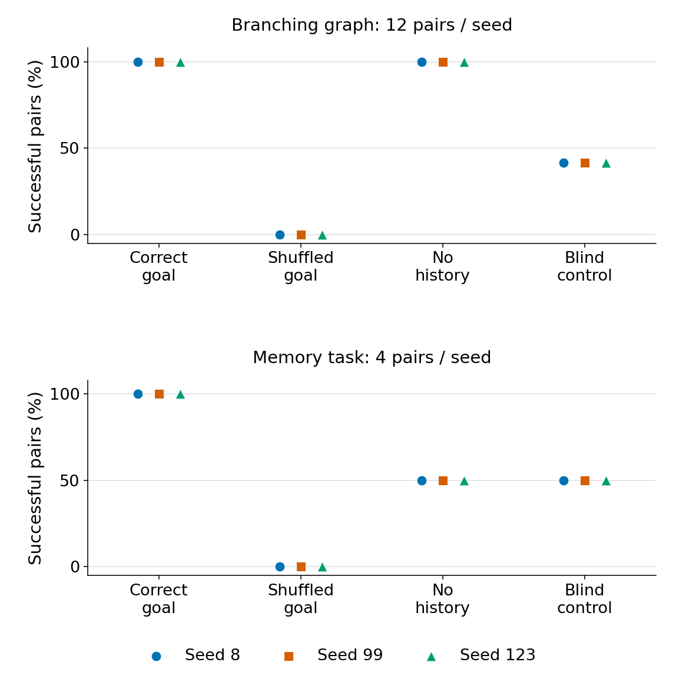

# Minimal control change after reward-free exploration

Date: 2026-11-27. Owner: this report. Scope confirmed by the user: every reachable learned DG landmark. **Status: full DMLab replay and fitting complete, with four control-evaluation jobs running. A smaller bounded-target design passes every query in three matched GeoMem grid tests; its memory-dependent regression remains pending.** The user requests GeoMem-style controlled simulations first and DMLab execution on NEMO. No DMLab installation was performed locally.

## Question and candidate

Can the existing DG/CA3 state support arbitrary landmark commands when the acting controller is trained directly to reach the requested landmark? The selected candidate preserves the visual trunk, DG identities, CA3 dynamics, and current goal-conditioned MLP. It changes the controller's objective, replay goal labels, and acting-head selection together as an explicit contract: fixed requested goal, unit first-arrival target, and action selection from that trained value. The first prototype used the available FiLM interface; the subsequent matched legacy-decoder test shows that addition is unnecessary on these tasks.

The [theory and prospective gates](../../../02_algorithm/fixed_goal_first_hit_control.md) were written before simulations. They give a finite-horizon Bellman proof and state the representation and action-support assumptions. The result is conditional sufficiency, not proof that the current learned DG/CA3 state satisfies those assumptions. The test of minimality is whether this controller change works before adding memory or a world model.

A [prospective smaller-candidate audit](runtime/minimal_stationary_head_design.md) asks whether discounted absorbing first-hit values can use the original action logits directly, adding no inference parameters or deadline input. Exact greedy values reach every reachable goal on a finite deterministic, sufficiently represented graph. In stochastic environments the discount trades success probability against arrival time; it does not optimize the finite-deadline criterion. The six unprojected local fits failed the every-pair gate in five runs. A subsequent analytically bounded bootstrap target passes a separately trained GeoMem grid in all three seeds. That smaller candidate has not yet passed the memory-dependent regression or native control test; neither result proves global architectural minimality.

Reward-free means the exploration transitions contain no external task reward. Goal labels are generated from frozen DG events. Offline control fitting uses this data; goal evaluation freezes learning. Fitting a new controller is not claimed to transfer the original worker policy. The representation and goal-command interface are retained. Synthetic DG cues in the small tests are controlled stand-ins, not learned DMLab place fields.

## Why this differs from previous attempts

The audited clean desktop runtime is `/home/xiaoxiong/SFgit/SF_hipposlam` at `206ee8330f048b910c19ea9b82e6215a58a63c8d`. Its `controller_q.py` declares that hindsight values never choose actions. Main replay keeps behavior and successor manager commands; virtual-goal replay rewrites both commands but trains only the auxiliary. Acting uses the main continuing-return head. This is a verified implementation distinction, not evidence that correcting it will solve DMLab navigation.

The [goal-value-stop study](../../reward_credit/goal_value_stop_dg_20261009.md) already trained eighteen 100M runs. Its terminal PPO/GAE change did not establish replicated control benefit; its executed command-intervention evidence is incomplete. Therefore this record does **not** treat the absence of a positive result as proof that option termination has no effect. The [episode-long DG comparison](../../dg_goal_control/episode_long_dg_comparison_20261009.md) supplies separate negative exact-start evidence for prescribed fields and FiLM. No completed run or TensorBoard analysis is repeated here.

The proposed all-goal labeling also differs from future-selected hindsight: it retains failed stochastic transitions for every goal. Goal-conditioned value functions and reward-free exploration are established methods ([UVFA](https://proceedings.mlr.press/v37/schaul15.html), [Jin et al.](https://proceedings.mlr.press/v119/jin20d.html)); stochastic hindsight bias is documented by [USHER](https://proceedings.mlr.press/v205/schramm23a.html). This study makes no general algorithmic novelty claim.

## Local experiment record

The first candidate succeeds on the declared graph tests while retaining the existing CA3 update and runtime FiLM/head classes. It does not establish that a particular pretrained DMLab representation is sufficient.

| Test | Result | Evidence boundary |
| --- | --- | --- |
| Exact covered branching graph, deadline 8 | 12/12 nontrivial pairs; oracle discrepancy zero | Tabular mechanism test using independent one-step resets, not natural exploration |
| Same graph, one essential action absent from replay | 8/12; four failures retained | Missing support cannot be repaired by the objective |
| Stochastic safe versus risky route | All-outcome replay selects success 1.0; successful-transitions-only subset selects success 0.1 | Illustrates outcome-selection bias; not a full HER comparison |
| Neural factual replay, two endpoint goals, deadline 6 | 12/12 pairs in each of seeds 8, 99, 123 | Fixed synthetic DG; 4,096 random-exploration transitions per seed |
| Neural factual replay, sparse cue-history task | 4/4 in each seed; history removal 2/4; shuffled command 0/4 | Existing CA3 is necessary and sufficient for these fresh-cue trials |
| Neural factual replay, **all seven DG identities as goals** | **42/42 nontrivial pairs in every seed**; every goal succeeds | One fixed seven-node graph with distinct current DG cues; not visual representation learning |

The all-seven-goal extension uses the exact same reward-free trajectory files as the two-target graph experiment. It assigns all goals after collection, enumerates goal labels independently of outcomes, and performs no evaluation updates. Its reported stopped-task alternative-command lift is $26/35=0.743$ in every seed; seven alternatives already satisfied at the initial state are excluded and counted explicitly. This statistic mixes navigation with command-dependent stopping and alone does not establish selective action choice; the [contrast addendum](runtime/command_contrast_addendum.md) gives the corrected interpretation. There are 49 declared source/goal combinations, seven trivial initial-goal cases, and 42 nontrivial cases per seed.

A [post-audit reanalysis of the saved state/action paths](toy_competing_first.json) directly tests ordering. Both decoder families, in every seed, have competing-target FIRST contrast $70/210=1/3$ (70 positive, 140 zero, no negative ordered comparisons); the command-blind control is exactly zero. This establishes command-dependent ordering on the tested graph without new rollouts or fitting. The all-competitor stopped-task statistic uses 210 comparisons and is distinct from the earlier 35-pair cyclic-shuffle statistic. Event times are derived from paths; the original toy CSV's `first_distinct_goal` field records the first goal event and may include a source revisit, so it is not used for this contrast.

The exact finite test also finds that greedy fixed-policy successor predictions solve the original branching graph. That graph alone does not establish a need for optimal Bellman backups. A separately labeled post-audit counterexample gives optimal-control success 1.0 versus 0.75 for greedy fixed-policy prediction. See the [finite record](finite/README.md), [pair table](finite/per_pair.csv), and [stochastic witness](finite/stochastic_witness.json).

The neural learner uses actual source `TargetFiLMDecoder` and `ControllerQHeads`, with the unchanged CA3 adapter. Its fixed settings are memory length 8, injection repeat 1, hidden width 128, deadline 6, 2,500 Adam updates, batch size 256, learning rate 0.003, and target refresh every 100 updates. These toy settings are not the DMLab checkpoint configuration. Distillation from an empirical value table is reported separately as an approximation upper bound; the replay-TD arm constructs targets from stored CA3, actions, successor CA3/DG and physical termination, without a latent-state table lookup. A latent-state relabeling test verifies that TD updates do not use hidden node identities.

Each point is one training/data seed, with exact deterministic evaluation over 12 or four nontrivial pairs. No confidence interval is inferred from three copies of the same task. Correct and shuffled commands use the same trained head. The history ablation removes earlier CA3 slots. The blind control also removes the goal input and trains a synthetic continuing reward objective: it is **not** a reproduction of the old controller or an isolated head-routing contrast. Editable [SVG](figures/replay_control.svg), [PDF](figures/replay_control.pdf), and [data/font mapping](figures/replay_control.mapping.json) accompany the inspected PNG.

All 15 trained readouts (12 initial fits plus three all-goal TD fits) were reloaded and reproduced their recorded trials exactly, with unchanged parameter hashes during evaluation. Results and audits: [initial neural results](neural/results.json), [saved-weight replay](neural/replay_audit.json), [all-landmark results](neural_all_landmarks/results.json).

**Limits.** Successful action selection does not establish calibrated probabilities: maximum absolute per-deadline value errors are 0.45–0.58 in the initial suite and 0.56–0.61 in the all-goal extension. The existing deadline head is affine in positive remaining time at fixed state/goal and cannot exactly represent arbitrary first-hit probability curves. The all-goal run uses 4.48M first-hit labels versus 1.28M in the two-goal TD run; equal optimizer steps do not mean equal supervision cost. Distillation also has a different target count. The sparse task evaluates fresh histories within the finite memory window; one seed-8 replay transition had already lost its initial cue. No universal CA3 sufficiency, held-out-map transfer, or training-efficiency advantage is claimed.

## Runtime qualification

The actual current C05 checkpoint uses the ordinary **legacy MLP**, not FiLM. Its full input already includes the target one-hot. A six-fit follow-up therefore repeats all-seven-goal and sparse-context replay-TD with the actual `MlpDecoderJit` architecture (`[128,128]`, ReLU, JIT enabled), using the same saved exploration data. It reaches 42/42 and 4/4 pairs respectively in every seed; removing memory gives 2/4 in the contextual task. [Legacy results and saved-weight audits](neural_legacy_r1/results.json). These are fresh toy decoder weights, not transferred pretrained weights. This supports preserving the original decoder in DMLab; adding FiLM is unnecessary for the tested repair. Including this follow-up, 21 fits completed successfully. An initial JIT target-copy failure occurred before optimization and is retained as an infrastructure failure.

The [GeoMem reference audit](geomem_reference/README.md) directly reuses its graph constructors, separates observations from latent nodes, distinguishes controlled action kernels from fixed-policy edge probabilities, and checks retained-cue versus expired-cue versus undisclosed-context failures. It involved no native DMLab. Those are the relevant conventions for the beginning of this investigation; its graph correctness labels are not imported as external-reward supervision for IntrMotiv.

### Smaller original-action-head test

The [stationary results](stationary_original_head/results.json) use the original `MlpDecoderJit` and `ActionParameterizationDefault`, with raw action outputs trained as discounted first-hit values at $\gamma=.99$. There is no clock input or auxiliary head. The six fits use the same saved data, sampled transition batches, seeds and optimizer budget as the legacy finite-horizon comparison. All six saved weights exactly reproduce their recorded trials, with frozen evaluation and unchanged source/data hashes; no tuning or rerun followed the failed gate.

| Task and metric | Seed 8 | Seed 99 | Seed 123 |
| --- | ---: | ---: | ---: |
| All-seven-goal fork: reached / 42 | 39 | 34 | 41 |
| All-seven-goal fork: shortest arrivals / 42 | 32 | 31 | 39 |
| All-seven-goal fork: competing FIRST | 0.286 | 0.305 | 0.333 |
| Sparse history: reached / 4 | 3 | 3 | 4 |

The finite-horizon legacy comparison reached every query in every seed; its fork FIRST was $1/3$. The stationary candidate often takes shorter successful routes but leaves failures, so shorter average paths do not establish better control. Start-query value errors on the fork are 0.024–0.061, larger than the sufficient uniform ranking tolerance of roughly 0.0048 at distance six. These sampled errors are not a global error certificate or a unique causal diagnosis.

The stationary comparison also removes the jointly trained continuing loss and excludes already-satisfied current goals from regression. It therefore tests the complete smaller design, not capacity alone. Each fork fit enumerates 4.48M labels and uses 3.84M after that exclusion; each sparse fit uses 1.28M. The toy action head has 387 parameters for three actions; the exact native donor head has 645 for five actions, confirmed by the [source/snapshot audit](runtime/stationary_action_head_audit.json). Including this test, 27 fits completed. This candidate does not pass the local gate for another full native run.

The [saved-path diagnostic](stationary_original_head/diagnostic/results.json) reproduces all 14 failures. Twelve first misrankings have an exact full-CA3 match in replay, and nine also have both the chosen and a shortest action represented. For sparse seed 99, the final network ranks waiting 1.010706 above direct arrival 1.000007. The physical wait shifts the retained cue to the next CA3 slot; its actual successor maximum is 1.024110. The [fresh-weight replay residual](stationary_original_head/final_replay_residual/results.json) is $1.49\times10^{-6}$ MSE, versus the recorded last minibatch's $1.18\times10^{-10}$ loss against an older target. The final network's same-minibatch residual is $1.34\times10^{-6}$. This demonstrates that the small logged loss did not certify the final ranking. It motivates a separately declared bounded-target test, without establishing a unique cause or changing these results.

### Bounded targets on a fresh GeoMem grid

The [projection derivation](runtime/projected_bootstrap_design.md) was fixed before implementation or fitting. It projects only the next-state bootstrap onto its known range $[0,1]$, before multiplying by $.99$. This preserves the exact optimal fixed point and its contraction under the stated representation assumptions. It adds no inference parameters, clock, output nonlinearity or actor clipping. Neural optimization and raw output accuracy remain unproved.

The [six completed matched fits](projected_grid_r1/results.json) use GeoMem's actual `clamped_lattice(4,4)` transition environment, fixed synthetic DG cues, unchanged CA3, the original decoder/action-head classes, and 4,096 reward-free transitions per seed. Each projected/unprojected pair has identical observed initial weights, replay, transition batches and masks, and uses 9.6M noninitial goal labels. Every one of the 240 nontrivial pairs is tested; sixteen initial-goal stops are counted separately.

| Grid metric | Seed 8, raw → projected | Seed 99, raw → projected | Seed 123, raw → projected |
| --- | ---: | ---: | ---: |
| Reached / 240 | 240 → **240** | 220 → **240** | 235 → **240** |
| Shortest arrivals / 240 | 178 → 189 | 144 → 172 | 167 → 175 |

The projected candidate passes the every-pair gate in all three seeds. Mean competing-target FIRST is 0.748 versus 0.706, using all 3,360 ordered comparisons per seed and condition. All six saved weights reproduce their trials exactly. This supports the target-range intervention on this fully observed graph; it is not transferred-policy, held-out-topology, learned-field or partial-observation evidence. Projected target maxima are one, while raw predictions still reach 1.015–1.024 and fresh-start value errors remain above the sufficient uniform shortest-ranking bound. Successful reaching does not imply calibrated values or shortest routes.

An [explicitly post-hoc regression protocol](runtime/projected_regression_protocol.json) now applies the unchanged projected candidate to the original fork and sparse-history data, with six fixed fits and no tuning. Those familiar queries can detect regressions but cannot become independent validation. Including the completed fresh-grid experiment, 33 local fits are recorded.

The copied-head adapter passes terminal-success, same-goal, deadline-zero, missing-successor, unsupported-continuation, source-immutability and training-gradient checks. A separate structural gate rejects goal-dependent geometry, goal-written worker states and unverified state layouts; replacing only the goal slice is not valid for those variants. [Adapter certificate](runtime/adapter_qualification.json) · [core-layout certificate](runtime/core_eligibility.json).

A pre-existing native DMLab installation reproduced two 64-decision no-reward prefixes exactly during an initial compatibility check. No checkpoint or learned controller participated, and no installation was performed. That check was unnecessary for the initial graph tests; following the user's correction, further native DMLab execution is confined to NEMO. The [historical local smoke receipt](runtime/native_smoke.json) is infrastructure evidence only.

## Full DMLab execution boundary

The user confirmed successful manual NEMO2 login on 27 November. The source audit selected `COS27_C05_TEMPORAL_TEMPORAL_S99`, checkpoint `checkpoint_000006104_100007936.pth`, SHA-256 `f35464c7e058df3ac51b676d5560470aa3cddd3c57f02ed1c0012a5fbcfaed38`. Its exact frozen source/configuration and parent StudySpec are recorded in the [qualification protocol](runtime/qualification_protocol.json). The source uses winner-based DG arrivals; exclusive single-active arrivals are a separate secondary metric.

The main plan was [submitted](runtime/main_submission.json) at 09:48 UTC on 27 November: job **8950233** collects and fits; jobs **8950234–8950237** evaluate the four source partitions after its successful completion. The [startup receipt](runtime/main_startup_receipt.json) verifies the loaded checkpoint, actual 1165-wide core and dependencies. By 10:15 UTC, [all 100,000 replay decisions were certified](runtime/main_results/replay/metadata.json): every native reward was zero, model hashes were unchanged, all 111 terminal successors were captured, and no reset observations were used. The [exposure audit](runtime/main_results/exposure/exposure.json) includes all 16 goals in both train and holdout episodes. Goal 4 is least exposed, with 75 training winner positives across 47 episodes and 15 holdout positives across eight episodes. Action 3 accounts for 80,066 decisions. These are coarse exposures, not full recurrent-state/action coverage.

The [fit](runtime/main_results/fit/metadata.json) completed all 30,000 updates in 969 seconds, using 61.44M goal labels and the final weights without selection. Collection/fitting job 8950233 completed successfully at 10:29 UTC; all four dependent evaluators started. The [fresh residual diagnostic](runtime/main_results/fit_diagnostics/residuals.json) finds substantial approximation problems: holdout horizon-one MSE is 0.7255, with predictions 0.497–2.886; at horizons 65–256, MSE is 0.01437 but 90.32% of sampled predictions lie outside $[0,1]$, reaching 6.495. Low long-horizon residual does not establish probability calibration or navigation. The full fixed evaluation continues unchanged; these diagnostics do not select or replace weights. The [retained progress receipt](runtime/main_progress_latest.json) records subsequent scheduler and process checks.

Pure analysis job **8950569** is [queued after all four evaluations](runtime/analysis_launch/analysis_submission.json). Its separate immutable source release passed 36 focused checks, parsed eight saved native qualification paths, and verified the exact field archive and scalable font in qualification job 8950568. It will aggregate complete denominators, extract physical trajectories and executed DG graphs, and render outcome-independent selected examples. These analysis jobs do not load an actor or execute DMLab.

A suitable reward-free pretrained checkpoint was not found in the inspected local transfer directories. The local online C15 trajectory arrays were produced while DG changed and omit the full actor state; they cannot substitute for stationary frozen replay. The existing remote 60k prediction dataset was collected after externally rewarded fine-tuning and is not eligible reward-free evidence.

The completed [r3 qualification](runtime/qualification_r3_verification.json), job `8950182`, collected 5,000 certified frozen decisions, fitted 100 updates, reloaded the readout exactly and executed the two-goal native panel. Native rewards were zero at every decision; all five terminal successors were captured; actor, graph, readout and Q hashes stayed unchanged. Both policies reached one of two requested targets with no missing/censored own trials. This qualifies integration and is not an efficacy result. The additional [nonempty-prefix probe](runtime/qualification_r3_nonempty_prefix_verification.json), job `8950203`, reproduced a 20-action prefix from seed 31003 in all four issued command/policy trials, with the same frozen-state and source checks. Both native integration gates passed.

| Qualification | Outcome and retained evidence |
| --- | --- |
| `8949867`, r1 | Failed before model loading: current evaluator required the missing shared checkpoint helper. Added actual-entry-point import tests; [failure receipt](runtime/qualification_r1_failure.json). |
| `8950150`, r2 | Collected 5,000 decisions and passed frozen/reward checks, then NumPy integer metadata serialization failed. Uncertified arrays are excluded from fitting; [failure receipt](runtime/qualification_r2_failure.json). |
| `8950182`, r3 | Completed in 6m06s, including certified replay, fitting, diagnostics and native start matching; [lightweight results](runtime/qualification_r3_results/evaluation/summary.json). |
| `8950203`, nonempty prefix | Completed in 6m20s: source 2, 20-action retained history, exact matching in all four trials, no missing/censored own rows. No recollection or refitting; [verification](runtime/qualification_r3_nonempty_prefix_verification.json). |

The pipeline preserves full actor state, executed actions, genuine successors, terminal validity, native per-step zero reward and source hashes. The saved readout binds checkpoint, configuration, detector semantics, source arithmetic and weights; relocation is accepted only with identical module bytes. Compare original and new controllers from identical physical and recurrent starts, with the same goals and deadlines. Before efficacy results, the larger budget is fixed at 100,000 new reward-free decisions (seed 73002, 20% uniform action mixture), 30,000 Adam updates, batch 128, learning rate 0.0003, horizon 256, and target refresh every 100 updates. A whole-episode 10% holdout is diagnostic only; use final weights without selection. This permits 300 target generations and at most 61.44M goal labels, but does not establish action support, convergence or calibrated probabilities.

The [reviewed main launch bundle](runtime/main_launch/manifest.json) renders one collection/fitting job and four independent source-shard evaluation jobs, with three histories per source and every observed target. Its effective plan fingerprint is `f2e36fccc994f361eb8725c782ed97c0abad3e8f3a9644cf97fbc24b40a412e6`. The native probe measured roughly 25 seconds per fresh-engine construction, so resource reservations allow four hours for collection/fitting and eight per evaluation shard. Scientific budgets and trial counts are unchanged.

Keep the separate [80-run action-transport study](../../../05_plans/ca3_action_transport_dmlab_handoff_20261113.md) independent. Its most recent inspected chat record (13 November) reports local qualification and **0/80 production jobs submitted**. It is not a receipt for this experiment or a reason to duplicate that matrix.

The [canonical analysis sidecar](../../../hpc_runs/studies/fixed_goal_first_hit_c05_s99_20261127.analysis.json) binds the unchanged donor StudySpec, schema `intrmotiv/study/v1`, and workflow `1.15.2`. Collection, offline fitting and shared-readout evaluation form a dependent artifact graph, so the [thin adapter](../../../hpc_runs/first_hit_control/ANALYSIS_PLAN.md) renders their commands without inventing independent Sample Factory training runs. All outputs, logs, caches and temporary data stay under `/work/classic/fr_xl1014-corridor-geometry`. Follow [the standard workflow](../../../04_implementation/standardized_study_workflow.md).

## Required full-scale evidence

| Component | Required result | Current status |
| --- | --- | --- |
| Place fields | Frozen 10k-decision checkpoint maps, pre-threshold activity, silent units, information and peak diversity, with complete unit/occupancy denominators | Exact-checkpoint panels audited; all-unit table and readable selected maps completed |
| Trajectories | Matched-command paths, occupancy, first requested-hit latency, failures and censoring | Requires executed frozen interventions |
| Graphs | Stored support distinguished from prospectively executed command outcomes; unattempted edges retained | Frozen graph and replay exposure audited; executed command graphs pending |
| Goal control | Every eligible DG identity, identical-start alternative commands, fixed deadlines, detector versus physical arrival, worst-goal success and complete denominator | Open; primary completion gate |

The historical canonical evaluator's headline lift filters censored trials. The new analysis retains them explicitly, reports success per issued trial and censoring separately, and preserves missing starts. Primary command selectivity is the matched difference in reaching $g$ before competing target $c$ under commands $g$ and $c$, with both absent initially. A command-blind deterministic path gives zero under this contrast even when its stopped-task lift is positive. Third landmarks may be crossed; zero does not refute reaching when landmark order is unavoidable. The [timestamped addendum](runtime/command_contrast_addendum.md) was registered before main efficacy outcomes. In DMLab an unobserved landmark or action is not thereby proved unreachable; it remains outside the identified support, with that denominator reported. Only the finite systems have an exhaustive reachability oracle.

The [field reuse audit](runtime/field_reuse_audit.json) verifies the donor checkpoint/configuration, shared observation panel, and existing field NPZ bytes. Both 10k-decision panels have all 16 DG units active and 16 distinct peak bins, but none qualifies as a single field under the saved component criteria. The common panel visits 242/361 bins, with active-map cosine 0.0253 and mean amplitude-weighted spatial score 0.0949; the source-policy panel visits 190/361, with cosine 0.0515 and score 0.2000. The legacy `spatial_information` metric retains an activity-amplitude factor and is not normalized bits per activation. These continuous post-inhibition maps are distinct from winner-event maps. Their half-peak components can describe physical endpoints secondarily, but cannot establish an exact winner footprint without per-step DG. New command trials therefore record processed DG and pose together; pose remains telemetry only. No repeated native field sweep is needed for the unchanged representation.

The [reused field and graph package](fields_reuse/README.md) contains all 16 unit rows, all 256 stored directed graph entries, and four inspected maps selected by unit index before control outcomes. Each shows post-inhibition activity beside pre-threshold logits with common scales and explicit unvisited bins. Stored `control_edge_confidence` is decayed success mass, not a probability. The canonical ratio and thresholds retain 15/240 directed edges and only 16/240 graph-reachable ordered pairs; these pretrained estimates do not prove current controllability or unreachability. Prospective graph arrays are absent and remain unavailable.

## Reuse and next action

The authoritative starting points are the current runtime's Q/replay/decoder code, the unchanged CA3 adapter in `exports/intrmotiv_prediction_starter`, GeoMem's controlled environment/sensing contracts, and the canonical study/evaluator workflow. Prior value-stop and HER reports prevent repeating already-tested mechanisms. Monitor the submitted main plan and aggregate all four completed shards with complete goal, source and competing-target denominators. Preserve the unprojected stationary failures and complete the separately declared projected regression before advancing that smaller candidate. The new controller is not yet established on learned DMLab landmarks.

Parallel edits initially changed two source-file hashes while the neural job was running. Exact original bytes were recovered and archived; function-level equivalence checks distinguish harmless report/docstring changes from executed logic. The all-goal extension used the new source-snapshot helper before training and completed without source drift. Future runs should archive dependencies before starting and check both saved-file integrity and loaded/current source identity.
