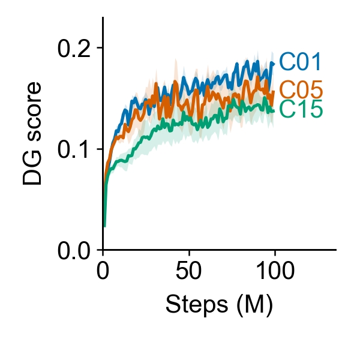

# 1–2. Model and emergence of spatial coding

[Outline](../../99_inbox/cosyne%202027%20abstract%20-%20evidence-linked%20draft.md) · [Question index](README.md) · [Detailed online analysis](online_and_behavior_analysis_20261011.md)

## 1. Model and setting

A fixed ImageNet-pretrained visual trunk feeds a trainable sparse DG-like landmark layer and CA3-like memory. Event-based encoder credit trains the visual landmark representation during reward-free open-field exploration. C05/C15 add goal-conditioned workers and an internal target-hit bonus; C01 is the flat model for the cleanest encoder-credit comparison. The [architecture and historical protocol](../corrected_core_reevaluation_20260901.md#shared-configuration) and [fresh factorial design](../reward_credit/cosyne27_staged_push_pull_submission_20261010.md#scientific-comparisons-and-seed-structure) define these components. “Without spatial labels or extrinsic reward” is defensible; this is a circuit-motivated computational model, not a biological implementation claim.

## 2. Does a spatial code appear during learning?

[Editable SVG](../results/cosyne_2027_compact_figures/01_online_spatial_course.svg) · [seed-aggregated plotting table](../results/cosyne_2027_online_wandb/arm_summaries.csv) · [unsampled histories and collection manifest](../results/cosyne_2027_online_wandb/collection_manifest.json) · [historical field maps and trajectories](../corrected_core_reevaluation_20260901.md)

Each line is the five-training-seed mean of W&B's amplitude-weighted, active-unit DG spatial score on the policy's latest 10k behavior samples; the shaded band is $\pm1$ SEM at each 1M-step grid point. All intact C01/C05/C15 seeds increase between 1M and 99M frames. This establishes a rising *online policy-sampled* score, while the field maps document location-dependent responses. It does not isolate changing weights from changing trajectories, occupancy, or activity amplitude. The [frozen-checkpoint analysis](checkpoint_fields_20261011.md#worker-timing-and-learning-course) contains two policy-specific five-checkpoint seed examples, but a multi-seed, matched-observation learning course is still needed for a stronger developmental claim.

**Abstract decision:** “Spatially informative activity emerges during reward-free exploration” is supported. Avoid “spatial information increases monotonically in a fixed representation” until shared-observation checkpoint curves exist. The terminal fixed-observation encoder comparison belongs to [question 5](03_encoder_credit.md#5-does-temporal-credit-improve-the-learned-code-beyond-equal-mean-constant-credit).

**Plot contract:** 1.9-inch panel, Arial 10 pt. The line uses the five-seed mean and the band is sample SD divided by $\sqrt{5}$; no smoothing or extrapolation. Full plotting source and input hashes are in [the compact renderer](render_compact_figures.py) and [manifest](../results/cosyne_2027_compact_figures/manifest.json).
