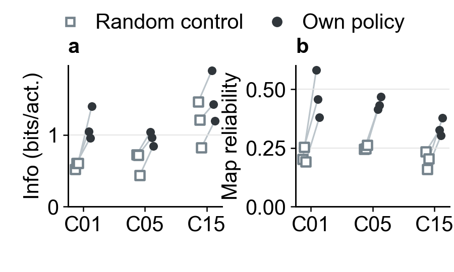

# 3. Does behavior change expression of a learned code?

[Outline](../../99_inbox/cosyne%202027%20abstract%20-%20evidence-linked%20draft.md) · [Question index](README.md) · [Detailed frozen-policy analysis](online_and_behavior_analysis_20261011.md#other-own-policy-versus-random-policy-readouts)

[Editable SVG](../results/cosyne_2027_compact_figures/02_behavior_expression.svg) · [per-training-seed table](../results/cosyne_2027_behavior_secondary/paired_training_seeds.csv) · [original 54-probe intervention](../dg_representation/behavior_field_expression_20261007.md#results-own-policy-versus-uniform-random) · [evaluation-to-training-run index](frozen_policy_evaluations.csv)

**Claim supported:** With frozen weights, the own policy gives higher decoder-1 spatial information per activation than uniform random actions in all three training seeds of C01, C05, and C15. Mean own-minus-random differences are +0.557, +0.324, and +0.344 bits per activation. Panel **a** shows training-seed differences; the two evaluation repeats were averaged within each training seed. The independent unit of replication is the training seed ($n=3$ per architecture).

**Secondary representation readout:** Split-half decoder-1 map correlation is higher under own policy in all nine training seeds; mean differences are +0.257, +0.187, and +0.136 for C01/C05/C15. Panel **b** shows this result. The map-reliability metric uses each policy's own occupied bins, so repeated or concentrated visitation can improve it. A common-support or occupancy-matched reliability analysis is needed before interpreting it as a gain in code stability. The [all-layer diagnostic](../results/cosyne_2027_behavior_secondary/figures/own_minus_random_map_reliability.svg) and [source tables](../results/cosyne_2027_behavior_secondary/paired_evaluation_repeats.csv) retain DG, CA3, and decoder 2.

**Causal scope:** The intervention changes executed actions with the model frozen. It demonstrates behavior-dependent *expression* of the learned code, not that the behavior caused the weights to develop. Decoder-1 information per activation is the clean headline; reliability is a candidate corroboration with the occupancy caveat.

## Candidate: control and experimental values

[Editable SVG](../results/cosyne_2027_compact_figures/02_behavior_expression_absolute.svg) · [paired absolute values by training seed](../results/cosyne_2027_compact_figures/02_behavior_expression_absolute_by_seed.csv) · [original common-support information probes](../results/behavior_field_expression_20261007/paired_prefixes.csv) · [original policy-native reliability probes](../results/behavior_field_expression_20261007/per_run.csv)

This is an alternative presentation of the **same three-training-seed September intervention** shown above. Gray open squares are the uniform-random-action **control**; charcoal filled circles are the frozen model's **own-policy experimental** rollout. A light-gray line joins the two values from one training seed, after its two evaluation repeats are averaged. Panel **a** is decoder-1 information per activation on the same eligible units and equally weighted shared spatial bins. Panel **b** is split-half decoder-1 map reliability on each policy's own occupied bins, so its absolute values remain sensitive to the different visitation patterns. Both axes start at zero. Subtracting control from own-policy reproduces the archived per-seed differences exactly within numerical precision. Additional-seed probes are not included in this candidate and will need a new export when available.

**Plot contract:** Both figures have two 1.5 × 1.8-inch panels in Arial 10 pt, following the [COSYNE figure standard](FIGURE_STANDARD.md) and [color palette](COLOR_PALETTE.md). In the difference view, colored dots are training-seed contrasts and black segments are means. In the absolute-value candidate, gray open squares and charcoal filled circles are control and own-policy values, and light-gray lines join paired seeds. Regenerate from [cached inputs](../results/cosyne_2027_compact_figures/manifest.json) with [the compact renderer](render_compact_figures.py).
