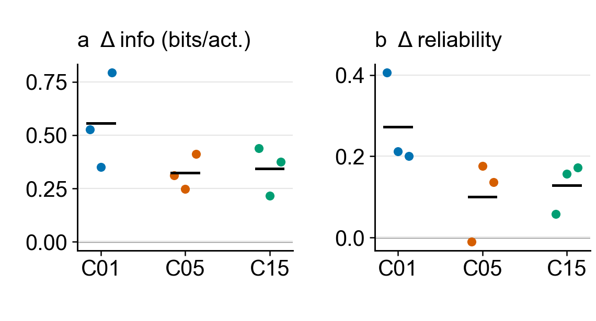
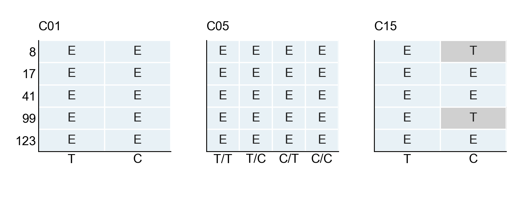

# 3. Does behavior change expression of a learned code?

[Outline](../../99_inbox/cosyne%202027%20abstract%20-%20evidence-linked%20draft.md) · [Question index](README.md) · [Detailed September intervention](../dg_representation/behavior_field_expression_20261007.md)

[Editable effect plot](../results/cosyne_2027_compact_figures/02_behavior_expression.svg) · [49-row training-seed table](../results/cosyne_2027_behavior_secondary/all_training_seeds.csv) · [factor summary](../results/cosyne_2027_behavior_secondary/factor_summary.csv) · [18 paired September evaluation repeats](../results/cosyne_2027_behavior_secondary/historical_pair_analysis/paired_evaluation_repeats.csv)

## Result with completed paired evaluations

In the **September corrected-core reference cohort**, frozen weights and changed executed actions yield higher decoder-1 spatial information per activation under each model's own policy than under uniform random actions. All three independent training seeds are positive in C01, C05, and C15; family mean own-minus-uniform differences are +0.557, +0.324, and +0.344 bits per activation (panel **a**). Each seed point averages two paired evaluation seeds. These nine training seeds came from the September source, whose checkout is unavailable. They are not pooled with the fresh COSYNE runs.

The original split-half decoder-1 map correlation used each policy's own spatial support and favored own policy in all nine seeds (+0.257/+0.187/+0.136 family means). A stricter reanalysis of the saved traces uses **the same bins and eligible units** for both policies: each bin has at least ten visits in each episode-disjoint half of each policy, and a unit must have a finite correlation in both arms. On this four-way common support, the own-policy advantage remains in 3/3 C01 seeds (mean +0.273) and 3/3 C15 seeds (+0.129), but only 2/3 C05 seeds (+0.101; seed 8 is −0.011). Panel **b** plots these training-seed differences. All 18 evaluation pairs support the comparison; decoder-1 common support spans 73–254 bins and 116–128 shared units per repeat. [The per-repeat table](../results/cosyne_2027_behavior_secondary/historical_pair_analysis/paired_evaluation_repeats.csv) retains the native and common-support scores, support counts, and all four layers.

At a stricter 25 visits in each half and policy, the decoder-1 seed directions remain 3/3 positive for C01, 2/3 for C05, and 3/3 for C15. At 50 visits, C01 and C15 remain 3/3 positive, while C05 has only two complete seed pairs (one positive, one negative); seed 123 lacks sufficient support in an evaluation repeat. These are sensitivity checks on progressively smaller maps, not substitutes for the declared ten-visit comparison.

Equal bin weights and common units remove two clear sampling differences. Visit counts within each bin and temporal observation sequences still differ between policies, so split-half reliability remains a behavior-conditioned map readout rather than proof of an intrinsically more stable code. The [earlier all-layer diagnostic](../results/cosyne_2027_behavior_secondary/figures/own_minus_random_map_reliability.svg) shows policy-native reliability; the new common-support values take precedence for this question.

## Fresh run matrix and evaluation status

[Editable coverage plot](../results/cosyne_2027_compact_figures/02_behavior_expression_coverage.svg) · [canonical 100M checkpoint manifest](../results/cosyne_2027_behavior_secondary/fresh_terminal_manifest_20261011.tsv) · [StudySpec provenance map](../results/cosyne_2027_behavior_secondary/fresh_manifest_sources_20261011.csv) · [own/uniform probe manifest](../../hpc_runs/studies/cosyne27_fresh_behavior_expression_20261011.tsv) · [152-job submission ledger](../results/cosyne_2027_behavior_secondary/fresh_probe_jobs_20261011.tsv) · [dated scheduler snapshot](../results/cosyne_2027_behavior_secondary/fresh_submission_status_20261011.json)

The fresh design has five independent training seeds per factor cell, with temporal (T) or mean-matched constant (C) encoder credit. C05 crosses that factor with temporal/constant worker hit bonus; C01 has no worker bonus, and C15 retains temporal worker bonus. In the coverage plot, **E** means a verified terminal checkpoint with paired evaluation still incomplete; **T** means replacement training is still running. The display has one row per training seed and one column per factor cell. Evaluation repeats never add training seeds.

| Fresh family | Encoder / worker cells | Planned independent seeds | Verified 100M checkpoints | Complete own/uniform training-seed pairs at 11 October submission |
| --- | --- | ---: | ---: | ---: |
| C01 | T, C / inapplicable | 5 per cell | 5/5, 5/5 | 0/5, 0/5 |
| C05 | T/T, T/C, C/T, C/C | 5 per cell | 5/5 each | 0/5 each |
| C15 | T, C / temporal | 5 per cell | 5/5, 3/5 | 0/5, 0/5 |

The 38 available fresh checkpoints yielded a reviewed **152-row** manifest: own and uniform policies, two evaluation seeds, and 50,000 decisions per arm. A C01 own/uniform 500-decision preflight passed (jobs 8333951–8333952) with identical checkpoint and frozen-model hashes and an executed-action change in the random arm. All 152 full probes were submitted as ordinary CPU jobs with IDs spanning 8333954–8334107 under the active NEMO2 workspace; the dependent paired-analysis job is 8334109. At 18:49:57 UTC on 11 October, all 152 full probes were running and no full trace had finished. The two C15 constant-credit replacement training runs (8329014–8329015) were also running, so those cells have no probe jobs yet. The [training catalog](training_runs.csv) retains failed originals and replacement lineage; the [frozen-policy evaluation catalog](frozen_policy_evaluations.csv) contains only the completed September protocol, while the fresh manifest and job ledger record the new cohort. **No fresh-seed own-versus-random effect is claimed until both policies and both evaluation repeats are analyzed for each training seed.**

## Interpretation and plot contract

This intervention changes action-driven observations with model parameters and BatchNorm buffers frozen. It tests behavior-dependent *expression* and sampling of a learned code; it does not establish that behavior caused the weights to develop. Decoder-1 information per activation is the completed September headline. The common-support reliability result is a qualified second readout. Fresh architecture-by-factor effects remain pending, with source versions and replacement patches retained in the [49-row table](../results/cosyne_2027_behavior_secondary/all_training_seeds.csv).

The companion [fresh checkpoint report](checkpoint_fields_20261011.md) covers the available DG place fields and selected trajectory/graph checks. Its stored graph comparisons are mixed, and the directed-edge and matched-command goal-control analyses remain open; the completed one-start command preflight is a protocol check. Those measures address different outcomes from the own/random representation intervention and cannot fill its pending fresh paired cells.

The effect plot has two 1.9-inch panels at Arial 10 pt. Colored dots are independent training-seed differences, black segments are family means, and zero indicates equal own/uniform scores. The coverage plot has three 1.9-inch family panels. Both regenerate from [hashed cached inputs and a figure manifest](../results/cosyne_2027_compact_figures/manifest.json) with [the compact renderer](render_compact_figures.py); [the seed summarizer](summarize_behavior_expression.py) averages evaluation repeats only after checking for a complete pair. Bulk traces and logs remain in `/work/classic/fr_xl1014-corridor-geometry/IntrMotiv/SF_hipposlam/train_dir/analysis/cosyne27_behavior_expression_20261011/`.
