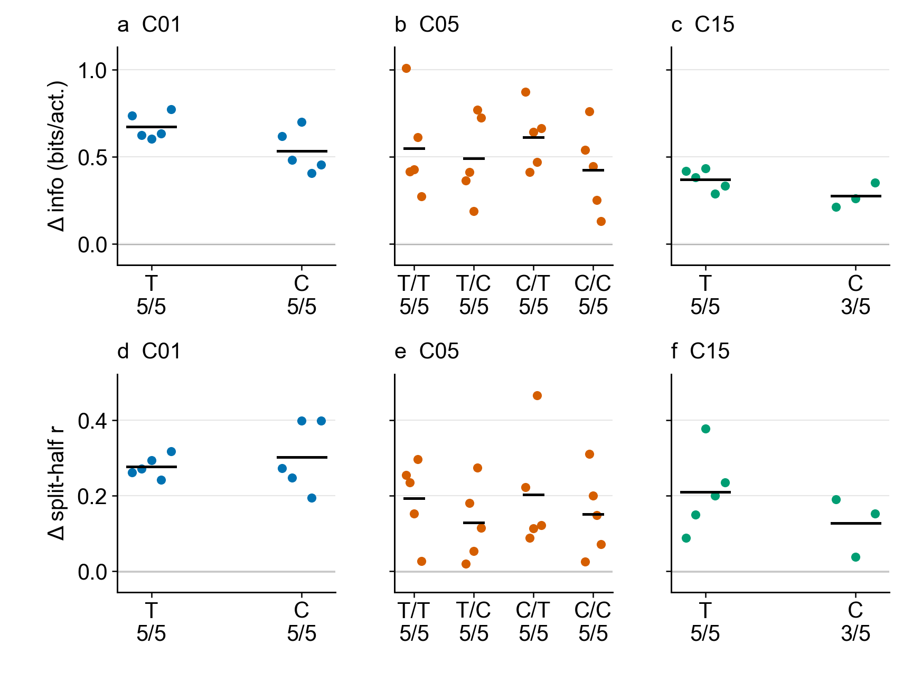

# 3. Does behavior change expression of a learned code?

[Outline](../../99_inbox/cosyne%202027%20abstract%20-%20evidence-linked%20draft.md) · [Question index](README.md) · [Detailed September intervention](../dg_representation/behavior_field_expression_20261007.md)

[Editable fresh plot](../results/cosyne_2027_compact_figures/02_behavior_expression_fresh.svg) · [49-row decoder-1 training-seed table](../results/cosyne_2027_behavior_secondary/all_training_seeds.csv) · [all-layer training-seed table](../results/cosyne_2027_behavior_secondary/all_layer_training_seeds.csv) · [factor summary](../results/cosyne_2027_behavior_secondary/factor_summary.csv) · [76 paired fresh evaluation repeats](../results/cosyne_2027_behavior_secondary/fresh_pair_analysis/paired_evaluation_repeats.csv)

## Fresh factorial result

At frozen 100M checkpoints, **all 38 available independent fresh training models** have positive own-policy minus uniform-random decoder-1 spatial information per activation and four-way common-support split-half correlation. Each model estimate averages two paired 50,000-decision evaluation seeds; those repeats do not increase the training-seed count. The plotted cells share the fresh source base and preserve their StudySpec and patch provenance. Temporal (T) and mean-matched constant (C) refer to encoder credit, then worker hit bonus where applicable.

| Fresh cell | Complete / planned training seeds | Information difference, bits per activation | Common-support split-half difference |
| --- | ---: | ---: | ---: |
| C01 T | 5/5 | +0.675 (5/5 positive) | +0.278 (5/5) |
| C01 C | 5/5 | +0.533 (5/5) | +0.303 (5/5) |
| C05 T/T | 5/5 | +0.548 (5/5) | +0.193 (5/5) |
| C05 T/C | 5/5 | +0.493 (5/5) | +0.129 (5/5) |
| C05 C/T | 5/5 | +0.613 (5/5) | +0.203 (5/5) |
| C05 C/C | 5/5 | +0.426 (5/5) | +0.151 (5/5) |
| C15 T | 5/5 | +0.372 (5/5) | +0.210 (5/5) |
| C15 C | **3/5** | +0.275 (3/3) | +0.127 (3/3) |

The information comparison gives equal spatial-bin weights on shared bins and jointly eligible units. For split-half reliability, a bin must have at least ten visits in each episode-disjoint half of **each** policy, and the same eligible unit must have a finite correlation in both arms. All 76 fresh evaluation pairs support both decoder-1 comparisons: information has 185–316 shared bins and 116–128 eligible units per repeat; four-way reliability has 66–257 common bins and 116–128 units. The paired table retains DG, CA3, decoder 1, and decoder 2 for all 76 pairs; [the all-layer training-seed table](../results/cosyne_2027_behavior_secondary/all_layer_training_seeds.csv) keeps their summaries separate from the decoder-1 headline. At 25 visits per half and policy, common-support decoder-1 reliability remains positive in 33/38 training models (C01 10/10, C05 16/20, C15 7/8). The 50-visit cutoff leaves many pairs unsupported. Decoder-1 bits per step is positive in 31/38 models, so the per-activation result must not be restated as a universal per-step result.

The two failed C15 constant-credit originals are excluded; their replacement training jobs have not yet supplied terminal checkpoints. Thus 38/40 planned models, not 40/40, support the fresh result. The [fresh analysis manifest](../results/cosyne_2027_behavior_secondary/fresh_pair_analysis/analysis_manifest.json) pins the probe-manifest SHA-256 and completion count. A separate [metadata audit](../results/cosyne_2027_behavior_secondary/fresh_probe_metadata_audit.json) checked all 152 trace records, consistent frozen-model/checkpoint hashes within each of the 38 models, executed-action changes in uniform arms, and workspace output paths.

## September reference cohort

[Editable September plot](../results/cosyne_2027_compact_figures/02_behavior_expression.svg) · [18 paired September evaluation repeats](../results/cosyne_2027_behavior_secondary/historical_pair_analysis/paired_evaluation_repeats.csv)

In the **September corrected-core reference cohort**, frozen weights and changed executed actions yield higher decoder-1 spatial information per activation under each model's own policy than under uniform random actions. All three independent training seeds are positive in C01, C05, and C15; family mean own-minus-uniform differences are +0.557, +0.324, and +0.344 bits per activation (panel **a**). Each seed point averages two paired evaluation seeds. These nine training seeds came from the September source, whose checkout is unavailable. They are not pooled with the fresh COSYNE runs.

The original split-half decoder-1 map correlation used each policy's own spatial support and favored own policy in all nine seeds (+0.257/+0.187/+0.136 family means). A stricter reanalysis of the saved traces uses **the same bins and eligible units** for both policies: each bin has at least ten visits in each episode-disjoint half of each policy, and a unit must have a finite correlation in both arms. On this four-way common support, the own-policy advantage remains in 3/3 C01 seeds (mean +0.273) and 3/3 C15 seeds (+0.129), but only 2/3 C05 seeds (+0.101; seed 8 is −0.011). Panel **b** plots these training-seed differences. All 18 evaluation pairs support the comparison; decoder-1 common support spans 73–254 bins and 116–128 shared units per repeat. [The per-repeat table](../results/cosyne_2027_behavior_secondary/historical_pair_analysis/paired_evaluation_repeats.csv) retains the native and common-support scores, support counts, and all four layers.

At a stricter 25 visits in each half and policy, the decoder-1 seed directions remain 3/3 positive for C01, 2/3 for C05, and 3/3 for C15. At 50 visits, C01 and C15 remain 3/3 positive, while C05 has only two complete seed pairs (one positive, one negative); seed 123 lacks sufficient support in an evaluation repeat. These are sensitivity checks on progressively smaller maps, not substitutes for the declared ten-visit comparison.

Equal bin weights and common units remove two clear sampling differences. Visit counts within each bin and temporal observation sequences still differ between policies, so split-half reliability remains a behavior-conditioned map readout rather than proof of an intrinsically more stable code. The [earlier all-layer diagnostic](../results/cosyne_2027_behavior_secondary/figures/own_minus_random_map_reliability.svg) shows policy-native reliability; the new common-support values take precedence for this question.

## Fresh run matrix and execution record

[Editable coverage plot](../results/cosyne_2027_compact_figures/02_behavior_expression_coverage.svg) · [canonical 100M checkpoint manifest](../results/cosyne_2027_behavior_secondary/fresh_terminal_manifest_20261011.tsv) · [StudySpec provenance map](../results/cosyne_2027_behavior_secondary/fresh_manifest_sources_20261011.csv) · [own/uniform probe manifest](../../hpc_runs/studies/cosyne27_fresh_behavior_expression_20261011.tsv) · [152-job submission ledger](../results/cosyne_2027_behavior_secondary/fresh_probe_jobs_20261011.tsv) · [completion status](../results/cosyne_2027_behavior_secondary/fresh_completion_status_20261011.json) · [submission-time scheduler snapshot](../results/cosyne_2027_behavior_secondary/fresh_submission_status_20261011.json)

The design has five independent training seeds per factor cell. C05 crosses encoder credit with temporal/constant worker hit bonus; C01 has no worker bonus, and C15 retains temporal worker bonus. In the coverage plot, **P** means both policies and both evaluation seeds are complete; **T** means replacement training remains pending. The display has one row per training seed and one column per factor cell.

| Fresh family | Encoder / worker cells | Planned independent seeds | Verified 100M checkpoints | Complete own/uniform training-seed pairs |
| --- | --- | ---: | ---: | ---: |
| C01 | T, C / inapplicable | 5 per cell | 5/5, 5/5 | 5/5, 5/5 |
| C05 | T/T, T/C, C/T, C/C | 5 per cell | 5/5 each | 5/5 each |
| C15 | T, C / temporal | 5 per cell | 5/5, 3/5 | 5/5, 3/5 |

The 38 available checkpoints yielded a reviewed **152-row** manifest: own and uniform policies, two evaluation seeds, and 50,000 decisions per arm. A 500-decision paired C01 preflight passed (jobs 8333951–8333952) with identical checkpoint and frozen-model hashes and an executed-action change in the uniform arm. All 152 full probes were submitted as ordinary CPU jobs with IDs spanning 8333954–8334107 under the active NEMO2 workspace. Every raw trace passed the metadata audit, and dependent paired-analysis job 8334109 finished with 76/76 evaluation pairs. The dated submission snapshot captures their earlier running state. The two C15 constant-credit replacement training runs (8329014–8329015) still had no verified terminal checkpoint at the analysis cutoff and have no probes in this matrix. The [training catalog](training_runs.csv) retains failed originals and replacement lineage; the [frozen-policy evaluation catalog](frozen_policy_evaluations.csv) contains the September protocol only, while the fresh manifest and job ledger record this cohort.

## Interpretation and plot contract

This intervention changes action-driven observations with model parameters and BatchNorm buffers frozen. It tests behavior-dependent *expression* and sampling of a learned code; it does not establish that behavior caused the weights to develop. The decoder-1 information result spans every available fresh factor cell; the positive common-support reliability result is qualified by occupancy and the stricter-cutoff sensitivity. Equal bin weights and common units leave within-bin sample counts and temporal inputs policy dependent. The positive within-cell effect does not by itself establish a temporal-versus-constant encoder or worker benefit. Source versions and replacement patches remain visible in the [training-seed table](../results/cosyne_2027_behavior_secondary/all_training_seeds.csv). Keep September and fresh results separate.

The companion [fresh checkpoint report](checkpoint_fields_20261011.md) covers the available DG place fields and selected trajectory/graph checks. Its stored graph comparisons are mixed, and the directed-edge and matched-command goal-control analyses remain open; the completed one-start command preflight is a protocol check. The [question index](README.md) keeps those outcomes distinct from this representation intervention.

The fresh effect plot has six 1.9-inch panels, with information and common-support correlation by family; the September plot has two, and the coverage plot has three. All use Arial 10 pt at intended abstract size. Colored dots are independent training-seed differences, black segments are cell means, and zero indicates equal own/uniform scores. They regenerate from [hashed cached inputs and a figure manifest](../results/cosyne_2027_compact_figures/manifest.json) with [the compact renderer](render_compact_figures.py); [the seed summarizer](summarize_behavior_expression.py) averages evaluation repeats only after checking for a complete pair. Bulk traces and logs remain in `/work/classic/fr_xl1014-corridor-geometry/IntrMotiv/SF_hipposlam/train_dir/analysis/cosyne27_behavior_expression_20261011/`.
