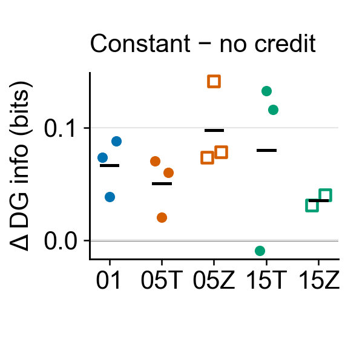
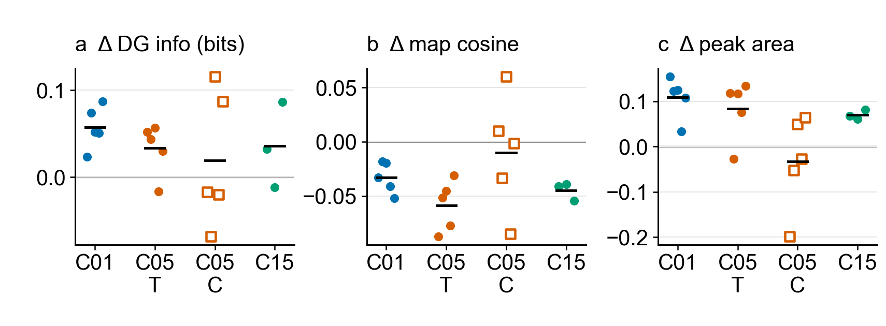

# 4–5. Encoder event credit and temporal credit assignment

[Outline](../../99_inbox/cosyne%202027%20abstract%20-%20evidence-linked%20draft.md) · [Question index](README.md) · [Detailed fixed-checkpoint analysis](checkpoint_fields_20261011.md)

## 4. Does positive event credit maintain usable DG responses?

[Editable SVG](../results/cosyne_2027_compact_figures/02_credit_presence.svg) · [paired source table](../reward_credit/results/corrected_core_encoder_worker_20261010/common_panel_encoder_pairs.csv)

The earlier positive-constant versus no-credit control lowers the common-panel spatial score in 13 of 14 paired C01/C05/C15 cells when credit is removed. However, many distinct peak bins can coexist with weak firing, so peak count alone is not a response-health measure. The [older factorial report](../reward_credit/corrected_core_encoder_worker_ablation_20261010.md#encoder-reward-fields-and-exposure), [same-observation fields](../reward_credit/results/corrected_core_encoder_worker_20261010/common_panel_place_fields.csv), and [per-unit peak centers](../reward_credit/results/corrected_core_encoder_worker_20261010/common_panel_peak_centers_per_unit.csv) provide the source evidence. Those older positive-credit magnitudes differ from the fresh mean-matched constants; this is a **credit-presence** control, not evidence that temporal weighting is better.

The plot shows constant credit minus no-credit DG information on the older identical-observation panel. Markers are paired training seeds and black segments are group means; architecture sets the hue, while open squares mark zero worker bonus. The 05/15 labels denote C05/C15, T is temporal worker hit bonus, and Z is zero worker bonus. C15Z has two available paired seeds; the other groups have three. The sum of 14 condition-seed cells is not 14 independent training seeds because seeds recur across worker arms.

In the fresh retained 100k snapshots, all 16 units of every completed run have eligible peaks at 0% and 0.025% firing cutoffs. One temporal C01/C05 unit per run falls below 0.25% but fires on 0.12–0.16% of observations; it is low-firing, not dead. The [cutoff sensitivity](snapshot_peak_spread_20261011.md#are-the-lost-peaks-practically-silent) reports 0%, 0.025%, 0.25%, and 1% side by side. The intended roughly 2.5% firing rate makes 0.025% a useful practical-silence reference, while 0.25% is a stricter spread sensitivity cutoff.

## 5. Does temporal credit improve the learned code beyond equal-mean constant credit?

[Editable SVG](../results/cosyne_2027_compact_figures/03_encoder_credit_factorized.svg) · [paired frozen fields](../results/cosyne_2027_checkpoint_fields/common_panel_analysis/paired_encoder_fields.csv) · [paired peak-spread sensitivity](../results/cosyne_2027_checkpoint_fields/common_panel_analysis/paired_peak_spread_by_seed.csv) · [selected common-panel peak locations](../results/cosyne_2027_checkpoint_fields/common_panel_analysis/figures/c01_seed99_common_peak_density.svg)

At 100M, all 38 available fresh terminal checkpoints were replayed on the *same* 10,001 observations and 242 visited spatial bins. Each marker is a paired training seed and each black segment is its group mean. Architecture sets the hue; the C05 constant-worker arm uses open squares. The contrast is temporal minus mean-matched constant encoder credit, holding the worker factor fixed. **T/C** beneath C05 mean temporal/constant worker hit bonus. C15 has three paired seeds because two original constant-credit runs failed; all other cells have five.

| Fixed architecture and worker | DG spatial information | Active-only map cosine | Gaussian eligible-peak effective area at 0.25% |
| --- | --- | --- | --- |
| C01; no worker | +0.0575 bits, 5/5 higher | −0.033, 5/5 lower | +0.109, 5/5 higher |
| C05; temporal hit bonus | +0.033 bits, 4/5 higher | −0.059, 5/5 lower | +0.083, 4/5 higher |
| C05; constant hit bonus | +0.020 bits, 2/5 higher | −0.010, 3/5 lower | −0.033, 2/5 higher |
| C15; temporal hit bonus | +0.036 bits, 2/3 higher | −0.045, 3/3 lower | +0.070, 3/3 higher |

The C01 result supports more informative, less redundant, and more spatially distributed DG activity under identical evaluation input in all five paired seeds. Effective area is the exponential Shannon entropy of equal-mass Gaussian-blurred eligible-peak density divided by 242 shared visited bins; the Gaussian width is 100 DMLab units. The [0%–1% cutoff and 50/100/150-unit blur checks](checkpoint_fields_20261011.md#identical-observations-strongest-representational-result) show where this result is robust. The single saved panel is one earlier C15 policy's state distribution, so it removes evaluation-sampling differences but does not cover all reachable states. Training behavior may still mediate the effect of encoder credit on weights.

**Abstract decision:** Lead with C01. C05 depends on the worker arm; C15 needs the two replacement seeds. The [policy-specific 10k probes](checkpoint_fields_20261011.md#policy-specific-10k-decision-comparison) are useful diagnostics but their varying state samples alter some conclusions. Decoder-1 information and reliability on identical observations, and matched-age common-panel curves, remain open.

**Plot contract:** All panels are 1.9 inches wide with Arial 10 pt. No confidence interval is inferred from these small seed sets; all paired differences and means are shown. [Renderer](render_compact_figures.py) · [source hashes](../results/cosyne_2027_compact_figures/manifest.json).
