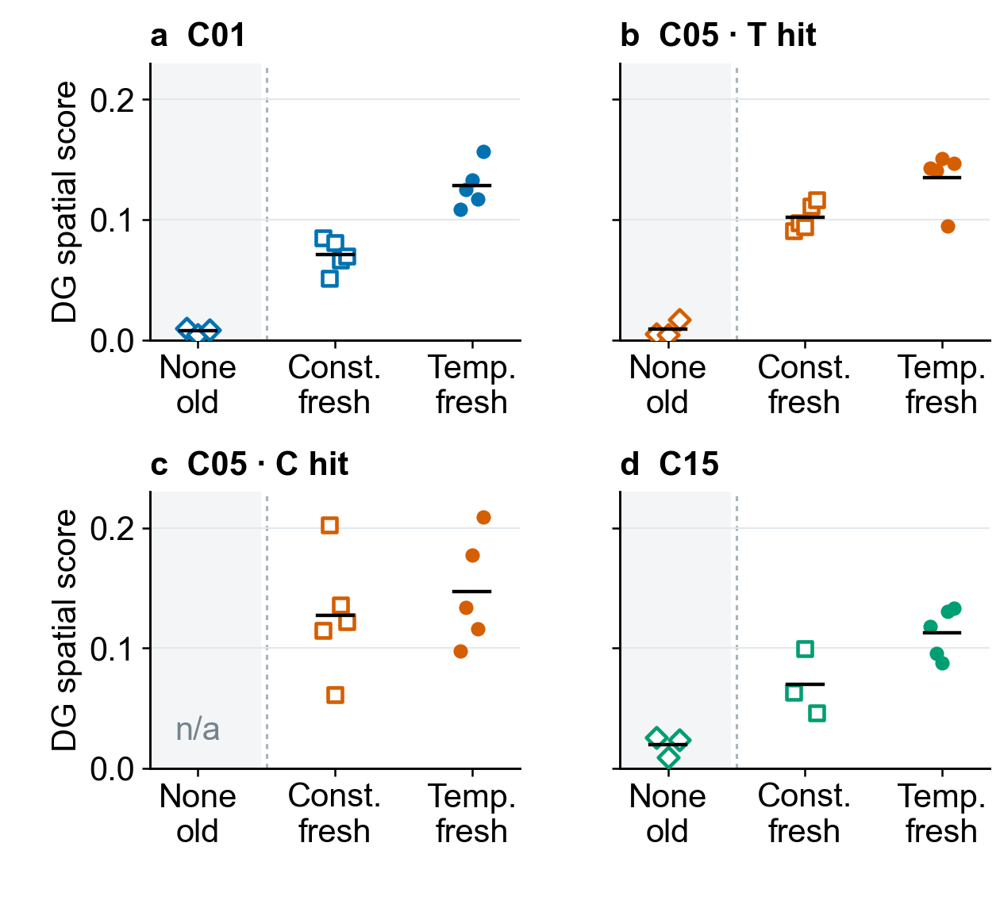
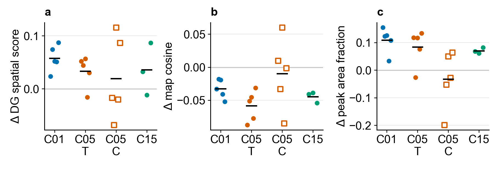

# 4–5. Encoder event credit and temporal credit assignment

[Outline](../../99_inbox/cosyne%202027%20abstract%20-%20evidence-linked%20draft.md) · [Question index](README.md) · [Detailed fixed-checkpoint analysis](checkpoint_fields_20261011.md)

## 4. Does positive event credit maintain usable DG responses?

[Editable SVG](../results/cosyne_2027_compact_figures/03_encoder_credit_original_values.svg) · [plotted original values and cohort labels](../results/cosyne_2027_compact_figures/03_encoder_credit_original_values.csv) · [same-layout map cosine](../results/cosyne_2027_compact_figures/03_encoder_map_cosine_original_values.svg) · [historical run table](../reward_credit/results/corrected_core_encoder_worker_20261010/common_panel_place_fields.csv) · [fresh run table](../results/cosyne_2027_checkpoint_fields/common_panel_analysis/shared_observation_fields.csv)

The shaded no-credit position uses historical `NONE_STOP` checkpoints. The constant- and temporal-credit positions use the fresh COSYNE factorial. All were evaluated on the **same saved 10,001 observations and 242 visited bins** at approximately 100M frames. Dots are training runs, short black segments are means, and architecture sets hue. C05 T/C hit fixes temporal/constant worker hit bonus. No historical no-credit run had the C05 constant-hit setting, so that position is marked unavailable. The fresh C15 temporal arm has five absolute values, while its constant arm has three; only the three matched seeds enter the paired temporal-minus-constant result below.

**Source boundary:** The vertical distance from historical no credit to either fresh arm is descriptive. The older positive-constant credit also had a different magnitude from the fresh mean-matched constant. The separate [historical constant-minus-no-credit $\Delta$ figure](../results/cosyne_2027_compact_figures/02_credit_presence.svg) supports the within-cohort credit-presence claim: removing credit lowers the common-panel spatial score in 13 of 14 paired C01/C05/C15 cells. C15 with zero worker bonus has two pairs; the other historical cells have three. These 14 cells reuse training seeds across worker arms. The [older factorial report](../reward_credit/corrected_core_encoder_worker_ablation_20261010.md#encoder-reward-fields-and-exposure) and [per-unit peak centers](../reward_credit/results/corrected_core_encoder_worker_20261010/common_panel_peak_centers_per_unit.csv) show why many distinct peak bins can coexist with weak firing. Low firing also limits interpretation of the historical no-credit [active-only map cosine](../results/cosyne_2027_compact_figures/03_encoder_map_cosine_original_values.svg).

In the fresh retained 100k snapshots, all 16 units of every completed run have eligible peaks at 0% and 0.025% firing cutoffs. One temporal C01/C05 unit per run falls below 0.25% but fires on 0.12–0.16% of observations; it is low-firing, not dead. The [cutoff sensitivity](snapshot_peak_spread_20261011.md#are-the-lost-peaks-practically-silent) reports 0%, 0.025%, 0.25%, and 1% side by side. The intended roughly 2.5% firing rate makes 0.025% a useful practical-silence reference, while 0.25% is a stricter spread sensitivity cutoff.

## 5. Does temporal credit improve the learned code beyond equal-mean constant credit?

[Editable SVG](../results/cosyne_2027_compact_figures/03_encoder_credit_deltas.svg) · [paired frozen fields](../results/cosyne_2027_checkpoint_fields/common_panel_analysis/paired_encoder_fields.csv) · [paired peak-spread sensitivity](../results/cosyne_2027_checkpoint_fields/common_panel_analysis/paired_peak_spread_by_seed.csv) · [selected common-panel peak locations](../results/cosyne_2027_checkpoint_fields/common_panel_analysis/figures/c01_seed99_common_peak_density.svg)

The separate $\Delta$ figure uses **fresh within-source seed pairs only**. Its panels show temporal minus mean-matched constant encoder credit for DG spatial score, active-only map cosine, and eligible-peak area fraction. Each marker is a paired training seed and each black segment is its group mean; open squares identify the C05 constant-worker arm. C15 has three pairs because two original constant-credit runs failed; all other cells have five. The original-value figure above includes every available fresh absolute run, while this figure excludes unpaired C15 temporal seeds from effect estimates.

| Fixed architecture and worker | DG spatial score | Active-only map cosine | Gaussian eligible-peak area fraction at 0.25% |
| --- | --- | --- | --- |
| C01; no worker | +0.0575; 5/5 higher | −0.033; 5/5 lower | +0.109; 5/5 higher |
| C05; temporal hit bonus | +0.033; 4/5 higher | −0.059; 5/5 lower | +0.083; 4/5 higher |
| C05; constant hit bonus | +0.020; 2/5 higher | −0.010; 3/5 lower | −0.033; 2/5 higher |
| C15; temporal hit bonus | +0.036; 2/3 higher | −0.045; 3/3 lower | +0.070; 3/3 higher |

The C01 result supports more informative, less redundant, and more spatially distributed DG activity under identical evaluation input in all five paired seeds. Its temporal versus constant means are 0.128 versus 0.071 for DG score, 0.047 versus 0.080 for active-only map cosine, and 0.394 versus 0.285 for eligible-peak area fraction. The C05 constant-worker arm is less consistent across seeds. Effective area is the exponential Shannon entropy of equal-mass Gaussian-blurred eligible-peak density divided by 242 shared visited bins; the Gaussian width is 100 DMLab units. The [0%–1% cutoff and 50/100/150-unit blur checks](checkpoint_fields_20261011.md#identical-observations-strongest-representational-result) show where this result is robust. The single saved panel is one earlier C15 policy's state distribution, so it removes evaluation-sampling differences but does not cover all reachable states. Training behavior may still mediate the effect of encoder credit on weights.

**Abstract decision:** Lead with C01. C05 depends on the worker arm; C15 needs the two replacement seeds. The [policy-specific 10k probes](checkpoint_fields_20261011.md#policy-specific-10k-decision-comparison) are useful diagnostics but their varying state samples alter some conclusions. Decoder-1 information and reliability on identical observations, and matched-age common-panel curves, remain open.

**Plot contract:** The four original-value panels and three $\Delta$ panels are separate, each under 2 inches wide with Arial 10 pt. Absolute axes begin at zero; difference axes mark zero. Historical no-credit is shaded and separated from fresh arms. No cross-cohort effect estimate is drawn. The historical data lack a Gaussian peak-area measure directly comparable with the fresh peak-area analysis, so the three-level original-value view covers DG score and map cosine. [Renderer](render_compact_figures.py) · [source hashes](../results/cosyne_2027_compact_figures/manifest.json).
