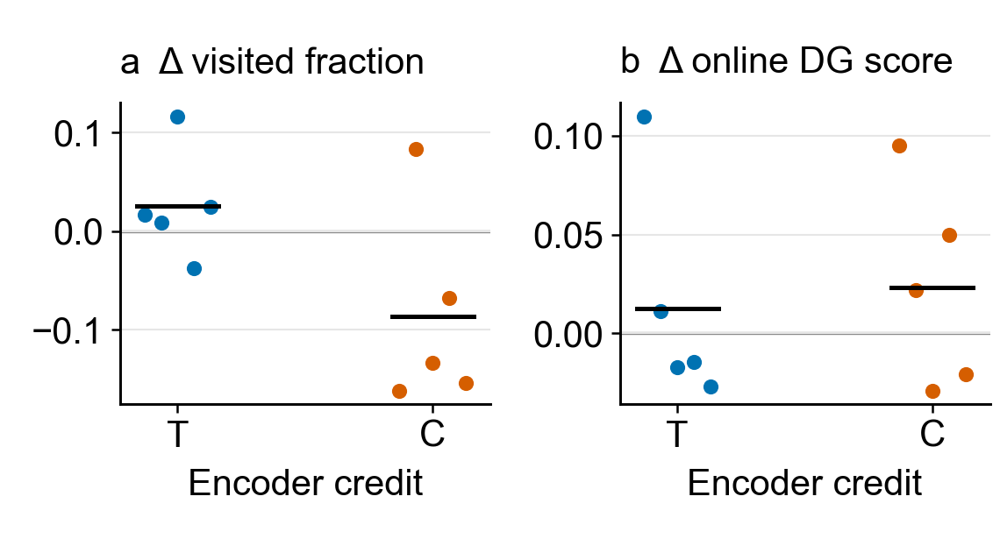

# 6–7. Worker hit bonus, exploration, and goal control

[Outline](../../99_inbox/cosyne%202027%20abstract%20-%20evidence-linked%20draft.md) · [Question index](README.md) · [Detailed online analysis](online_and_behavior_analysis_20261011.md#factorized-online-candidates)

## 6. Does temporal worker hit weighting improve exploration?

[Editable SVG](../results/cosyne_2027_compact_figures/04_worker_timing_factorized.svg) · [five-seed online paired values](../results/cosyne_2027_online_wandb/paired_contrasts_by_seed.csv) · [same-observation worker field pairs](../results/cosyne_2027_checkpoint_fields/common_panel_analysis/paired_worker_fields.csv) · [historical zero-bonus comparison](../reward_credit/corrected_core_distance_reward_ablation_20261009.md#1-does-removing-the-bonus-change-learning-and-exploration)

The fresh C05 factorial crosses temporal/constant encoder credit with temporal/mean-matched constant worker hit bonus. Here each dot is a training seed and each black segment is its mean; T/C on the abscissa fixes the encoder arm. Temporal minus constant *worker bonus* has mean 90–99M visited-cell fraction +0.026 in the temporal encoder arm, but −0.087 in the constant encoder arm, with seed signs mixed in both. The online DG spatial-score differences are likewise mixed. On identical frozen observations, the worker-timing DG spatial-information effect is −0.012 and −0.026 bits in the two encoder arms. Thus the current fresh data do not establish a general exploration or representational advantage of temporal hit weighting.

The older bonus-versus-no-bonus C05 comparison favored bonus presence in three paired seeds, but its historical source boundary and unmatched bonus magnitudes limit interpretation. The new factorial addresses timing at approximately equal mean hit reward; the [older analysis](../reward_credit/corrected_core_encoder_worker_ablation_20261010.md#worker-bonus-exploration-and-trajectories) is motivation, not a fresh timing result. Correct-hit exposure, realized reward magnitude, matched-age trajectories/coverage, graph retention, and time to a commanded detector hit remain the next analyses. Detector hits alone do not verify physical arrival at a mapped location.

## 7. What outcome should close the abstract?

Spatial information, spatial exploration, and command following are distinct outcomes. C15's greater coverage in older comparisons does not by itself establish reliable control. Keep HRL in the model schematic unless the pending matched-start executed-command comparison supports a concise payoff sentence. The [historical graph and command diagnostics](../reward_credit/corrected_core_encoder_worker_ablation_20261010.md#commanded-goal-control) and [current control preflight](checkpoint_fields_20261011.md#trajectory-graph-and-control-checks) show the present evidence boundary.

**Abstract decision:** The C05 timing result is conditional and should not carry the two-page story now. Reserve at most one sentence for the distinction between learned spatial code and control if space remains after the encoder and frozen-policy results.

**Plot contract:** Two 1.9-inch panels, Arial 10 pt. Differences are temporal minus constant worker hit bonus; means are black segments. Values are each seed's average of the interpolated 90–99M online window and therefore are policy sampled. [Renderer](render_compact_figures.py) · [source hashes](../results/cosyne_2027_compact_figures/manifest.json).
