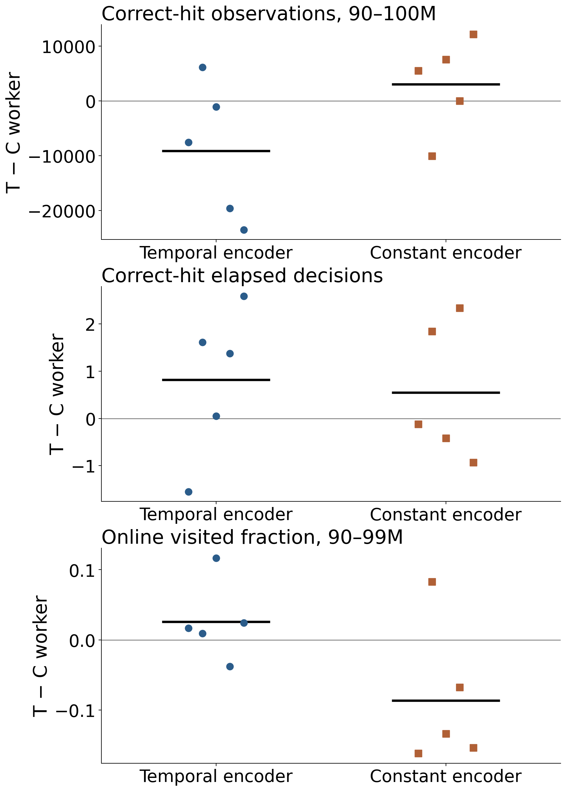
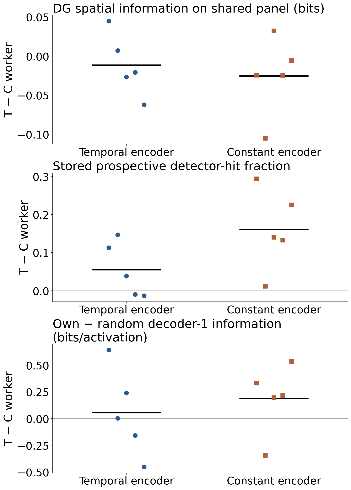

# 6–7. Worker hit bonus, exploration, and goal control

[Outline](../../99_inbox/cosyne%202027%20abstract%20-%20evidence-linked%20draft.md) · [Question index](README.md) · [Full checkpoint provenance](checkpoint_fields_20261011.md)

## Conclusion at the available evidence boundary

The fresh C05 $2\times2$ factorial crosses temporal versus mean-matched constant encoder credit with temporal versus mean-matched constant **worker hit bonus**, using the same five training seeds in each cell. Temporal worker weighting does not show a general improvement in exploration, absolute DG/CA3/decoder representation quality, or stored graph reachability. On identical observations it lowers the all-unit amplitude-weighted decoder-1 and decoder-2 scores in every temporal-encoder seed. The stored prospective DG detector-hit fraction is higher, especially with constant encoder credit, but that ratio is not an executed-command outcome. All 48 original matched-command jobs reached the eight-hour limit without terminal trial tables. A second same-label 48-job full-panel cohort is running with 72-hour limits, but has no audited outcomes yet. Executed control remains unmeasured; independent physical-arrival mapping is also unavailable in the current trial schema.

The unit below is the *training seed*. Worker contrasts are temporal minus constant bonus within each fixed encoder arm. The factorial interaction subtracts the constant-encoder worker contrast from the temporal-encoder worker contrast **within the same seed**. Five matched seeds, rather than 20 models or their many evaluation events, determine each mean and sign count. [Every paired seed value](../results/cosyne_2027_checkpoint_fields/worker_timing_summary/paired_by_seed.csv), [factorial interactions and dispersion](../results/cosyne_2027_checkpoint_fields/worker_timing_summary/factor_summary.csv), and [hashed source manifest](../results/cosyne_2027_checkpoint_fields/worker_timing_summary/manifest.json) are available. The [thin summarizer](summarize_worker_timing.py) checks the original StudySpec IDs, schema `intrmotiv/study/v1`, workflow version `1.14.1`, and study SHA-256 before joining the independently committed fresh behavior table.

## Training exposure, reward, and exploration

[Editable plot](../results/cosyne_2027_checkpoint_fields/worker_timing_summary/worker_reward_exposure.svg) · [online original values and paired differences](../results/cosyne_2027_compact_figures/04_worker_coverage_values_and_delta.svg) · [conditional-hit seed table](../results/cosyne_2027_checkpoint_fields/conditional_hits/conditional_hit_seed_metrics.csv)

| Last training-window outcome                          |  Temporal encoder: worker T − C | Constant encoder: worker T − C | Seed-paired interaction |
| ----------------------------------------------------- | ------------------------------: | -----------------------------: | ----------------------: |
| Correct-hit observations, 90–100M                     |           −9,135 (1/5 positive) |                   +3,010 (3/5) |           −12,145 (1/5) |
| Count-weighted correct-hit elapsed decisions, 90–100M |                    +0.815 (4/5) |                   +0.541 (2/5) |            +0.274 (2/5) |
| Count-weighted correct-hit reward magnitude, 90–100M  |                    +0.063 (4/5) |                   +0.067 (5/5) |            −0.004 (4/5) |
| Online visited-cell fraction, 90–99M                  |                    +0.026 (4/5) |                   −0.087 (1/5) |            +0.113 (4/5) |
| Retained 100k-decision visited-cell fraction at 100M  | −0.006 (0/5 positive; two ties) |              0.000 (five ties) |   −0.006 (0/5 positive) |

The correct-hit counts and elapsed/reward means come from the [existing NEMO2 collector outputs](../results/cosyne_2027_checkpoint_fields/conditional_hits/conditional_hit_seed_metrics.csv). Each C05 seed has 305 observed updates with correct hits and zero censored observations in that telemetry. Reward and elapsed means are **weighted by correct-hit count**, avoiding an unweighted average of update means. Higher reward per correct hit does not show greater hit exposure: the count contrast reverses across encoder arms, and repeated training telemetry is not independent trial evidence. Calibration mean-matched the designed bonuses, not the realized per-hit rewards for every seed.

The online visited fraction averages interpolated 90–99M observations from each evolving policy. The [separate retained trajectory course](checkpoint_fields_20261011.md#trajectories-and-occupancy) uses the latest 100k decisions at each checkpoint; its narrower window cannot be substituted for the online course. Neither measure gives a uniform exploration advantage. The historical bonus-versus-zero [comparison](../reward_credit/corrected_core_distance_reward_ablation_20261009.md#1-does-removing-the-bonus-change-learning-and-exploration) motivated this timing test but has a different source and unmatched magnitudes.

## Absolute representation, behavior-conditioned expression, and stored graphs

[Editable plot](../results/cosyne_2027_checkpoint_fields/worker_timing_summary/worker_representation_graph.svg) · [trajectory, reachability, and reliability companion](../results/cosyne_2027_checkpoint_fields/worker_timing_summary/worker_trajectory_reliability.svg) · [original frozen-field values and differences](../results/cosyne_2027_compact_figures/04_worker_frozen_info_values_and_delta.svg)

| Frozen or stored outcome at 100M | Temporal encoder: worker T − C | Constant encoder: worker T − C | Seed-paired interaction |
| --- | ---: | ---: | ---: |
| DG amplitude-weighted spatial score, identical observations | −0.012 (2/5 positive) | −0.026 (1/5) | +0.014 (3/5) |
| DG active-map cosine, identical observations | −0.022 (1/5) | +0.026 (3/5) | −0.049 (1/5) |
| Stored prospective detector-hit fraction | +0.055 (3/5) | +0.161 (5/5) | −0.106 (1/5) |
| Stored graph reachable-pair fraction | +0.006 (2/5) | +0.022 (4/5) | −0.016 (1/5) |
| Own-minus-random decoder-1 information contrast | +0.055 bits/activation (3/5) | +0.187 (4/5) | −0.132 (3/5) |
| Own-minus-random common-support split-half contrast | +0.065 (4/5) | +0.051 (3/5) | +0.013 (3/5) |

The DG comparison replays all 20 C05 terminal networks on [one identical 10,001-observation panel](checkpoint_fields_20261011.md#identical-observations-strongest-representational-result). Temporal worker bonus lowers mean DG amplitude-weighted spatial score in both encoder arms; mixed map-cosine signs do not establish a general absolute representation-quality gain. Native-policy 10k probes give mixed DG score changes (−0.009 and +0.008); [their paired values](../results/cosyne_2027_checkpoint_fields/paired_worker_fields.csv) sample different behavior distributions and remain separate from the fixed-panel result.

### Downstream information on the identical panel

[Full CA3/decoder report with readable panels, all five seed values, activity and silence](05_downstream_spatial_information.md) · [absolute CA3](../results/cosyne_2027_common_panel_layers/absolute_ca3.svg) · [absolute decoder 1](../results/cosyne_2027_common_panel_layers/absolute_decoder_1.svg) · [absolute decoder 2](../results/cosyne_2027_common_panel_layers/absolute_decoder_2.svg) · [factor summary](../results/cosyne_2027_common_panel_layers/factor_summary.csv)

| Layer and score | Temporal encoder: worker T−C | Constant encoder: worker T−C | Interaction |
| --- | ---: | ---: | ---: |
| CA3 bits per activation | +0.141 ± 0.148 (4/5 positive) | +0.144 ± 0.334 (3/5) | −0.003 ± 0.204 (3/5) |
| CA3 amplitude-weighted score | −0.038 ± 0.101 (1/5) | −0.066 ± 0.096 (1/5) | +0.028 ± 0.154 (3/5) |
| Decoder 1 bits per activation | +0.057 ± 0.740 (3/5) | +0.177 ± 0.489 (3/5) | −0.120 ± 1.016 (3/5) |
| Decoder 1 amplitude-weighted score | −0.093 ± 0.112 (0/5) | −0.035 ± 0.100 (2/5) | −0.057 ± 0.095 (2/5) |
| Decoder 2 bits per activation | −0.203 ± 0.362 (2/5) | +0.163 ± 0.198 (3/5) | −0.366 ± 0.540 (2/5) |
| Decoder 2 amplitude-weighted score | −0.057 ± 0.058 (0/5) | −0.006 ± 0.041 (3/5) | −0.051 ± 0.044 (1/5) |

These are absolute between-checkpoint responses under identical input and occupancy, with sample SD across five seed-paired differences. Bits per activation averages field-eligible channels after dividing by their mean rectified activity; the amplitude-weighted score averages every channel, including silent ones. The sign and dispersion patterns are mixed or unfavorable for temporal worker timing, especially in decoder 1 and 2 under temporal encoder credit. [The companion report](05_downstream_spatial_information.md) gives all individual seed values, channel eligibility and silence, source hashes, and the separate **encoder-credit** contrasts. Its absolute decoder result must not be substituted for the own-minus-random behavior-expression contrast below.

The [cross-architecture panel](temporal_credit_multilayer_20261012.md) places these C05 worker contrasts beside C01 encoder and the measured C15 encoder contrasts at matched checkpoint age. C15 constant-worker training is still pending, so there is no C15 worker or interaction estimate yet.

The fresh [independently committed frozen-policy analysis](https://github.com/xiaoxionglin/IntrMotiv/blob/6412596/06_experiments/cosyne_2027/02_behavior_expression.md) changes executed actions under frozen checkpoints, with two 50k-decision own/random repeats per training seed. All 20 C05 models have positive own-minus-random decoder-1 information and ten-visit four-way common-support split-half correlation. Mean information contrasts are +0.548 (T/T), +0.493 (T/C), +0.613 (C/T), and +0.426 (C/C) bits per activation. The **own-minus-random** worker rows in the opening frozen/stored-outcome table compare that behavior-expression effect across trained models; they are not absolute decoder information contrasts. With a stricter 25-visit reliability cutoff, only 16/20 C05 models retain a positive own-minus-random effect. The [immutable seed table](https://github.com/xiaoxionglin/IntrMotiv/blob/6412596/06_experiments/results/cosyne_2027_behavior_secondary/all_training_seeds.csv) and [paired probe table](https://github.com/xiaoxionglin/IntrMotiv/blob/6412596/06_experiments/results/cosyne_2027_behavior_secondary/fresh_pair_analysis/paired_evaluation_repeats.csv) retain support and StudySpec metadata.

The directed graph table keeps all 240 nonself DG edges per checkpoint. The prospective fraction pools stored detector successes and attempts **within a snapshot**. It rises under temporal worker timing in 5/5 constant-encoder pairs, yet the 100M graph has only about 48–52 prospectively attempted edges and 5–11 reliable edges per C05 arm, with reachable-pair fractions around 0.027–0.054. [Complete graph and trajectory tables](checkpoint_fields_20261011.md#directed-graph-support-and-outcomes) document sparse support. These quantities describe the learned graph, not commands executed in a matched intervention. A DG detector hit is not an independently mapped physical arrival.

## Executed-command control and abstract scope

The [one-start preflight](checkpoint_fields_20261011.md#matched-command-control-gate) checks protocol execution only. The original 48 matched-command jobs 8331735–8331782 span 40 C05 and eight C15 interventions. Slurm marks all 48 `TIMEOUT`; no production trial CSV or summary JSON was saved because the evaluator writes them only at completion. Their logs do not certify any partial source or goal coverage. A second 48-job same-label cohort, 8343879–8343926, was running with 72-hour limits at the 12 October 06:38 Berlin check. One inspected command reuses the full intervention manifest row and output path, so this is not evidence of a bounded source-shard recovery; the rest require command-by-command audit. This task did not submit those jobs. Avoid overlapping recovery writes while they run. When complete trial tables exist, audit exact starts, frozen policy and graph, source/goal coverage, and failure versus censoring at 64, 128, 256, and 900 decisions. Analyze detector hits and any independently mapped physical arrivals separately. The current schema lacks an independent destination map. Use the existing remote `summarize_control.py` and StudySpec identities for paired seed and checkpoint-age results; do not infer executed control from prospective graph ratios.

**Abstract decision:** Keep C05 worker timing conditional and secondary. The strong within-model own-versus-random expression effect is a different question and cannot be written as a worker-timing effect. Keep HRL in the schematic; add a control payoff sentence only after complete executed-command evidence.

**Figure key:** In the original worker reward/representation/graph figures, blue circles are temporal-encoder seed pairs, rust squares are constant-encoder pairs, and black bars are within-arm mean differences. The new downstream panel uses charcoal filled circles and slate open squares for those same encoder arms. Jitter positions follow seeds 8, 17, 41, 99, and 123. Vertical axes are temporal minus constant worker hit bonus. The plots use scalable DejaVu Sans and were inspected at report-page viewing size. [Original renderer and joins](summarize_worker_timing.py) preserve each collection window and intervention type; the [downstream renderer](analyze_common_panel_layers.py) uses the same seed order.
