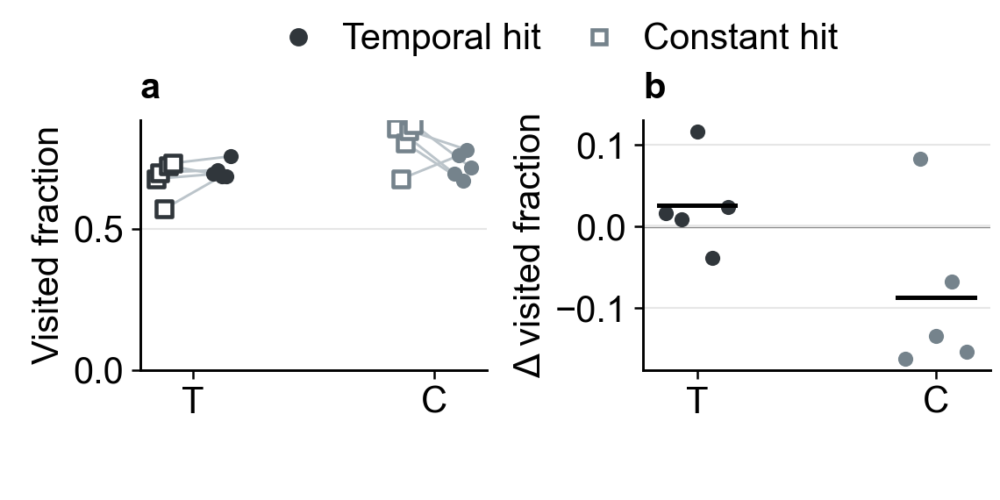

# 6–7. Worker hit bonus, exploration, and goal control

[Outline](../../99_inbox/cosyne%202027%20abstract%20-%20evidence-linked%20draft.md) · [Question index](README.md) · [Detailed online analysis](online_and_behavior_analysis_20261011.md#factorized-online-candidates)

## 6. Does temporal worker hit weighting improve exploration?

[Editable SVG](../results/cosyne_2027_compact_figures/04_worker_coverage_values_and_delta.svg) · [online DG-score values and differences](../results/cosyne_2027_compact_figures/04_worker_online_info_values_and_delta.svg) · [frozen DG-information values and differences](../results/cosyne_2027_compact_figures/04_worker_frozen_info_values_and_delta.svg) · [five-seed online paired values](../results/cosyne_2027_online_wandb/paired_contrasts_by_seed.csv) · [same-observation worker field pairs](../results/cosyne_2027_checkpoint_fields/common_panel_analysis/paired_worker_fields.csv) · [historical zero-bonus comparison](../reward_credit/corrected_core_distance_reward_ablation_20261009.md#1-does-removing-the-bonus-change-learning-and-exploration)

The fresh C05 factorial crosses temporal/constant encoder credit with temporal/mean-matched constant worker hit bonus. Panel **a** shows temporal-hit filled circles and constant-hit open squares joined within each training seed; panel **b** shows temporal minus constant hit bonus for those same seeds, with a black segment for the mean. T/C on the abscissa fixes the encoder arm. The mean 90–99M visited-cell fractions are 0.706 versus 0.680 in the temporal-encoder arm, but 0.724 versus 0.810 in the constant-encoder arm. Their paired differences are +0.026 and −0.087, with mixed seed signs in both arms. The [online DG-score view](../results/cosyne_2027_compact_figures/04_worker_online_info_values_and_delta.svg) is also mixed by seed. On [identical frozen observations](../results/cosyne_2027_compact_figures/04_worker_frozen_info_values_and_delta.svg), temporal versus constant worker hit bonus gives mean DG information 0.135 versus 0.147 bits in the temporal-encoder arm and 0.102 versus 0.127 bits in the constant-encoder arm. Thus the current fresh data do not establish a general exploration or representational advantage of temporal hit weighting. The earlier [difference-only summary](../results/cosyne_2027_compact_figures/04_worker_timing_factorized.svg) remains available.

The older bonus-versus-no-bonus C05 comparison favored bonus presence in three paired seeds, but its historical source boundary and unmatched bonus magnitudes limit interpretation. The new factorial addresses timing at approximately equal mean hit reward; the [older analysis](../reward_credit/corrected_core_encoder_worker_ablation_20261010.md#worker-bonus-exploration-and-trajectories) is motivation, not a fresh timing result. Correct-hit exposure, realized reward magnitude, matched-age trajectories/coverage, graph retention, and time to a commanded detector hit remain the next analyses. Detector hits alone do not verify physical arrival at a mapped location.

## 7. What outcome should close the abstract?

Spatial information, spatial exploration, and command following are distinct outcomes. C15's greater coverage in older comparisons does not by itself establish reliable control. Keep HRL in the model schematic unless the pending matched-start executed-command comparison supports a concise payoff sentence. The [historical graph and command diagnostics](../reward_credit/corrected_core_encoder_worker_ablation_20261010.md#commanded-goal-control) and [current control preflight](checkpoint_fields_20261011.md#trajectory-graph-and-control-checks) show the present evidence boundary.

**Abstract decision:** The C05 timing result is conditional and should not carry the two-page story now. Reserve at most one sentence for the distinction between learned spatial code and control if space remains after the encoder and frozen-policy results.

**Plot contract:** Each side-by-side plot has two panels under 1.9 inches wide in Arial 10 pt. Absolute axes start at zero; difference axes mark zero and show each seed plus a black mean segment. Online values are each seed's average of the interpolated 90–99M window and therefore are policy sampled; the frozen DG panel instead replays identical observations. [Renderer](render_compact_figures.py) · [source hashes](../results/cosyne_2027_compact_figures/manifest.json).
