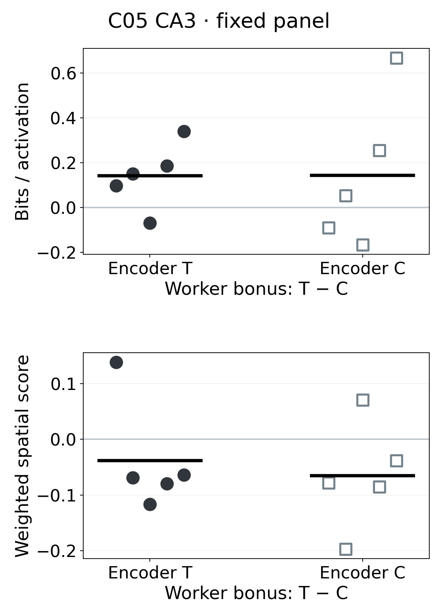
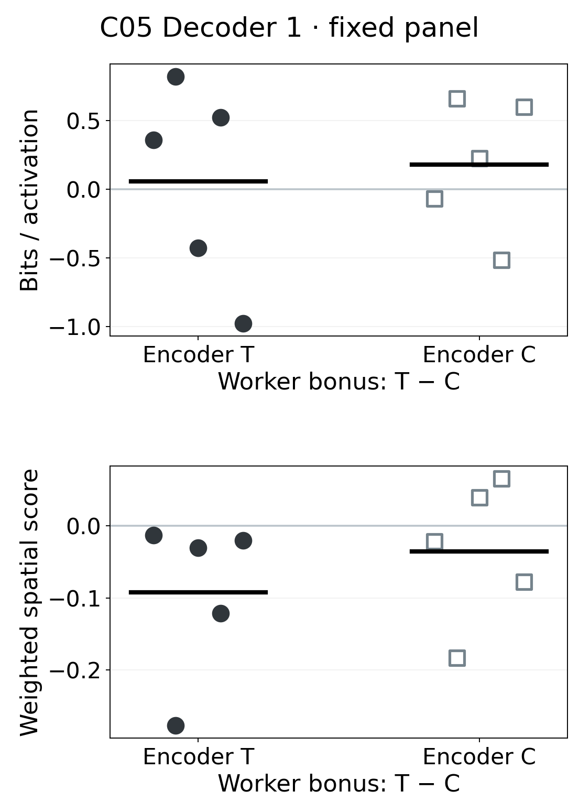
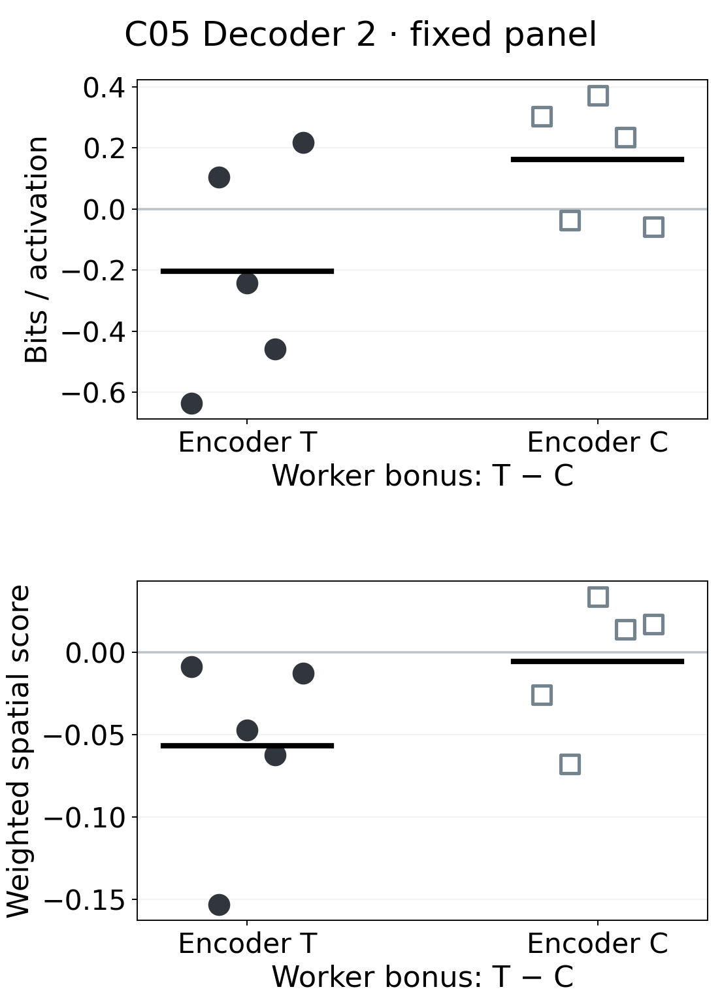

# C05 temporal hit-credit ablation: CA3 and decoder spatial information

[Worker-bonus synthesis](04_worker_bonus_and_scope.md) · [Encoder-credit question](03_encoder_credit.md) · [Evidence index](README.md)

## Result

The fresh C05 five-seed $2\times2$ factorial does **not** support a general downstream spatial-information benefit from a temporal rather than mean-matched constant **worker hit bonus**. On the same 10,001 observations, the temporal worker bonus raises CA3 bits per activation by about 0.14 in each fixed encoder arm, but signs are mixed (4/5 and 3/5) and the amplitude-weighted score falls in 4/5 pairs in both arms. Decoder 1 bits per activation are mixed in both encoder arms (3/5 positive); its amplitude-weighted score falls in all five temporal-encoder pairs. Decoder 2 reverses its bits-per-activation mean across encoder arms and also falls on the amplitude-weighted measure in all five temporal-encoder pairs. No five-seed interaction is uniform. These are absolute frozen-representation comparisons between separately trained checkpoints, not own-policy-minus-random effects.

[Editable paired CA3](../results/cosyne_2027_common_panel_layers/worker_difference_ca3.svg) · [decoder 1](../results/cosyne_2027_common_panel_layers/worker_difference_decoder_1.svg) · [decoder 2](../results/cosyne_2027_common_panel_layers/worker_difference_decoder_2.svg) · [absolute CA3](../results/cosyne_2027_common_panel_layers/absolute_ca3.svg) · [absolute decoder 1](../results/cosyne_2027_common_panel_layers/absolute_decoder_1.svg) · [absolute decoder 2](../results/cosyne_2027_common_panel_layers/absolute_decoder_2.svg) · [all absolute seed values](../results/cosyne_2027_common_panel_layers/absolute_by_seed.csv) · [all paired seed values](../results/cosyne_2027_common_panel_layers/paired_by_seed.csv) · [summary with sample SD and sign counts](../results/cosyne_2027_common_panel_layers/factor_summary.csv)

The primary contrast is **temporal minus constant worker bonus**, once with temporal encoder credit fixed and once with constant encoder credit fixed. The interaction is the first worker contrast minus the second, within each training seed. The seed order in both tables is **8 / 17 / 41 / 99 / 123**; $n=5$ independent training seeds per comparison. T and C below name temporal and constant levels, respectively. A positive difference means the temporal worker bonus has the larger score. SD is the sample standard deviation across the five paired differences; signs are positive / negative / tied.

### Bits per activation, field-eligible units

This gain-invariant measure divides each unit's occupancy-weighted spatial score by its mean rectified activation, then averages units active on at least 20 observations in at least three bins. The eligible set is determined separately for each network, so its size is reported below.

| Layer | Contrast | Paired differences, seeds 8 / 17 / 41 / 99 / 123 | Mean ± SD | Signs + / − / 0 |
| --- | --- | --- | ---: | ---: |
| CA3 | Worker T−C; encoder T | +0.098 / +0.150 / −0.068 / +0.186 / +0.340 | +0.141 ± 0.148 | 4 / 1 / 0 |
| CA3 | Worker T−C; encoder C | −0.090 / +0.053 / −0.166 / +0.255 / +0.667 | +0.144 ± 0.334 | 3 / 2 / 0 |
| CA3 | Interaction | +0.188 / +0.097 / +0.098 / −0.069 / −0.327 | −0.003 ± 0.204 | 3 / 2 / 0 |
| Decoder 1 | Worker T−C; encoder T | +0.356 / +0.819 / −0.430 / +0.520 / −0.979 | +0.057 ± 0.740 | 3 / 2 / 0 |
| Decoder 1 | Worker T−C; encoder C | −0.072 / +0.657 / +0.222 / −0.518 / +0.599 | +0.177 ± 0.489 | 3 / 2 / 0 |
| Decoder 1 | Interaction | +0.427 / +0.162 / −0.652 / +1.038 / −1.577 | −0.120 ± 1.016 | 3 / 2 / 0 |
| Decoder 2 | Worker T−C; encoder T | −0.636 / +0.105 / −0.242 / −0.458 / +0.217 | −0.203 ± 0.362 | 2 / 3 / 0 |
| Decoder 2 | Worker T−C; encoder C | +0.304 / −0.037 / +0.372 / +0.235 / −0.057 | +0.163 ± 0.198 | 3 / 2 / 0 |
| Decoder 2 | Interaction | −0.940 / +0.143 / −0.614 / −0.693 / +0.275 | −0.366 ± 0.540 | 2 / 3 / 0 |

### Amplitude-weighted spatial score, all units

The evaluator's original spatial score retains response amplitude: multiplying all of a unit's positive activations by a constant multiplies its score. The table averages **all** CA3 or decoder channels, including silent channels as zero. It therefore answers a different question from bits per activation and makes lower activity or more silence visible in the result.

| Layer | Contrast | Paired differences, seeds 8 / 17 / 41 / 99 / 123 | Mean ± SD | Signs + / − / 0 |
| --- | --- | --- | ---: | ---: |
| CA3 | Worker T−C; encoder T | +0.138 / −0.069 / −0.117 / −0.080 / −0.064 | −0.038 ± 0.101 | 1 / 4 / 0 |
| CA3 | Worker T−C; encoder C | −0.078 / −0.197 / +0.070 / −0.085 / −0.038 | −0.066 ± 0.096 | 1 / 4 / 0 |
| CA3 | Interaction | +0.217 / +0.128 / −0.187 / +0.005 / −0.025 | +0.028 ± 0.154 | 3 / 2 / 0 |
| Decoder 1 | Worker T−C; encoder T | −0.013 / −0.277 / −0.031 / −0.122 / −0.021 | −0.093 ± 0.112 | 0 / 5 / 0 |
| Decoder 1 | Worker T−C; encoder C | −0.022 / −0.183 / +0.040 / +0.066 / −0.078 | −0.035 ± 0.100 | 2 / 3 / 0 |
| Decoder 1 | Interaction | +0.009 / −0.094 / −0.070 / −0.187 / +0.057 | −0.057 ± 0.095 | 2 / 3 / 0 |
| Decoder 2 | Worker T−C; encoder T | −0.009 / −0.153 / −0.047 / −0.062 / −0.013 | −0.057 ± 0.058 | 0 / 5 / 0 |
| Decoder 2 | Worker T−C; encoder C | −0.026 / −0.068 / +0.034 / +0.014 / +0.017 | −0.006 ± 0.041 | 3 / 2 / 0 |
| Decoder 2 | Interaction | +0.017 / −0.085 / −0.081 / −0.076 / −0.030 | −0.051 ± 0.044 | 1 / 4 / 0 |

The apparent CA3 bits-per-activation gain is therefore **mixed**, not a broad improvement in layer output. Decoder 1 is **mixed to unfavorable** for temporal worker timing, depending on score definition and encoder arm. Decoder 2 is **mixed** for bits per activation and **unfavorable** for the temporal-encoder amplitude-weighted comparison; its constant-encoder weighted contrast is near zero. The decoder 2 weighted interaction is negative in four seeds, but the five-seed factorial and multiple layer/readout comparisons do not establish a general interaction.

## Activity, silence, and spatial support

All 20 runs replayed exactly the same 10,001 observations at 100,007,936 training frames. Every layer summary uses all 10,001 in-bounds observations and the same 242 of 361 visited spatial bins. Each row below is the five-seed mean for one absolute factor cell; [the absolute table](../results/cosyne_2027_common_panel_layers/absolute_by_seed.csv) retains each seed's activity, eligible-channel count, silence, and information values. Decoder layers have 128 channels each; CA3 has 1,136.

| Layer | Encoder / worker | Eligible channels | Silent channels | Positive fraction | Mean rectified activity |
| --- | --- | ---: | ---: | ---: | ---: |
| CA3 | T / T | 1,133.8 | 0.0 | 0.162 | 0.644 |
| CA3 | T / C | 1,090.6 | 28.4 | 0.163 | 0.760 |
| CA3 | C / T | 1,132.4 | 0.0 | 0.179 | 0.541 |
| CA3 | C / C | 1,134.8 | 0.0 | 0.176 | 0.500 |
| Decoder 1 | T / T | 119.4 | 1.6 | 0.256 | 0.704 |
| Decoder 1 | T / C | 118.0 | 2.6 | 0.272 | 0.906 |
| Decoder 1 | C / T | 116.4 | 5.4 | 0.283 | 0.672 |
| Decoder 1 | C / C | 115.2 | 5.8 | 0.291 | 0.622 |
| Decoder 2 | T / T | 105.0 | 10.0 | 0.338 | 0.430 |
| Decoder 2 | T / C | 104.8 | 11.2 | 0.325 | 0.483 |
| Decoder 2 | C / T | 101.8 | 14.0 | 0.339 | 0.452 |
| Decoder 2 | C / C | 99.6 | 16.4 | 0.322 | 0.365 |

CA3 T/C has 71 silent channels in seeds 8 and 17, and none in the other three seeds. Thus neither cell's mean bits per activation describes the same number of responding channels in every seed. Decoder 2 has 4–25 silent channels across individual runs, making its normalized score especially sensitive to the eligibility rule. Positive fraction and mean rectified activity vary across cells and do not provide a uniform worker-timing explanation for every spatial-score difference. The exact five paired activity and silence differences, including ties, are in [the paired table](../results/cosyne_2027_common_panel_layers/paired_by_seed.csv).

## Secondary contrast: encoder credit timing

**The factor changed here is temporal versus constant encoder credit**, with the worker hit bonus held fixed. It is separate from the primary worker comparison above. Decoder 1 shows a more consistent favorable encoder-credit contrast on the identical panel: bits per activation rises by +0.438 ± 0.366 (5/5) with temporal worker bonus and +0.559 ± 0.736 (4/5) with constant worker bonus; the amplitude-weighted score rises by +0.067 ± 0.089 (4/5) and +0.124 ± 0.077 (5/5), respectively. CA3 bits per activation rises in 4/5 pairs in both worker arms, while decoder 2 is mixed under temporal worker bonus and 5/5 positive under constant bonus. [Every secondary seed contrast and interaction](../results/cosyne_2027_common_panel_layers/paired_by_seed.csv) and [their dispersion](../results/cosyne_2027_common_panel_layers/factor_summary.csv) remain separate from the worker result. This is a terminal, single-panel observation; the existing stronger C01 DG evidence remains the abstract lead.

## Measurement boundary and provenance

The [frozen own-policy-versus-random analysis](02_behavior_expression.md) intervenes on **executed actions of one frozen checkpoint**. Its decoder-1 own-minus-random information difference is a behavior-conditioned *expression* effect over two 50k-decision probe repeats. The present analysis compares **absolute layer responses between independently trained checkpoints** on one fixed input sequence, preserving each model's own recurrent-state dynamics. Those effect sizes cannot be substituted for one another. The common panel also uses its actual occupancy weights; the own/random intervention weights bins equally after restricting to shared support.

The original C05 training cells are in the validated [three-seed StudySpec](../../hpc_runs/studies/cosyne27_c05_pushpull_s3_20261010.study.json) (SHA-256 fingerprint `48b3643dedc2df8af199acb6312e91ec20497e5b0a5a756306a2a8445f511496`) and [two-seed extension](../../hpc_runs/studies/cosyne27_c05_pushpull_s2_20261010.study.json) (`a071114e3181f4b75fe1c897c732938b7deddee9a2681a967f4e9b5ad05cef2c`), both schema `intrmotiv/study/v1`, workflow `1.14.1`. [The run catalog](training_runs.csv) supplies source commit, source patch, run path, factor values, and verified endpoint for each of the 20 identities. The observation panel is the validated earlier C15-policy sequence at the allocated workspace path in [the source manifest](../results/cosyne_2027_common_panel_layers/analysis_manifest.json), byte SHA-256 `14e977ff526c71d04822dde8903e4d1eeda8ed44d16b8eb1a9b7d69b426fc54d`.

The [replay implementation](../../hpc_runs/common_panel_layer_probe.py) captures the 1,136-channel CA3 core output and the first two 128-channel decoder activations using the established frozen behavior-probe hooks. Signed traces are rectified for map metrics. The [ordinary-job launcher](../../hpc_runs/submit_common_panel_layers.py) used a reviewed 20-row terminal manifest, skipped the completed seed-8 preflight, and submitted the other 19 independent jobs. All 20 completed with Slurm exit zero. Each compact raw replay summary, for example [C05 T/T seed 8](../results/cosyne_2027_common_panel_layers/raw/COS27_C05_TEMPORAL_TEMPORAL__s8__f100007936.json), records its checkpoint, panel, DG reference, model hashes, and exact per-layer support; the [submission manifest](../results/cosyne_2027_common_panel_layers/submission_manifest.tsv) binds the 19 production job IDs to rows. Replay occupancy matches the archived DG evaluator after an explicit axis transpose, and every DG unit's amplitude-weighted score matches its archived value (maximum absolute difference across all 20 runs $1.89\times10^{-8}$). The [analysis manifest](../results/cosyne_2027_common_panel_layers/analysis_manifest.json) hashes every copied summary and source script; [aggregation code](analyze_common_panel_layers.py) validates both StudySpec fingerprints and all 20 source identities before pairing.

The panel removes differences in **evaluation sampling** but covers one C15-policy state distribution; it does not erase training behavior's possible role in shaping weights, establish place-field compactness or reliability, or test executed goal control. The [trajectory and directed-graph evidence](checkpoint_fields_20261011.md) and [worker control gate](04_worker_bonus_and_scope.md#executed-command-control-and-abstract-scope) remain the sources for those outcomes. No policy-driven checkpoint rollout is treated as a fixed-trajectory drift test here.

**Reusable lesson:** The archived common panel and canonical C05 manifest enabled a 20-run downstream comparison without another environment rollout. The critical preflight was replaying DG alongside CA3 and decoder traces: its exact per-unit score check caught the evaluator's opposite occupancy-axis convention before the factorial jobs were released. Keep one shared panel, one source-verified factor catalog, and separate normalized and amplitude-weighted scores for future layer analyses.
