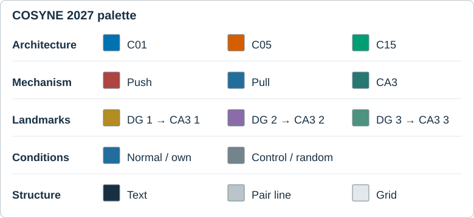

# COSYNE 2027 color palette

For the current abstract Figure 1 v3 and Figure 2 metric-icon candidates, the selected working palette is [H: orange push, violet pull](../../07_abstracts/cosyne_2027_submission_draft/figure_palette_candidates/README.md). Its NG/UG/FG colors are slate/olive/rose, and its illustrative DG unit colors are blue/red/green/cyan. The table below remains the convention for earlier study and diagnostic figures; the abstract figure sources and manuscript have not yet been switched to H.

In the earlier study figures, architecture is the **global quantitative color key**. Keep its three hues fixed within those comparisons. Encode other factors with position, marker shape, and line style whenever architectures also appear. See [figure standard](FIGURE_STANDARD.md) for size and typography.

| Context                 | Role                                            | Color                                                  | Encoding                                                                                                                 |
| ----------------------- | ----------------------------------------------- | ------------------------------------------------------ | ------------------------------------------------------------------------------------------------------------------------ |
| Architecture comparison | C01 / C05 / C15                                 | `#0072B2` blue / `#D55E00` vermilion / `#009E73` green | Existing result-figure colors; label every curve or group.                                                               |
| Mechanism schematic     | Push / pull / CA3 structure                     | `#424B53` dark ink / `#DCE4E8` light gray              | Push: solid labeled arrow. Pull: dashed labeled arrow. CA3: neutral background. Do not assign push/pull data colors.    |
| Illustrative landmarks  | DG events 1 / 2 / 3                             | `#B58C22` ochre / `#8B6CA8` violet / `#BD5C89` rose    | Number each event and repeat its color on the corresponding CA3 sequence segment; use only in the illustration.          |
| Condition comparison    | Normal or own policy / control or random        | `#30363B` charcoal / `#75838C` slate gray             | Normal: filled circle, solid line. Control: open square, dashed line. Pair matched seeds with light-gray connectors.     |
| Neutral structure       | Text / pair connector / grid or unvisited area | `#183043` / `#BBC4CA` / `#E2E8EB`                      | Keep backgrounds white or nearly white; never use grid gray as a data series.                                           |

Show the three landmark events' order by position and arrows as well as color.

**Factorial panels:** When C01/C05/C15 are compared, architecture owns the hue; encode temporal versus constant or intact versus ablated with solid/filled versus dashed/open marks. In a single-architecture comparison, use charcoal versus gray for conditions and label the manipulation. For a $2\times2$ C05 plot, show one factor as a signed contrast and the other by position and marker shape; use line style for crossed learning curves. Do not reuse an architecture hue to mean a reward, behavior, or control condition.

**Current adoption of this diagnostic convention:** The control-versus-own-policy [behavior candidate](02_behavior_expression.md#candidate-control-and-experimental-values) uses the neutral condition row. Earlier study plots retain their recorded colors. Use the selected H artwork linked above for the next abstract-figure revisions.
