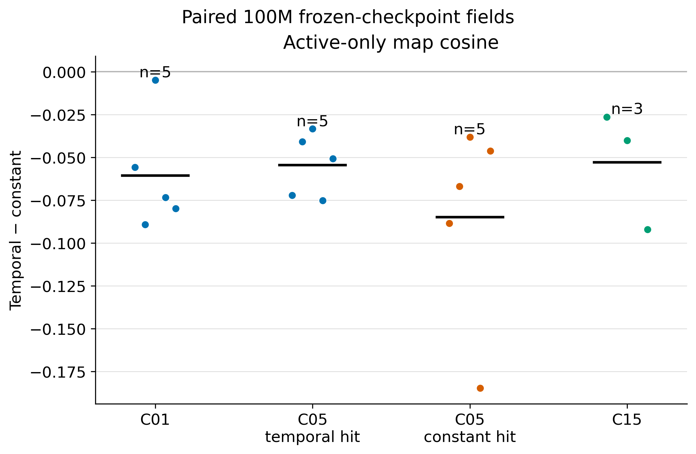
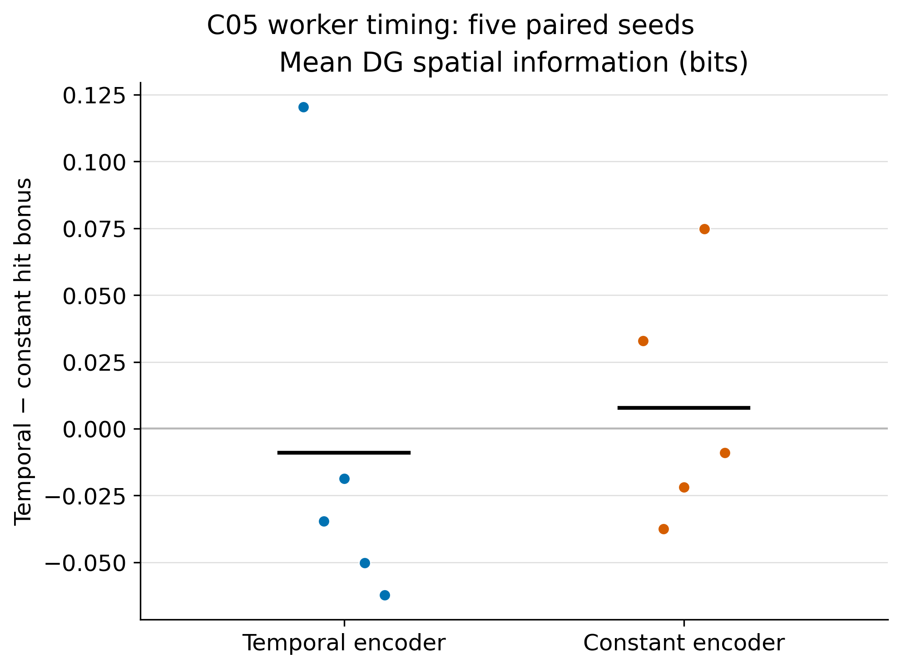

# COSYNE 2027: frozen-checkpoint field comparison

**Status, 11 October 2026:** All 98 declared frozen-checkpoint place-field jobs for the available original fresh runs have finished: 38 terminal checkpoints plus additional 5M, 25M, 50M, and 75M checkpoints for seed 17 in every arm and seed 99 except C15 constant credit. The two failed original C15 constant-credit seeds 8 and 99 still await replacement training, so C15 has three paired terminal seeds. The [canonical field-summary sources](../results/cosyne_2027_checkpoint_fields/) and [derived manifest](../results/cosyne_2027_checkpoint_fields/analysis_manifest.json) contain 98 unique checkpoint rows after each condition/seed/age is joined once. This is a **policy-specific 10k-decision evaluation**, not the fixed-observation comparison.

## Main representational comparison

[Editable SVG](../results/cosyne_2027_checkpoint_fields/figures/paired_active_map_cosine_mean.svg) · [factorized terminal spatial information](../results/cosyne_2027_checkpoint_fields/figures/factorized_mean_spatial_information_bits.svg) · [paired per-seed table for all nine metrics](../results/cosyne_2027_checkpoint_fields/paired_terminal_fields.csv)

At 100M, temporal minus mean-matched constant **encoder** credit gives:

| Architecture; worker hit bonus | Paired seeds | Active-only map cosine | Mean DG spatial information | Distinct active peak bins | Field-eligible units |
| --- | ---: | ---: | ---: | ---: | ---: |
| C01; inapplicable | 5 | −0.061, 5/5 lower | +0.016 bits, 3/5 higher | +0.6, 3/5 higher | −1.0, 5/5 lower |
| C05; temporal | 5 | −0.054, 5/5 lower | +0.024 bits, 4/5 higher | +1.2, 4/5 higher | −0.8, 4/5 lower |
| C05; constant | 5 | −0.085, 5/5 lower | +0.041 bits, 3/5 higher | +1.4, 4/5 higher | −0.6, 4/5 lower |
| C15; temporal | 3 | −0.053, 3/3 lower | −0.011 bits, 1/3 higher | +1.7, 2/3 higher | +0.3, 1/3 higher |

The map-cosine direction is consistent across all 18 paired *condition-seed cells*, with C05 seeds reused across its two worker arms. It measures similarity among active DG unit maps over each rollout's visited support. [Pre-threshold logit-map cosine](../results/cosyne_2027_checkpoint_fields/figures/paired_prethreshold_map_cosine_mean.svg) is lower in all five C01 pairs, all five C05 temporal-hit pairs, three of five C05 constant-hit pairs, and all three C15 pairs. Thus the lower similarity is visible before output thresholding in most, but not every, factor arm.

The result is **less map redundancy associated with temporal encoder credit**. It is not a uniform improvement in spatial information: C01 and C15 signs are mixed, while C05 has a positive mean in both worker arms. [The factorized spatial-information plot](../results/cosyne_2027_checkpoint_fields/figures/factorized_mean_spatial_information_bits.png) displays every arm and seed. [The distinct-peak plot](../results/cosyne_2027_checkpoint_fields/figures/paired_active_unique_peak_bins.svg) is generally positive but less consistent than cosine; [pairwise peak distance](../results/cosyne_2027_checkpoint_fields/figures/paired_active_pairwise_peak_distance_bins.svg) switches sign across the two C05 worker arms. The 10k probes also classify one fewer C01 unit as field-eligible under temporal credit in every pair; [that full factorized plot](../results/cosyne_2027_checkpoint_fields/figures/factorized_field_eligible_units.svg) should accompany any apparent diversity benefit. No terminal 10k probe has an entirely silent DG unit, but [mean active fraction](../results/cosyne_2027_checkpoint_fields/figures/paired_mean_active_fraction.svg) is lower in all five C01 pairs and all three C15 pairs, and [single-field fractions](../results/cosyne_2027_checkpoint_fields/figures/factorized_mono_field_fraction.svg) are near zero in C01 and low elsewhere. Lower cosine is not evidence of compact biological place fields. The retained 100k training snapshots show that the units below a 0.25% practical cutoff are low-firing rather than truly dead at a 0.025% cutoff; see the [cutoff analysis](snapshot_peak_spread_20261011.md#are-the-lost-peaks-practically-silent).

## Worker timing and learning course

Holding the C05 encoder arm fixed, temporal minus mean-matched constant **worker hit bonus** changes terminal spatial information by −0.009 bits for temporal encoder credit (1/5 paired seeds higher) and +0.008 bits for constant credit (2/5 higher). [Worker timing per-seed table](../results/cosyne_2027_checkpoint_fields/paired_worker_fields.csv) and [visited-support plot](../results/cosyne_2027_checkpoint_fields/figures/worker_visited_cell_fraction.svg) show mixed signs. The field data therefore do not establish a representational advantage of temporal worker-bonus timing. Behavior and hit-latency benefits require the separate online, trajectory, and matched-command readouts.

The [C05 seed-99 checkpoint course](../results/cosyne_2027_checkpoint_fields/figures/c05_seed99_checkpoint_course.png) and [seed-17 course](../results/cosyne_2027_checkpoint_fields/figures/c05_seed17_checkpoint_course.svg) show the four factorial arms at 5M, 25M, 50M, 75M, and 100M. C01 and C15 courses are also retained as [seed-99](../results/cosyne_2027_checkpoint_fields/figures/c01_seed99_checkpoint_course.svg) and [seed-17](../results/cosyne_2027_checkpoint_fields/figures/c15_seed17_checkpoint_course.svg) examples. These are two learning trajectories, each sampled through its own changing policy and visited bins. They demonstrate that several seed-99 spatial-information and cosine effects develop after 5M, but do not establish a population-level monotonic time course or fixed-observation representational drift.

## Trajectory, graph, and control checks

The independent [retained-snapshot paired trajectory and graph plot](../results/cosyne_2027_snapshot_peak_spread/figures/paired_behavior_graph_checks.svg) shows terminal visited fraction, physical step length, and stored graph efficiency. The 100k-window visited fraction is never higher under temporal encoder credit in its 18 terminal pairs (ties included), and the 10k checkpoint [visited-fraction contrast](../results/cosyne_2027_checkpoint_fields/figures/paired_visited_cell_fraction.svg) is negative in most pairs. These are different observation windows; neither equates trajectories or occupancy between conditions. The archived checkpoint [field-summary CSVs](../results/cosyne_2027_checkpoint_fields/) include each run's visited-cell fraction, and the [selected source field maps](../results/cosyne_2027_checkpoint_fields/c01_temporal_s3/summary/place_fields_COS27_C01_TEMPORAL_S99__00_COS27_C01_TEMPORAL_S99__COS27_C01_TEMPORAL__s99__f100007936.png) distinguish visited from unvisited bins.

The stored graph scores in the [snapshot analysis](snapshot_peak_spread_20261011.md#example-peak-locations-and-behavior-check) are mixed across factors. Complete directed-edge support, attempted versus unattempted edges, reachability, and matched checkpoint changes are not yet in this local report; the declared graph analysis remains open. A matched-start commanded-goal preflight on C05 seed 8 completed successfully with frozen policy and graph, 9 trials from one start, and negligible initial action change across commands; see its [summary](../results/cosyne_2027_checkpoint_fields/control_preflight/output/raw/COS27_C05_TEMPORAL_TEMPORAL__s8__f100007936/intervention_summary.json) and [trials](../results/cosyne_2027_checkpoint_fields/control_preflight/output/raw/COS27_C05_TEMPORAL_TEMPORAL__s8__f100007936/intervention_trials.csv). That one-start preflight is a protocol check, not an effect estimate. The full matched-command analysis remains open.

## Measurement and claim boundary

- [Regeneration code](analyze_checkpoint_fields.py) reads seven canonical `derived_place_field_metrics.csv` files and writes [all checkpoint rows](../results/cosyne_2027_checkpoint_fields/all_checkpoint_fields.csv), [encoder-credit paired rows](../results/cosyne_2027_checkpoint_fields/paired_terminal_fields.csv), [worker-bonus paired rows](../results/cosyne_2027_checkpoint_fields/paired_worker_fields.csv), and summaries. It carries each source SHA-256 in the [analysis manifest](../results/cosyne_2027_checkpoint_fields/analysis_manifest.json). Source StudySpec schemas, workflow versions, and fingerprints are in the corresponding source [manifest files](../results/cosyne_2027_snapshot_peak_spread/inputs/) and [run index](training_runs.csv).
- Each field probe contains 10k policy decisions. The fixed DG capacity is 16 units; field eligibility requires at least 20 active observations in at least three spatial bins. Map cosine is computed only among active unit maps. Spatial information and map shape depend on occupancy, and each policy samples its own positions. The selected thresholded and pre-threshold source maps are diagnostics; the numerical comparisons use all available paired seeds.
- The [100k-window Gaussian peak-area analysis](snapshot_peak_spread_20261011.md) independently finds broader eligible-peak coverage under temporal credit in all five C01 pairs at a 0.25% activity cutoff, but C05 is conditional on worker arm. Its common pooled visited-bin mask is a shared spatial domain, not a common observation sequence.

**Current COSYNE sentence:** “Temporally weighted self-supervised encoder credit produces less redundant DG maps than mean-matched constant credit across matched C01, C05, and C15 training seeds; C01 also distributes eligible peaks across more of the visited arena.” The first clause is an association in policy-specific samples. A **common-observation frozen-checkpoint evaluation** is still required to attribute it to a changed learned code independently of behavior. The initial panel-recording preflight failed on an obsolete workspace path; its [failure log](../results/cosyne_2027_snapshot_peak_spread/common_panel_preflight_8331634.log) is archived. A corrected common-panel replay sweep is now running in the same analysis workspace; its results are not yet included here.

**Reusable lesson:** Keeping canonical checkpoint CSVs keyed by condition, seed, and target frames made the seven studies join without parsing run names as metadata. The major scientific bottleneck is now matching observations and executed commands, not adding more spatial scalar plots. Run the canonical postprocessor after each manifest is complete, then link its small CSVs and a few readable figure panels into the COSYNE index.
