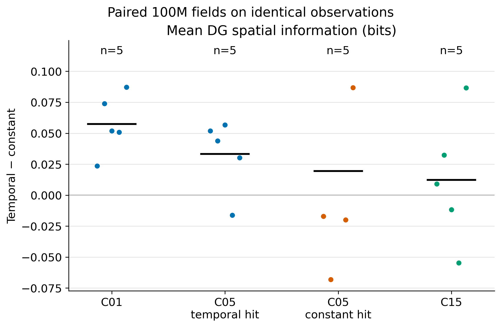
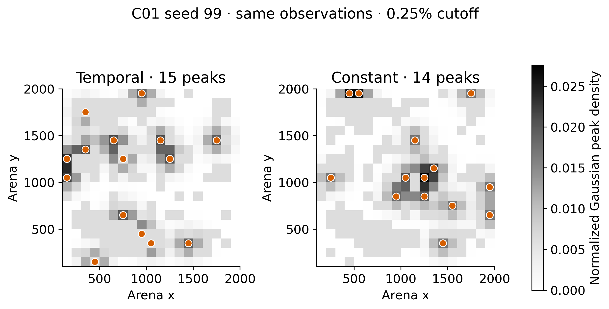
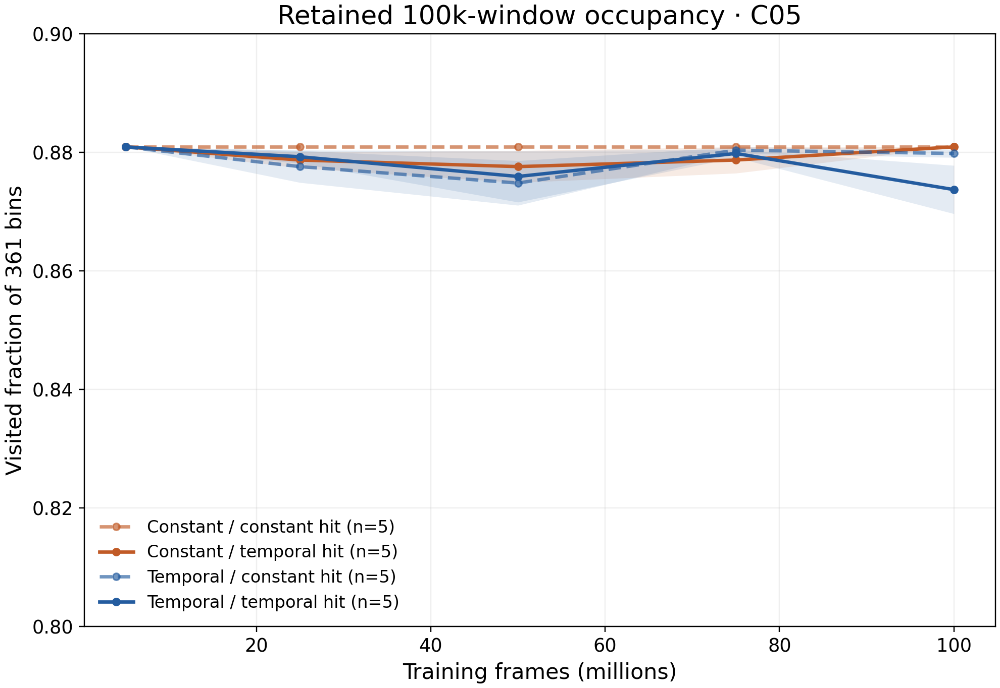
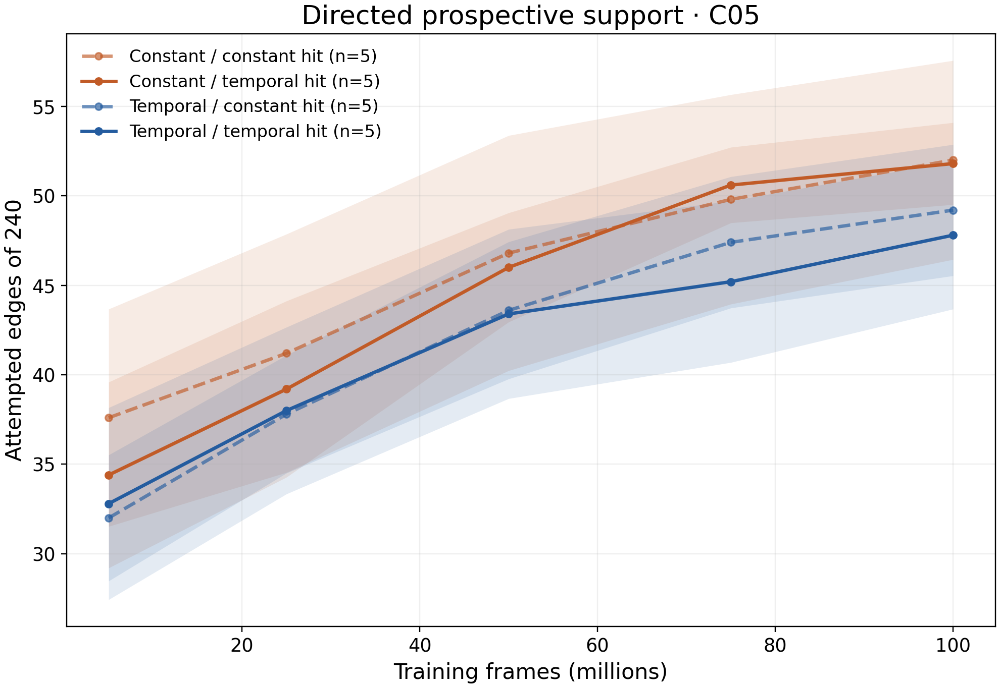

# COSYNE 2027: frozen-checkpoint field comparison

**Outline placement:** [4–5 encoder-credit ablations](03_encoder_credit.md) and [6–7 worker timing and scope](04_worker_bonus_and_scope.md). Those question reports lead with final-size figures; this file retains the full checkpoint tables, factor cells, and source boundaries.

**Status, 12 October 2026:** All 98 declared policy-specific frozen-checkpoint field jobs for the available original fresh runs and six C15 replacement probes have finished. The [policy-specific source tables](../results/cosyne_2027_checkpoint_fields/analysis_manifest.json) contain 104 unique checkpoint rows and 40 terminal checkpoints. All 40 terminal checkpoints now have DG fields on **one identical 10,001-observation panel**, including five paired C15 seeds. The original [20-run C05 companion](05_downstream_spatial_information.md) adds CA3 and decoder-1/2 responses on that panel; both C15 replacement downstream-layer replays are complete. The completed trajectory and directed-graph aggregates cover 200 snapshots from 40 runs and 150 snapshots from 30 goal-conditioned runs, retaining replacement source tags. The [canonical worker-timing synthesis](04_worker_bonus_and_scope.md) integrates reward/exposure, representation, trajectory, graph, and fresh behavior-expression contrasts. The original 48 matched-command jobs timed out; 12 jobs in a second 48-job full-panel cohort failed. One distinct, complete source-shard panel now measures DG detector hits for a single C05 seed at 75M frames, while seed-paired executed-control effects and physical arrivals remain unmeasured.

**12 October downstream extension:** All 40 terminal checkpoints now have CA3, decoder-1, and decoder-2 information on that identical saved panel. The [full architecture-by-factor layer report](temporal_credit_multilayer_20261012.md) gives paired means, sample SDs, sign counts, activity, silence, and explicit missing C15 cells. All accepted downstream replays reproduce the archived DG score. This extends the fixed-observation representation result; the policy-specific checkpoint courses below remain a different sampling protocol.

**C15 replacement follow-up:** Both replacement runs have five retained spatial snapshots. A distinct 1,000-decision field preflight, job 8345152, completed with exit zero and wrote [1,001 observations with active DG responses](../results/cosyne_2027_checkpoint_fields/c15_recovery_field_preflight_summary.csv). All [six declared 10,000-decision policy-specific field jobs 8345225–8345230](../results/cosyne_2027_checkpoint_fields/c15_recovery_field_jobs.tsv) then exited zero. Each NPZ matches its manifest checkpoint, contains 10,001 observations, finite scores and visited-bin maps, and responses from all 16 DG units. The [canonical replacement summary](../results/cosyne_2027_checkpoint_fields/c15_recovery/summary/derived_place_field_metrics.csv) contributes seed-8 terminal and seed-99 five-checkpoint rows; its SHA-256 is in the combined analysis manifest. Their training source is the [separately indexed C15 recovery StudySpec](training_runs.csv), not the failed original attempts. Their retained trajectories and directed-edge tables enter the five-seed course below. The existing [C15 common-panel jobs 8344896/8344897](../results/cosyne_2027_checkpoint_fields/common_panel/submission_manifest_20261012T061632Z.tsv) also wrote valid replacement DG NPZs; all 40 replays match the same occupancy hash and 242 visited bins. The separately print-reviewed [C15 replacement layer jobs 8345364 and 8345388](../results/cosyne_2027_temporal_credit_layers/c15_recovery_layer_job_audit_20261012.csv) both exited zero; their exact terminal checkpoints, DG reference parity, and finite CA3/decoder metrics place them in the [five-seed C15 downstream table](temporal_credit_multilayer_20261012.md). Executed control remains pending.

## Identical observations: strongest representational result

[Editable spatial-information SVG](../results/cosyne_2027_checkpoint_fields/common_panel_analysis/figures/paired_mean_spatial_information_bits.svg) · [active-only map-cosine plot](../results/cosyne_2027_checkpoint_fields/common_panel_analysis/figures/paired_active_map_cosine_mean.svg) · [all seed-level contrasts](../results/cosyne_2027_checkpoint_fields/common_panel_analysis/paired_encoder_fields.csv)

Temporal minus mean-matched constant encoder credit on the same observations at 100M:

| Architecture; worker hit bonus | Paired seeds |  DG spatial information | Active-only map cosine | Field-eligible units | Gaussian effective peak area, 0.25% cutoff |
| ------------------------------ | -----------: | ----------------------: | ---------------------: | -------------------: | -----------------------------------------: |
| C01; inapplicable              |            5 | +0.0575 bits, 5/5 higher |      −0.033, 5/5 lower |     +1.6, 5/5 higher |                         +0.109, 5/5 higher |
| C05; temporal                  |            5 | +0.033 bits, 4/5 higher |      −0.059, 5/5 lower |     +0.8, 3/5 higher |                         +0.083, 4/5 higher |
| C05; constant                  |            5 | +0.020 bits, 2/5 higher |      −0.010, 3/5 lower |     −1.4, 1/5 higher |                         −0.033, 2/5 higher |
| C15; temporal                  |            5 | +0.012 bits, 3/5 higher |      −0.052, 5/5 lower |     +0.4, 2/5 higher, 2 ties |                 +0.038, 4/5 higher |

The C01 comparison supports a narrower, stronger result: temporal encoder credit leads to more spatially informative, less redundant DG activity with broader eligible-peak coverage under **identical evaluation input** in every paired seed. C05 depends on worker timing; its constant-hit arm is mixed on all three measures. C15 now has five pairs: map similarity is lower in every pair, while spatial-information signs remain mixed and peak-area gain holds in four. Its two replacement constant-credit runs used the isolated learner recovery patch; the [source-tagged catalog](training_runs.csv) makes this lineage explicit, so the C15 five-seed contrast has a source qualification absent from the C01/C05 pairs. [Pre-threshold map cosine](../results/cosyne_2027_checkpoint_fields/common_panel_analysis/figures/paired_prethreshold_map_cosine_mean.svg) is lower in all C01, C05 temporal-hit, and C15 pairs, but only three of five C05 constant-hit pairs. The [full factorized fixed-panel plots](../results/cosyne_2027_checkpoint_fields/common_panel_analysis/figures/factorized_mean_spatial_information_bits.svg) and [worker-bonus table](../results/cosyne_2027_checkpoint_fields/common_panel_analysis/paired_worker_fields.csv) retain every architecture, manipulation, and seed.

[Editable peak-example SVG](../results/cosyne_2027_checkpoint_fields/common_panel_analysis/figures/c01_seed99_common_peak_density.svg) · [factorized peak-area plot](../results/cosyne_2027_checkpoint_fields/common_panel_analysis/figures/factorized_peak_effective_area.svg) · [C01 area across 0%, 0.025%, 0.25%, and 1% cutoffs](../results/cosyne_2027_checkpoint_fields/common_panel_analysis/figures/c01_effective_area_by_cutoff.svg) · [all-factor paired cutoff table](../results/cosyne_2027_checkpoint_fields/common_panel_analysis/paired_peak_spread_by_seed.csv) · [50/100/150-unit blur-width sensitivity](../results/cosyne_2027_checkpoint_fields/common_panel_analysis/paired_peak_width_sensitivity.csv)

The peak area is the exponential Shannon entropy of equal-mass Gaussian-blurred eligible peak density divided by the shared 242 visited bins. At the 100-unit Gaussian width, the C01 area advantage is positive in all five seeds at 0%, 0.025%, and 0.25% activity cutoffs; four of five remain positive at 1%. At the 0.25% cutoff, Gaussian-density Gini is lower in all five C01 pairs, whereas mean pairwise peak distance is higher in only three; the density measures support a more even spatial spread without requiring every pair of peaks to be farther apart. At that cutoff, 50-unit blur yields four of five positive C01 area pairs, and 100- and 150-unit blurs yield five of five. The individual peak dots and normalized densities use the same occupancy mask and color scale; they do not imply that the 16 unit identities align between independently trained networks.

The saved panel comes from an earlier C15-policy rollout: [panel provenance](../reward_credit/corrected_core_distance_reward_ablation_20261009.md) describes its construction. All 40 replays identify the same panel path and have a byte-identical 19-by-19 occupancy array; the [occupancy certificate](../results/cosyne_2027_checkpoint_fields/common_panel_analysis/occupancy_certificate.json) records one hash and 242/361 visited bins. This removes differences in **evaluation sampling**, but it assesses one policy's state distribution, not every reachable state. Training behavior may still mediate how encoder credit changes the learned weights.

## Policy-specific 10k-decision comparison

[Editable SVG](../results/cosyne_2027_checkpoint_fields/figures/paired_active_map_cosine_mean.svg) · [factorized terminal spatial information](../results/cosyne_2027_checkpoint_fields/figures/factorized_mean_spatial_information_bits.svg) · [paired per-seed table for all nine metrics](../results/cosyne_2027_checkpoint_fields/paired_terminal_fields.csv)

At 100M, temporal minus mean-matched constant **encoder** credit gives:

| Architecture; worker hit bonus | Paired seeds | Active-only map cosine | Mean DG spatial information | Distinct active peak bins | Field-eligible units |
| --- | ---: | ---: | ---: | ---: | ---: |
| C01; inapplicable | 5 | −0.061, 5/5 lower | +0.016 bits, 3/5 higher | +0.6, 3/5 higher | −1.0, 5/5 lower |
| C05; temporal | 5 | −0.054, 5/5 lower | +0.024 bits, 4/5 higher | +1.2, 4/5 higher | −0.8, 4/5 lower |
| C05; constant | 5 | −0.085, 5/5 lower | +0.041 bits, 3/5 higher | +1.4, 4/5 higher | −0.6, 4/5 lower |
| C15; temporal | 5 | −0.066, 5/5 lower | −0.004 bits, 3/5 higher | +1.6, 3/5 higher, 1 tie | +0.2, 1/5 higher, 4 ties |

The map-cosine direction is consistent across all 20 paired *condition-seed cells*, with C05 seeds reused across its two worker arms. It measures similarity among active DG unit maps over each rollout's visited support. [Pre-threshold logit-map cosine](../results/cosyne_2027_checkpoint_fields/figures/paired_prethreshold_map_cosine_mean.svg) is lower in all five C01 pairs, all five C05 temporal-hit pairs, three of five C05 constant-hit pairs, and all five C15 pairs. Thus the lower similarity is visible before output thresholding in most, but not every, factor arm.

This policy-specific result associates temporal encoder credit with less map redundancy across all four contrasts, but it is **not** a uniform improvement in spatial information: C01 and C15 signs are mixed, while C05 has a positive mean in both worker arms. [The factorized spatial-information plot](../results/cosyne_2027_checkpoint_fields/figures/factorized_mean_spatial_information_bits.png) displays every arm and seed. [The distinct-peak plot](../results/cosyne_2027_checkpoint_fields/figures/paired_active_unique_peak_bins.svg) is generally positive but less consistent than cosine; [pairwise peak distance](../results/cosyne_2027_checkpoint_fields/figures/paired_active_pairwise_peak_distance_bins.svg) switches sign across the two C05 worker arms. The 10k probes also classify one fewer C01 unit as field-eligible under temporal credit in every pair; [that full factorized plot](../results/cosyne_2027_checkpoint_fields/figures/factorized_field_eligible_units.svg) should accompany any apparent diversity benefit. No terminal 10k probe has an entirely silent DG unit, but [mean active fraction](../results/cosyne_2027_checkpoint_fields/figures/paired_mean_active_fraction.svg) is lower in all five C01 pairs and four of five C15 pairs, and [single-field fractions](../results/cosyne_2027_checkpoint_fields/figures/factorized_mono_field_fraction.svg) are near zero in C01 and low elsewhere. Lower cosine is not evidence of compact biological place fields. The retained 100k training snapshots show that the units below a 0.25% practical cutoff are low-firing rather than truly dead at a 0.025% cutoff; see the [cutoff analysis](snapshot_peak_spread_20261011.md#are-the-lost-peaks-practically-silent). **The common panel reverses the C01 field-eligibility comparison and makes its spatial-information gain consistent; the C05 constant-hit cosine effect weakens to 3/5.** This illustrates why policy-specific maps alone cannot carry the causal representation claim.

## Worker timing and learning course

Holding the C05 encoder arm fixed, temporal minus mean-matched constant **worker hit bonus** changes policy-specific terminal spatial information by −0.009 bits for temporal encoder credit (1/5 paired seeds higher) and +0.008 bits for constant credit (2/5 higher). [Worker timing per-seed table](../results/cosyne_2027_checkpoint_fields/paired_worker_fields.csv) and [visited-support plot](../results/cosyne_2027_checkpoint_fields/figures/worker_visited_cell_fraction.svg) show mixed signs. On the common panel, the temporal hit bonus changes spatial information by −0.012 and −0.026 bits in the temporal and constant encoder arms, again without a consistent positive effect; see the [shared-panel worker table](../results/cosyne_2027_checkpoint_fields/common_panel_analysis/paired_worker_fields.csv). The field data therefore do not establish a representational advantage of temporal worker-bonus timing. Behavior and hit-latency benefits require the separate online, trajectory, and matched-command readouts.

The [C05 seed-99 checkpoint course](../results/cosyne_2027_checkpoint_fields/figures/c05_seed99_checkpoint_course.png) and [seed-17 course](../results/cosyne_2027_checkpoint_fields/figures/c05_seed17_checkpoint_course.svg) show the four factorial arms at 5M, 25M, 50M, 75M, and 100M. C01 and C15 courses are also retained as [seed-99](../results/cosyne_2027_checkpoint_fields/figures/c01_seed99_checkpoint_course.svg) and [seed-17](../results/cosyne_2027_checkpoint_fields/figures/c15_seed17_checkpoint_course.svg) examples. These are two learning trajectories, each sampled through its own changing policy and visited bins. They demonstrate that several seed-99 spatial-information and cosine effects develop after 5M, but do not establish a population-level monotonic time course or fixed-observation representational drift.

## Trajectories and occupancy

[Editable C05 SVG](../results/cosyne_2027_checkpoint_fields/graph_trajectory_summary/trajectory_visited_course_c05.svg) · [C01 course](../results/cosyne_2027_checkpoint_fields/graph_trajectory_summary/trajectory_visited_course_c01.svg) · [C15 course](../results/cosyne_2027_checkpoint_fields/graph_trajectory_summary/trajectory_visited_course_c15.svg) · [all 200 checkpoint rows](../results/cosyne_2027_checkpoint_fields/graph_trajectory_summary/trajectory_by_snapshot.csv) · [seed-paired encoder contrasts](../results/cosyne_2027_checkpoint_fields/graph_trajectory_summary/paired_trajectory.csv) · [C05 seed-paired worker contrasts](../results/cosyne_2027_checkpoint_fields/graph_trajectory_summary/paired_worker_trajectory.csv)

Each line is the available training-seed mean with a ±1 SEM band; the legend gives its seed count. All checkpoints use each policy's own latest 100k behavior observations, with 361 spatial bins as the denominator. At 100M, temporal minus constant encoder credit changes visited fraction by −0.016 in C01, −0.007 and −0.001 in C05's temporal- and constant-hit arms, and −0.001 in five-seed C15. The C15 signs are two higher, two lower, and one tied; its mean path-efficiency difference is −0.088, with one of five higher. The 10k frozen checkpoint [visited-fraction contrast](../results/cosyne_2027_checkpoint_fields/figures/paired_visited_cell_fraction.svg) is a separate rollout window. Mean physical step length and path efficiency have mixed paired signs across the other factor arms; the per-seed tables retain those quantities. In C05, temporal versus constant worker bonus changes 100k visited fraction by −0.006 for temporal encoder credit and exactly 0.000 for constant credit across the five paired seeds. These data do not support a fresh-study claim that temporal worker timing improves area coverage.

The canonical segmented atlas shows occupancy and reset-separated paths for a selected seed: [C01 temporal](../results/cosyne_2027_checkpoint_fields/selected_figures/trajectories/COS27_C01_TEMPORAL_S99.png) and [C01 constant](../results/cosyne_2027_checkpoint_fields/selected_figures/trajectories/COS27_C01_CONSTANT_S99.png), all four [C05 temporal/temporal](../results/cosyne_2027_checkpoint_fields/selected_figures/trajectories/COS27_C05_TEMPORAL_TEMPORAL_S99.png), [constant/temporal](../results/cosyne_2027_checkpoint_fields/selected_figures/trajectories/COS27_C05_CONSTANT_TEMPORAL_S99.png), [temporal/constant](../results/cosyne_2027_checkpoint_fields/selected_figures/trajectories/COS27_C05_TEMPORAL_CONSTANT_S99.png), and [constant/constant](../results/cosyne_2027_checkpoint_fields/selected_figures/trajectories/COS27_C05_CONSTANT_CONSTANT_S99.png) arms, and the available [C15 temporal](../results/cosyne_2027_checkpoint_fields/selected_figures/trajectories/COS27_C15_TEMPORAL_S17.png) and [C15 constant](../results/cosyne_2027_checkpoint_fields/selected_figures/trajectories/COS27_C15_CONSTANT_S17.png) pair. Segment color indicates storage identity, circles mark starts, crosses mark ends, and arrows show headings; color is not elapsed time. Examples are illustrative and do not match trajectories between models. [Selected figure hashes and remote sources](../results/cosyne_2027_checkpoint_fields/selected_figures/selected_figure_sources.csv) make the copies auditable.

## Directed graph support and outcomes

[Editable C05 support SVG](../results/cosyne_2027_checkpoint_fields/graph_trajectory_summary/graph_attempted_course_c05.svg) · [C15 support course](../results/cosyne_2027_checkpoint_fields/graph_trajectory_summary/graph_attempted_course_c15.svg) · [C05 stored reachability](../results/cosyne_2027_checkpoint_fields/graph_trajectory_summary/graph_reachability_course_c05.svg) · [C15 stored reachability](../results/cosyne_2027_checkpoint_fields/graph_trajectory_summary/graph_reachability_course_c15.svg) · [all 150 graph snapshots](../results/cosyne_2027_checkpoint_fields/graph_trajectory_summary/directed_graph_by_snapshot.csv) · [paired encoder contrasts](../results/cosyne_2027_checkpoint_fields/graph_trajectory_summary/paired_directed_graph.csv) · [paired worker contrasts](../results/cosyne_2027_checkpoint_fields/graph_trajectory_summary/paired_worker_directed_graph.csv)

All 240 directed nonself edges among 16 DG units are retained per graph snapshot, including unattempted edges. The graph course shows seed means ±1 SEM with sample sizes in its legend. At 100M, the following are arm means over available original seeds; prospective hit fraction pools detector successes and attempts *within each snapshot* before averaging seeds:

| Family; encoder / worker | Seeds | Prospectively attempted edges / 240 | Prospective detector-hit fraction | Reliable stored edges / 240 | Reachable ordered-pair fraction |
| --- | ---: | ---: | ---: | ---: | ---: |
| C05; temporal / temporal | 5 | 47.8 | 0.725 | 11.2 | 0.054 |
| C05; constant / temporal | 5 | 51.8 | 0.737 | 10.0 | 0.048 |
| C05; temporal / constant | 5 | 49.2 | 0.670 | 8.2 | 0.048 |
| C05; constant / constant | 5 | 52.0 | 0.576 | 5.2 | 0.027 |
| C15; temporal / temporal | 5 | 237.8 | 0.640 | 147.4 | 0.988 |
| C15; constant / temporal | 5 | 238.6 | 0.653 | 173.0 | 0.988 |

C05 graph support grows from roughly 32–38 prospectively attempted edges at 5M to 48–52 at 100M, leaving about 188–192 of 240 directed pairs without prospective trials at the endpoint. Its stored reliable graph remains sparse: mean reachable-pair fractions are 0.027–0.054. C15 attempts almost all directed pairs by 100M and has near-complete stored reachability, despite mean prospective detector-hit fractions of 0.640 and 0.653. Thus topology and observed detector outcomes answer different questions. In five paired C15 seeds, temporal minus constant encoder credit yields −25.6 reliable stored edges on average (two higher, three lower), −0.013 prospective detector-hit fraction (three higher, two lower), and exactly zero mean reachable-pair difference (one higher, one lower, three ties). C05 graph contrasts also have mixed seed signs; no uniform graph advantage follows from the strong C01 field result. Holding the C05 encoder constant, temporal worker bonus raises prospective detector-hit fraction by +0.161 in 5/5 constant-encoder seed pairs, but by +0.055 in only 3/5 temporal-encoder pairs. These are stored/prospective graph readouts, not frozen executed-command effects.

The canonical directed matrices use source rows and target columns, a fixed 0–1 detector-hit ratio scale, and gray for unattempted edges. Selected [C05 temporal/temporal](../results/cosyne_2027_checkpoint_fields/selected_figures/graphs/COS27_C05_TEMPORAL_TEMPORAL_S99.png), [constant/temporal](../results/cosyne_2027_checkpoint_fields/selected_figures/graphs/COS27_C05_CONSTANT_TEMPORAL_S99.png), [temporal/constant](../results/cosyne_2027_checkpoint_fields/selected_figures/graphs/COS27_C05_TEMPORAL_CONSTANT_S99.png), [constant/constant](../results/cosyne_2027_checkpoint_fields/selected_figures/graphs/COS27_C05_CONSTANT_CONSTANT_S99.png), [C15 temporal](../results/cosyne_2027_checkpoint_fields/selected_figures/graphs/COS27_C15_TEMPORAL_S17.png), and [C15 constant](../results/cosyne_2027_checkpoint_fields/selected_figures/graphs/COS27_C15_CONSTANT_S17.png) examples retain the same scale. The [source manifest](../results/cosyne_2027_checkpoint_fields/graph_trajectory_summary/source_manifest.json) records eight validated StudySpec fingerprints, schema/workflow versions, exact CSV hashes, and 36,000 directed-edge source rows, with `c15_recovery` separate from failed originals. Full edge tables and raw NPZs remain in the allocated NEMO2 workspace.

## Matched-command control gate

The [C05 seed-8 preflight summary](../results/cosyne_2027_checkpoint_fields/control_preflight/output/raw/COS27_C05_TEMPORAL_TEMPORAL__s8__f100007936/intervention_summary.json) verifies a frozen policy and graph, exact start, and nine trial rows from one start; its [trial table](../results/cosyne_2027_checkpoint_fields/control_preflight/output/raw/COS27_C05_TEMPORAL_TEMPORAL__s8__f100007936/intervention_trials.csv) shows negligible initial action change across commands. That one-start result is protocol evidence, not an effect estimate.

**The original production command panel failed at its runtime bound.** [Slurm records for all 48 jobs](../results/cosyne_2027_checkpoint_fields/control_failure_audit_20261012.csv) show `TIMEOUT` for 8331735–8331782 after approximately eight hours each. The authorized analysis root contains no `intervention_trials.csv` or `intervention_summary.json` from those jobs; the only trial table is the earlier nine-row preflight. Representative job logs continue constructing fresh DMLab engines until cancellation, and the current evaluator writes its CSV and JSON only after the entire source panel returns. Its logs do not expose a completed source count, so no partial source, goal, start, or horizon coverage can be certified. There is no 64/128/256/900-decision effect or censoring estimate to report.

The second same-label 48-job cohort, 8343879–8343926, has 72-hour limits. At the 12 October 20:32 Berlin check, 12 had failed with Slurm exit `134:0` after 3:36–4:00 hours, and 36 were still `RUNNING`. [The twelve-job failure audit](../results/cosyne_2027_checkpoint_fields/control_rerun_failures_20261012.csv) records their exact IDs, nodes, and remote logs; each log ends with a native DMLab `buffer overflow detected` and core dump. Failures occurred on two compute nodes, n3104 and n3109. No terminal trial CSV or JSON had appeared in those full-panel output folders. [The 48-command audit](../results/cosyne_2027_checkpoint_fields/control_rerun_command_audit_20261012.json) verifies unique job IDs, labels, and manifest rows, their three original output folders, and the absence of any source-shard argument: the rerun remained monolithic. These jobs were submitted outside this task. Do not launch overlapping recovery shards against active outputs or interpret the surviving jobs as a complete panel. After the cohort settles, audit complete trial tables; failed cells require a separately reviewed bounded source-shard recovery with distinct outputs.

**Interim executed detector-hit panel:** A distinct source-shard cohort, submitted outside this task, completed all 16 sources for C05 temporal encoder / temporal worker, seed 99, at 75,005,952 frames. Its [audited merged-table record](../results/cosyne_2027_checkpoint_fields/control_c05_s99_75m_merged_audit_20261012.json) identifies the remote trial CSV by SHA-256 and its StudySpec. The 1,152 rows cover 128 source/repeat starts, 48 source/target pairs, and 384 matched command triplets. Every trial verifies the exact start; the source summaries report frozen policy and graph. The merged rows reconcile by key and numeric tolerance to the 16 complete source tables. Across all three executed arms, DG detector hits by 64/128/256/900 decisions were 771/899/959/994; 900-decision censoring was 157/1,152, with one observed nonhit failure. The canonical `summarize_control.py` gives commanded-minus-mean-alternate detector-hit lifts of +0.0039, +0.0169, +0.0052, and −0.0013 at those horizons. Earlier-horizon nonhits can hit later and should not be counted as terminal failures. This is one run at one checkpoint, not a training-seed contrast or checkpoint-age trend; do not mix its merged source-shard output with the running full-panel cohort.

The existing trial schema contains physical start and endpoint positions but no independently mapped spatial destination for each DG target; therefore a detector hit cannot presently be called a **physical arrival**. Physical arrival remains an explicit open measurement gate even if bounded command trials complete.

## Measurement and claim boundary

- [Policy-specific regeneration code](analyze_checkpoint_fields.py) reads eight canonical `derived_place_field_metrics.csv` files and writes [all checkpoint rows](../results/cosyne_2027_checkpoint_fields/all_checkpoint_fields.csv), [encoder-credit paired rows](../results/cosyne_2027_checkpoint_fields/paired_terminal_fields.csv), [worker-bonus paired rows](../results/cosyne_2027_checkpoint_fields/paired_worker_fields.csv), and summaries. It carries each source SHA-256 in the [analysis manifest](../results/cosyne_2027_checkpoint_fields/analysis_manifest.json). [Common-panel code](analyze_common_panel_fields.py) reuses those pairing and plotting methods on the canonical [40-row field table](../results/cosyne_2027_checkpoint_fields/common_panel/summary/derived_place_field_metrics.csv). [Peak-spread code](analyze_common_panel_peaks.py) uses the evaluator's post-inhibition eligible peak coordinates; its [source manifest](../results/cosyne_2027_checkpoint_fields/common_panel_analysis/npz_source_manifest.csv) hashes every remote NPZ without copying raw arrays into the vault. Source StudySpec schemas, workflow versions, and fingerprints are in the corresponding source [manifest files](../results/cosyne_2027_snapshot_peak_spread/inputs/) and [run index](training_runs.csv).
- Each policy-specific field probe contains 10k decisions; the common panel has 10,001 saved observations. The fixed DG capacity is 16 units; field eligibility requires at least 20 active observations in at least three spatial bins. Map cosine is computed only among active unit maps. Spatial information and map shape depend on occupancy. The selected thresholded and pre-threshold source maps are diagnostics; the numerical comparisons use all available paired seeds.
- The [100k-window Gaussian peak-area analysis](snapshot_peak_spread_20261011.md) independently finds broader eligible-peak coverage under temporal credit in all five C01 pairs at a 0.25% activity cutoff, but C05 is conditional on worker arm. Its common pooled visited-bin mask is a shared spatial domain, not a common observation sequence.
- [Graph and trajectory regeneration code](analyze_graph_trajectories.py) uses canonical `collect-spatial --include-details` outputs and validates 240 directed nonself edges at each of 150 goal-run snapshots. It leaves graph-edge tables on NEMO2 and exports factorized per-age tables, paired seed contrasts, and selected plots. The retained 100k-window paths are policy sampled; the atlas preserves reset and segment boundaries. No graph metric, even a prospective detector-hit ratio, substitutes for a completed matched-command intervention.

**Current COSYNE sentence:** “In a reward-free visual exploration model, temporally weighted self-supervised encoder credit yields more spatially informative, less redundant, and more spatially distributed DG activity than mean-matched constant credit across five matched C01 seeds, when both networks are evaluated on identical observations.” C05 with a temporal worker hit bonus shows a related but less uniform pattern; the C05 constant-hit arm does not. The common panel removes evaluation-trajectory differences, while still sampling one C15-policy state distribution and allowing training behavior to mediate the total credit effect. The initial attempt to record a new panel failed on an obsolete workspace path; its [failure log](../results/cosyne_2027_snapshot_peak_spread/common_panel_preflight_8331634.log) is archived. Reusing the validated existing panel completed the comparison without changing the training runs.

**Reusable lesson:** Keeping canonical checkpoint CSVs keyed by condition, seed, and target frames made the seven studies join without parsing run names as metadata. Reusing one archived panel and verifying identical occupancy across every NPZ resolved the largest interpretive ambiguity in the earlier policy-specific plots. The canonical retained snapshots already held every graph edge and segmented trajectory, so source-validated CSV aggregation and selected atlas copies finished those components without another DMLab rollout. The command preflight was too small to certify the original production runtime: all 48 monolithic jobs hit eight hours without a saved table. A second full-panel cohort has already produced native DMLab crashes after several hours, showing that a longer limit alone does not address this evaluator failure. Inspect its lifecycle and output-write boundary before treating it as evidence or launching a separate bounded recovery. Use the canonical postprocessor only on complete audited trials. A separate physical destination mapping is still needed for arrival claims.
