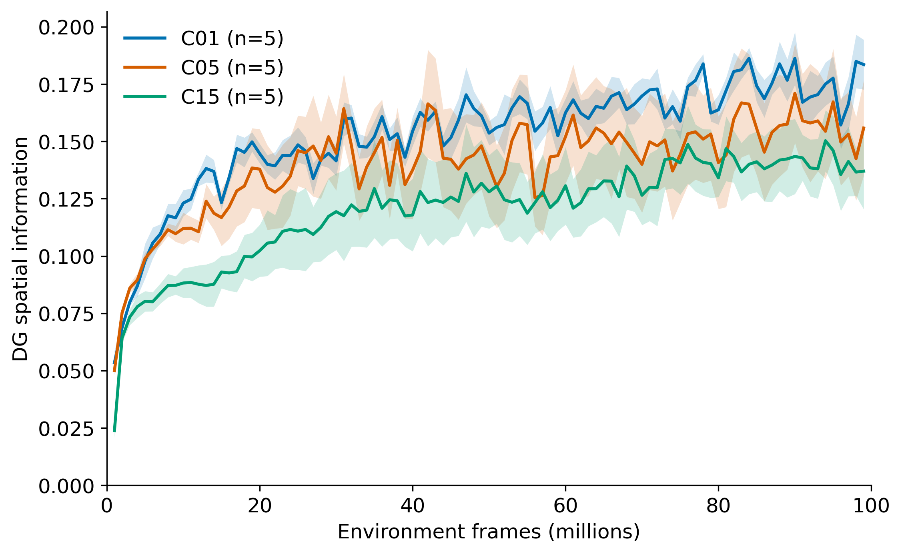

# COSYNE 2027: online learning curves and frozen-policy secondary readouts

**Outline placement:** [1–2 model and emergence](01_model_and_spatial_emergence.md) · [3 behavior-dependent code expression](02_behavior_expression.md). Those reports contain the final-size compact figures; this file retains full candidate plots and data provenance.

**Status, 11 October 2026:** The W&B spatial histories of 38 verified fresh original runs have been archived and plotted. The two failed original C15 constant-credit attempts are excluded; their replacements are not yet included. The 54 already completed own/random frozen-policy probes have been reanalyzed for additional readouts. [Retained-snapshot activity-cutoff and peak-spread analyses](snapshot_peak_spread_20261011.md) and the later [frozen-checkpoint/common-observation field comparison](checkpoint_fields_20261011.md) are available. This document remains the online and frozen-policy evidence layer; graph and full command-control outcomes remain in progress.

## Main learning-course figure

[Editable SVG](../results/cosyne_2027_online_wandb/figures/intact_spatial_information_mean_sem.svg) · [interpolated seed data](../results/cosyne_2027_online_wandb/interpolated_by_seed.csv) · [mean and SEM data](../results/cosyne_2027_online_wandb/arm_summaries.csv) · [W&B collection manifest](../results/cosyne_2027_online_wandb/collection_manifest.json)

This figure uses the temporal-encoder, temporal-worker C05/C15 arms and temporal-encoder flat C01 arm, with five independent training seeds per line. The ordinate is W&B's `intrmotiv/online/place_field/active_unit_mean_spatial_information`: its amplitude-weighted active-unit DG score on each policy's latest 10k behavior samples. It is **not** bits per activation. The abscissa is `train/env_steps`, not W&B `_step`. Each unsampled W&B history was linearly interpolated onto a 1M-frame grid, with no smoothing or extrapolation; the line is the five-seed mean and the `fill_between` band is the sample SD divided by $\sqrt{5}$ at each grid point. Raw histories and the exact StudySpec/W&B run matches are retained under [the results folder](../results/cosyne_2027_online_wandb/).

| Family | Mean at 1M | Mean at 99M | Paired rise across five seeds |
| --- | ---: | ---: | --- |
| C01 | 0.053 | 0.184 | 5/5 positive; mean +0.130 |
| C05 | 0.050 | 0.156 | 5/5 positive; mean +0.106 |
| C15 | 0.024 | 0.137 | 5/5 positive; mean +0.113 |

This supports a rise in the **online policy-sampled amplitude-weighted score** in these fresh runs. The online score alone does not separate changing DG weights from changing behavior, occupancy, or response amplitude. The later [fixed-observation terminal comparison](checkpoint_fields_20261011.md#identical-observations-strongest-representational-result) supplies that test at 100M; it does not yet establish a full matched-input developmental trajectory.

## Factorized online candidates

The [factorized spatial-information plot](../results/cosyne_2027_online_wandb/figures/factorized_spatial_information.svg) shows temporal and mean-matched constant encoder credit for C01/C15, crossed with temporal/constant worker hit bonus in C05. Separate candidate plots retain [active fraction](../results/cosyne_2027_online_wandb/figures/factorized_active_fraction.svg), [map cosine](../results/cosyne_2027_online_wandb/figures/factorized_map_cosine.svg), [unique peak bins](../results/cosyne_2027_online_wandb/figures/factorized_unique_peak_bins.svg), [peaks per active unit](../results/cosyne_2027_online_wandb/figures/factorized_peaks_per_active_unit.svg), [nearest peak distance](../results/cosyne_2027_online_wandb/figures/factorized_peak_nearest_neighbor_distance.svg), [primary–secondary component distance](../results/cosyne_2027_online_wandb/figures/factorized_primary_secondary_peak_distance.svg), [mono-field fraction](../results/cosyne_2027_online_wandb/figures/factorized_mono_field_fraction.svg), and [visited-cell fraction](../results/cosyne_2027_online_wandb/figures/factorized_visited_cell_fraction.svg). Every panel displays its actual seed count; C15 constant credit currently has only three complete original seeds.

The table is temporal minus constant encoder credit in the mean of each seed's interpolated 90–99M window. Worker bonus is held fixed as indicated. Full paired values, including C05 worker-bonus contrasts, are in [the per-seed table](../results/cosyne_2027_online_wandb/paired_contrasts_by_seed.csv) and [summary table](../results/cosyne_2027_online_wandb/paired_contrast_summaries.csv).

| Family; fixed worker | Paired seeds |              DG score |         Map cosine |   Unique peak bins | Nearest peak distance |
| -------------------- | -----------: | --------------------: | -----------------: | -----------------: | --------------------: |
| C01; inapplicable    |            5 | +0.010 (4/5 positive) | −0.064 (4/5 lower) | +1.24 (5/5 higher) |    +60.7 (5/5 higher) |
| C05; temporal hit    |            5 | +0.006 (4/5 positive) | −0.077 (5/5 lower) | +1.91 (5/5 higher) |    +98.9 (5/5 higher) |
| C05; constant hit    |            5 | +0.017 (3/5 positive) | −0.067 (4/5 lower) | +0.54 (4/5 higher) |    +40.8 (4/5 higher) |
| C15; temporal hit    |            3 | −0.004 (2/3 positive) | −0.066 (3/3 lower) | +1.29 (3/3 higher) |   +128.9 (3/3 higher) |

The peak-spacing signal is more consistent than the DG spatial-score difference. It is a **lead**, not yet a place-field conclusion: every fresh arm has active-unit fraction 1.0 by the online “fired at least once” definition, which cannot detect practically silent units; the score includes amplitude; each policy supplies a different recent trajectory; and the mono-field fraction is low and mixed. Common-observation maps, active-only checks, 0.025%/0.25%/1% activity cutoffs, and valid peak locations are needed before choosing a claim about temporal credit or spatial spread.

## Other own-policy versus random-policy readouts

The [secondary analysis figure](../results/cosyne_2027_behavior_secondary/figures/own_minus_random_decoder1_candidates.svg) puts decoder-1 spatial information beside split-half map reliability, active-unit map cosine, and mean activity. The [all-layer reliability figure](../results/cosyne_2027_behavior_secondary/figures/own_minus_random_map_reliability.svg) shows each training seed. [Per-evaluation-repeat differences](../results/cosyne_2027_behavior_secondary/paired_evaluation_repeats.csv), [per-training-seed differences](../results/cosyne_2027_behavior_secondary/paired_training_seeds.csv), and [condition/layer summaries](../results/cosyne_2027_behavior_secondary/summary_by_layer.csv) preserve the source values.

At 50k decisions, the policy-native own-policy split-half map correlation exceeds uniform random in **all three training seeds of C01, C05, and C15 for DG, CA3, decoder 1, and decoder 2**. Mean own-minus-random differences for DG are +0.301/+0.138/+0.171 (C01/C05/C15); decoder 1 gives +0.257/+0.187/+0.136. These native maps use each policy's own occupied bins. The later [four-way common-support check](02_behavior_expression.md#result-with-completed-paired-evaluations) holds bins and eligible units fixed across both temporal halves of both policies. Decoder-1 reliability remains positive in all C01 and C15 seeds but falls to 2/3 C05 seeds. Equal bin weights do not remove within-bin visit-count or temporal sampling differences, so the stability interpretation remains qualified.

For decoder 1, own-policy bits per activation is positive in all three training seeds of every family (+0.557/+0.324/+0.344 on average), while mean activation on the *same eligible units and equally weighted shared bins* is lower in all three seeds of every family (−0.130/−0.097/−0.066). Active-only decoder-1 map cosine is lower for own policy in all C01/C05 seeds (−0.184/−0.119), but mixed in C15 (−0.036). These readouts distinguish selectivity, amplitude, and population redundancy. Bits per step is positive in all decoder-1 seeds of C01/C05 and mixed in C15; see the original [frozen-policy analysis](../dg_representation/behavior_field_expression_20261007.md#matched-support-bits-per-step). The two evaluation seeds are repeated measurements, not six independent training seeds. Frozen weights establish changed expression under action intervention, not an effect on how weights were learned.

## Methods, regeneration, and remaining analysis

- [W&B collector and plotter](plot_wandb_online.py): `collect` stores unsampled `wandb.Api.scan_history` rows from exact StudySpec `study_id`/experiment/seed matches; `render` reads only cached CSVs and makes all plots and paired tables. The [render manifest](../results/cosyne_2027_online_wandb/render_manifest.json) records grid, sample unit, uncertainty, and Matplotlib version.
- [Frozen-policy secondary plotter](plot_behavior_secondary.py): uses the archived 50k [paired-prefix](../results/behavior_field_expression_20261007/paired_prefixes.csv) and [per-run](../results/behavior_field_expression_20261007/per_run.csv) tables. The [analysis manifest](../results/cosyne_2027_behavior_secondary/analysis_manifest.json) distinguishes shared-support information from policy-native map metrics.
- Figures are SVG with editable vector text plus 300-dpi PNG previews; they were inspected for legible labels, clipping, and seed counts. Lines are unsmoothed. All plotted quantities retain their original scale.
- **Remaining analysis:** the [retained-snapshot peak analysis](snapshot_peak_spread_20261011.md) reports cutoff sensitivity, Gaussian peak coverage/entropy/Gini, and example peak locations on each model's own behavior samples. The later [checkpoint report](checkpoint_fields_20261011.md) repeats the terminal field and peak comparisons on identical observations. Full directed-edge graph, matched-start command-control, and C15 replacement outcomes remain open. The [study analysis gates](../reward_credit/cosyne27_staged_push_pull_submission_20261010.md#analysis-and-claim-gates) and [run catalog](training_runs.csv) specify their cohorts. No online metric substitutes for executed command evidence.

**Reusable lesson:** Exact W&B `study_id`/experiment/seed matching and unsampled history export made the learning curves cheap to re-render. The first plot attempt used a long vertical label that clipped at letter-page scale; a short axis label with the full metric definition in this report is clearer. Keep `train/env_steps` separate from W&B `_step` and archive the source histories before trying alternate plots.
