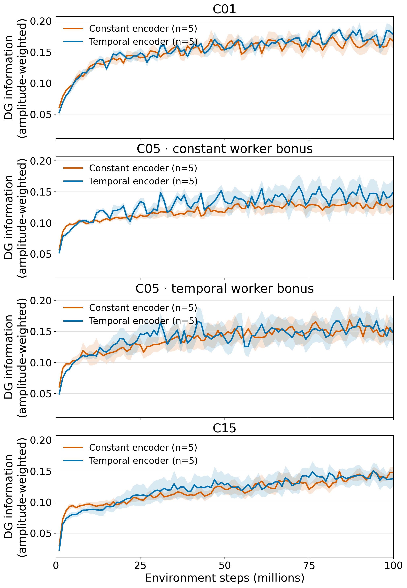
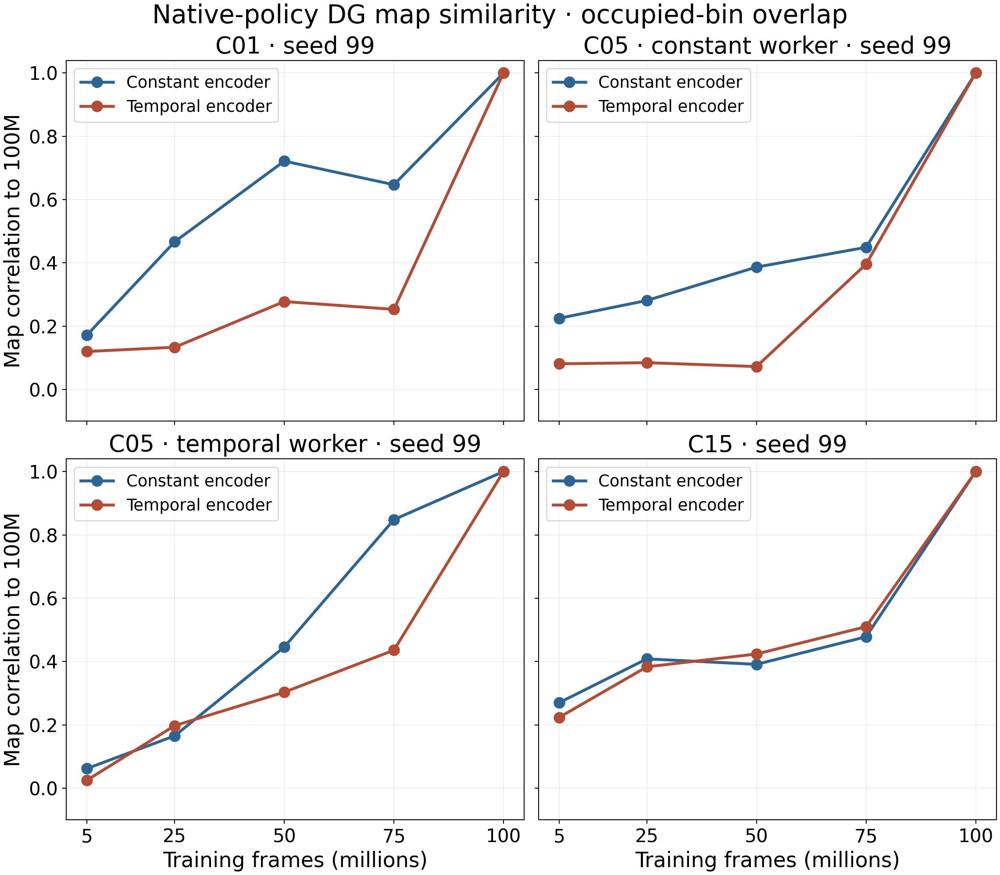
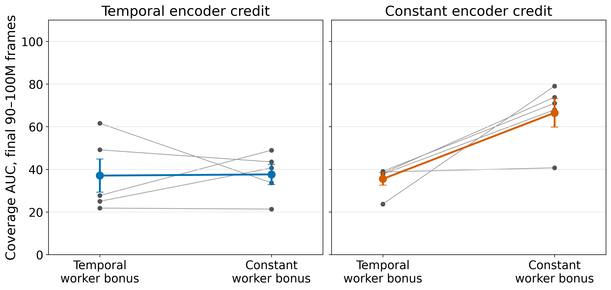
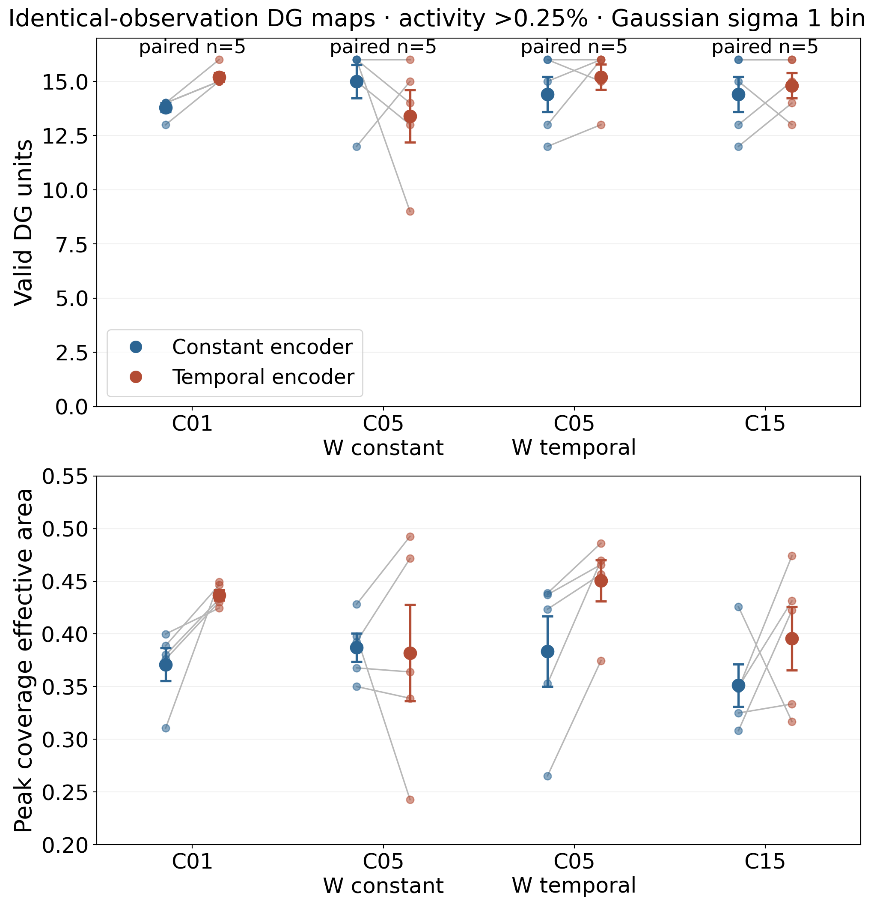
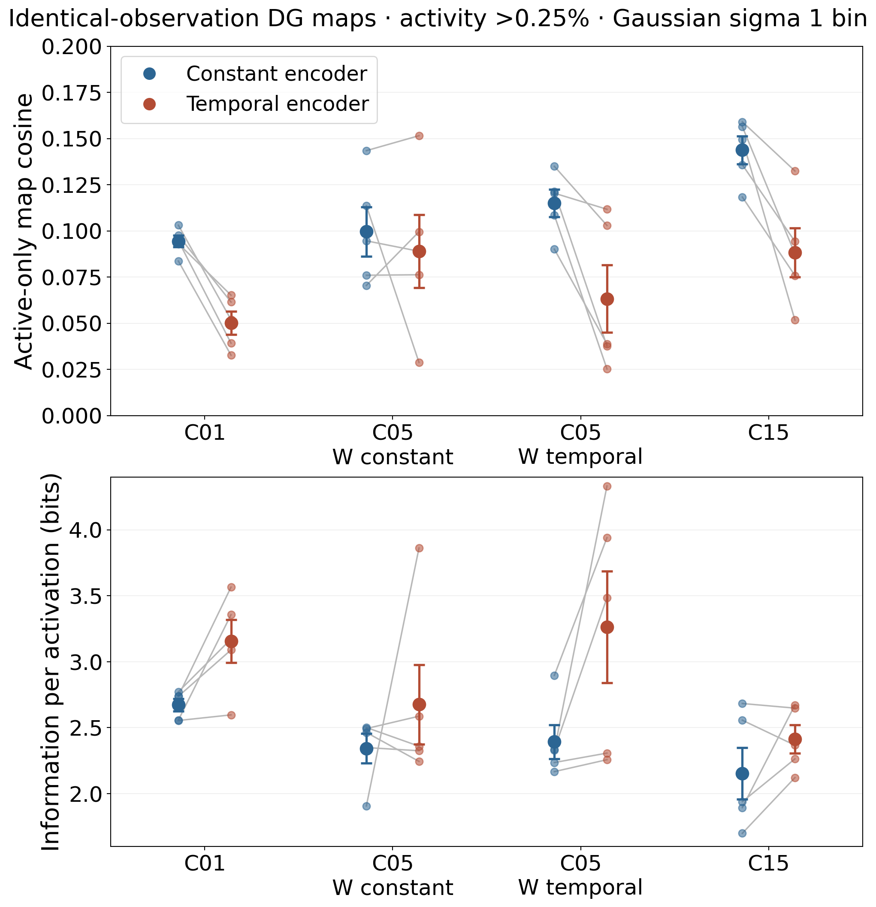

# COSYNE 2027 checkpoint and telemetry comparison

This folder is the reproducible result package for the fresh temporal versus mean-matched constant encoder-credit comparison. It joins the five seeds 8, 99, 123, 17, and 41 across C01, C05, and C15. C05 also crosses temporal and mean-matched constant worker hit bonus. The [run catalog](../training_runs.csv) and [submission record](../../reward_credit/cosyne27_staged_push_pull_submission_20261010.md) define the attempts and scientific factors.

**Status, 12 October 2026:** Both C15 constant-credit replacements reached verified 100M checkpoints, and their W&B histories and ten retained online spatial snapshots are included in the complete 40-run online comparison. The two failed originals remain excluded. The six new native-policy field rows and two identical-observation terminal replays completed successfully; the native and shared-panel comparisons now include all five C15 seeds. Four replacement control rows and the bounded source-0 pilot are running, so executed-command conclusions remain **interim**. All 48 first-pass executed-command jobs timed out at eight hours with no trial output. The three-day resubmissions then encountered twelve native buffer-overflow aborts across two nodes; the seven first detected rows have been retried with an explicit node exclusion, while the remaining five need a bounded runtime repair. No completed command-control result is available yet.

## Training-course spatial information

The [vector figure](figures/spatial_information_learning_curves.svg), [per-run W&B cache](wandb_histories/manifest.json), [joined history](figures/online_spatial_history_long.csv), [summary table](figures/online_spatial_history_summary.csv), [fetcher](../fetch_wandb_spatial.py), and [plotter](../plot_wandb_spatial.py) regenerate this panel without repeating API calls. W&B `train/env_steps` is the horizontal variable. Each run has 100 measurements; rounding to the nearest million aligns one observation per run per plotted bin, with no interpolation. Lines are means over independent training seeds and shaded bands are plus or minus one sample standard error, $s/\sqrt{n}$. The metric is `intrmotiv/online/place_field/active_unit_mean_spatial_information`, computed from each policy's latest 10k sampled observations. Its underlying spatial-information formula is amplitude weighted; the y-axis does not represent gain-invariant bits per activation.

| Family and worker timing | Constant encoder mean | Temporal encoder mean | Paired temporal-minus-constant, terminal seeds |
| --- | ---: | ---: | --- |
| C01, no worker bonus | 0.1673 ($n=5$) | 0.1784 ($n=5$) | mean +0.0111; signs mixed |
| C05, constant worker bonus | 0.1285 ($n=5$) | 0.1497 ($n=5$) | mean +0.0213; signs mixed |
| C05, temporal worker bonus | 0.1478 ($n=5$) | 0.1475 ($n=5$) | mean −0.0003; signs mixed |
| C15, temporal worker bonus | 0.1476 ($n=5$) | 0.1379 ($n=5$) | mean −0.0097; signs mixed |

The C15 curves now contain all five matched training seeds. Their spatial-information contrast changes sign across seeds. None of these policy-sampled curves establishes an advantage on identical observations. [Seed-level retained-snapshot contrasts](online_spatial_summary/paired_encoder_terminal.csv) also change sign across seeds.

The supplemental [active-only map-cosine course](figures/active_only_cosine_learning_curves.png) ([vector version](figures/active_only_cosine_learning_curves.svg)) uses the same 40 runs and uncertainty definition. Temporal-credit means are lower from early training across all four comparison panels, including all five C15 pairs at the terminal bin. This is consistent with reduced map redundancy under each learned policy's sampling; shared-observation cosine below tests whether the pattern survives identical visual inputs.

## Retained place fields, paths, graphs, and repeatability

The canonical `collect-spatial --include-details` workflow processed 200 retained 100k-observation snapshots, five per verified run. [Snapshot rows](online_spatial_summary/snapshot_long.csv), [terminal seed rows](online_spatial_summary/terminal_seed_metrics.csv), [cell summaries](online_spatial_summary/terminal_condition_summary.csv), [paired encoder contrasts](online_spatial_summary/paired_encoder_terminal.csv), and [paired C05 worker contrasts](online_spatial_summary/paired_worker_terminal.csv) preserve the candidate measures and provenance. [Per-unit tables and canonical manifests](online_spatial/) retain field structure, peak positions, activity, graph evidence, StudySpec fingerprints, and source release. C01 has no commanded-goal graph; missing graph fields are inapplicable, not zero.

Representative 100M [C01 temporal](atlas/c01_temporal/figures/COS27_C01_TEMPORAL_S99/target_000100000000_policy_00_place_fields_page01.pdf) and [constant](atlas/c01_constant/figures/COS27_C01_CONSTANT_S99/target_000100000000_policy_00_place_fields_page01.pdf) field atlases, [C05 four-cell fields and segmented paths](atlas/c05/figures/), [paired C15 seed-17 fields and paths](atlas/c15/figures/), and the [replacement C15 constant seed-99 fields and path](atlas/c15_recovery/figures/COS27_REC_C15_CONSTANT_S99/) use the same canonical renderer and snapshot ages. Within each field atlas, each unit's own peak sets its color scale; white cells are unvisited. Trajectory colors identify independent stored fragments, not a common episode clock. The [selected directed graph maps](selected_graphs/) now include the C15 seed-99 temporal and replacement-constant pair. They show prospective detector hits divided by attempts on a fixed 0–1 scale, with unattempted directed pairs gray. Their attempt counts, stored reliability, and executed-command success are different outcomes.

The retained arrays include aligned pose, DG activity, episode boundaries, and segment IDs. [Split-segment reliability](reliability/split_segment_reliability_per_snapshot.csv) alternates complete contiguous segments into two halves, computes occupancy-normalized maps, and correlates each unit over bins with at least five visits in both halves; fewer than 20 shared bins or zero variance gives a missing value. [Per-unit correlations](reliability/split_segment_reliability_per_unit.csv) and the [calculator](../analyze_snapshot_reliability.py) preserve that definition. At 100M, mean correlation is 0.804 temporal versus 0.821 constant in C01, 0.741 versus 0.743 with temporal worker bonus and 0.667 versus 0.752 with constant worker bonus in C05, and 0.693 temporal versus 0.731 constant across five C15 seeds per arm. Paired signs vary. This is within-window repeatability under each policy's own sampling, not a fixed-observation test of learned weights.

The retained terminal directed graph has mean reliable-edge counts of 5.2, 10.0, 8.2, and 11.2 for C05 constant/constant, constant/temporal, temporal/constant, and temporal/temporal, respectively, across five seeds per cell. The corresponding reachable-pair fractions are 0.027, 0.048, 0.048, and 0.054. C15 has much denser retained graphs (173.0 constant and 147.4 temporal, five seeds per arm) and equal mean reachable-pair fractions of 0.988, under a different architecture. [Seed-level graph and path rows](online_spatial_summary/terminal_seed_metrics.csv) and [cell aggregates](online_spatial_summary/terminal_condition_summary.csv) retain denominators and variability. Prospective graph success is a stored detector-history diagnostic; it is not executed matched-command success.

The retained grounded-controllability composite is at most 0.045 in the condition means, including 0.003–0.005 for C15 despite its dense graph. That composite partly uses mono-field criteria, so it is neither an independent field-quality check nor a substitute for the executed control trial.

On the same 100k-observation retained trajectories, C05 constant/constant has mean path efficiency 0.358 versus 0.151, 0.193, and 0.184 in the other three cells. Yet it exceeds each comparator in only three of five paired seeds, so the trajectory metric is less uniform than training coverage AUC. All C05 cells visit about 0.874–0.881 of the map cells in this long retained window, close to that metric's observed ceiling. C01 mean path efficiency is 0.094 constant versus 0.066 temporal; C15 is 0.292 constant versus 0.204 temporal across five seeds per arm, with the constant arm higher in four of five pairs. These paths visualize how each policy samples its environment, and the seed rows above retain physical step distance and stationary fraction for a closer behavior audit.

## Native-policy 10k fields and checkpoint course

All 104 native-policy 10,001-decision place-field rows completed. The [canonical cohort summaries](native_fields/) contain activity, silence, spatial information, thresholded and pre-threshold cosine, peak diversity, component geometry, and mono-field eligibility. The [joined 40 terminal seed rows](native_field_summary/native_terminal_seed_metrics.csv), [condition statistics](native_field_summary/native_terminal_condition_summary.csv), [paired encoder](native_field_summary/native_terminal_paired_encoder.csv), [paired worker](native_field_summary/native_terminal_paired_worker.csv), and [join script](../summarize_native_fields.py) use each verified run once.

At 100M, native-policy amplitude-weighted active-unit spatial-information means are 0.167 constant versus 0.183 temporal for C01; 0.129 versus 0.170 with C05 constant worker bonus; 0.137 versus 0.161 with C05 temporal worker bonus; and 0.142 versus 0.143 for C15, with five seeds per arm throughout. Active-only map cosine is lower under temporal credit in all 20 paired training seeds across the four comparisons. The means are 0.131 versus 0.070 in C01, 0.171 versus 0.086 and 0.154 versus 0.100 in the two C05 worker arms, and 0.184 versus 0.115 in C15. The continuous pre-threshold map cosine is also lower in each cell-level temporal comparison. Mono-field fractions are near zero in most cells, so distinct peak bins must not be described as clean single fields. These native replays sample different positions under each trained policy; the identical-observation analysis below is the representation comparison.

The [vector stability figure](figures/native_map_stability.svg), [canonical overlap and per-unit tables](map_stability/), and [plotter](../plot_map_stability.py) compare each checkpoint with 100M on overlapping occupied bins. Each panel shows one representative seed: 99 for C01, C05, and the recovered C15 pair. The five-checkpoint [trajectory summaries](checkpoint_trajectories/) and [recovered C15 seed-99 course](native_fields/c15_available/seed99_checkpoint_trajectory.csv) preserve rollout coverage and path measures. Correlations tend to increase with checkpoint age, but the ordering differs across architectures and timing cells. Each checkpoint was evaluated under its own policy; changing trajectory support and changing weights can both affect these correlations. The 100M value is one by definition and is not a reliability estimate.

## C05 worker timing and exposure

The [vector coverage figure](figures/c05_coverage_factorial.svg) and [plotter](../plot_c05_coverage.py) use the canonical TensorBoard 90–100M window mean of training coverage AUC. Gray lines connect the same training seed within each encoder-credit setting; colored points and bars are the five-seed mean and plus or minus one standard error. With constant encoder credit, switching the worker bonus from constant to temporal lowers coverage AUC in all five paired seeds (mean 66.48 to 35.51). With temporal encoder credit, the worker-timing contrast is mixed (37.62 constant versus 37.07 temporal). Holding the worker bonus constant, switching the encoder to temporal lowers coverage AUC in all five seeds (66.48 to 37.62). These are same-source, mean-calibrated timing comparisons, but coverage alone does not identify which internal mechanism changed behavior.

The [five-seed coverage factorial table](figures/c05_coverage_factorial_seed.csv) shows the encoder-by-worker interaction, defined as temporal/temporal minus constant/temporal minus temporal/constant plus constant/constant. It is positive in all five seeds, mean +30.42 coverage-AUC units. The corresponding [common-panel factorial table](common_peaks/peak_c05_interaction.csv) has mean interaction +0.539 bits per activation (five of five positive seeds), +0.072 Gaussian peak effective-area fraction (four of five positive), and −0.041 active-only cosine (four of five negative) at the primary cutoff and bandwidth. This is a C05 timing interaction within the current environment, not evidence that either timing mechanism will help independently in other settings.

[Canonical per-run scalar tables](online_scalar/) retain coverage, DG density, event exposure, hit counters, and action sensitivity by original StudySpec. [Count-weighted hit measurements](conditional_hits/conditional_hit_seed_metrics.csv), their [cell summary](conditional_hits/conditional_hit_cell_summary.csv), and the [calculator](../summarize_conditional_hits.py) join each conditional reward or elapsed mean to `correct_count` at the same learner update. Across five C05 seeds, realized correct-hit reward magnitude averages about 1.59 under the constant worker bonus and 1.65–1.66 under the temporal bonus. The match is close but not exact at this late window. These sums count repeated learner-batch observations, not independent executed-command trials; physical arrival remains unmeasured here.

On the identical-observation panel at the primary cutoff, changing the worker bonus from constant to temporal changes Gaussian peak effective area by −0.004 on average with constant encoder credit and +0.069 with temporal encoder credit; the paired signs are mixed in both arms (two and three positive seeds of five). Worker timing's large training-coverage effect therefore does not imply a uniform shared-panel peak-spread effect. [Paired worker rows](common_peaks/peak_paired_worker.csv) retain the seed-level interaction.

## Older controls and behavior-expression alternatives

The older [same-observation no-credit table](../../reward_credit/results/corrected_core_encoder_worker_20261010/common_panel_place_fields.csv), [paired-credit table](../../reward_credit/results/corrected_core_encoder_worker_20261010/common_panel_encoder_pairs.csv), and [per-unit peak locations](../../reward_credit/results/corrected_core_encoder_worker_20261010/common_panel_peak_centers_per_unit.csv) remain the credit-presence controls. Their positive constant magnitudes were below the newly mean-matched constants. The September intact checkpoints have a different source version. These cohorts should not be pooled with the fresh timing effect.

For the three older matched-observation seeds in each comparable flat/temporal-worker cell, mean active-unit amplitude-weighted spatial information was 0.074 for C01 positive constant credit, 0.051 with no credit and joint PPO-to-DG routing, and 0.007 with no credit and stopped routing. The corresponding C05 temporal-worker values were 0.059, 0.042, and 0.009; C15 temporal-worker values were 0.100, 0.021, and 0.020. These establish the older credit-presence and routing context on the same observation file, but credit magnitude, training source, and training factors differ from the fresh temporal-versus-mean-matched-constant experiment. Credit presence cannot be inferred from the fresh comparison alone, and the old three-condition contrast cannot isolate temporal timing.

For the separate September frozen-weight own-policy versus uniform-random intervention, [50k probe rows](policy_expression/own_uniform_50k_probe_rows.csv), [training-seed means](policy_expression/own_uniform_training_seed_means.csv), [three-seed summaries](policy_expression/own_uniform_three_seed_summary.csv), and [calculator](../summarize_policy_expression.py) preserve additional candidate outcomes. Decoder-1 bits per activation and split-half map correlation favor the own policy in every C01/C05/C15 training seed. Decoder-1 bits per step is positive in all C01 and C05 seeds but mixed in C15; active-only map cosine is mostly lower under the own policy. The two evaluation seeds per training seed are repeat probes, not independent training replications. The policies sample different paths and occupancies, so these differences describe expression of frozen weights, not a training effect or a matched-observation comparison.

## Shared-observation field geometry and control

The primary identical-observation panel is the previously validated 10,001-observation file at `/work/classic/fr_xl1014-corridor-geometry/IntrMotiv/SF_hipposlam/train_dir/analysis/corrected_core_distance_ablation_20261009/common_panel100/observations.npz`, SHA-256 `14e977ff526c71d04822dde8903e4d1eeda8ed44d16b8eb1a9b7d69b426fc54d`. The [40-row terminal replay manifest](manifests/available_terminal_manifest.tsv) and [source map](manifests/manifest_sources.csv) exclude failed originals and preserve each source StudySpec SHA-256, including the [C15 recovery specification](manifests/c15_recovery/study_manifest.json). All 40 terminal replays completed on that checksum-verified panel. The [manifest adapter](../build_available_field_manifests.py) joins six canonical cohort manifests with C15's four valid original endpoints and two verified replacement endpoints using the canonical checkpoint selector. The C15 three-seed StudySpec's `render-telemetry` currently fails on the two incomplete originals because fallback checkpoint labels collide.

The [peak analyzer](../analyze_common_peaks.py) measured only units with positive supported-bin rate and activity fraction above 0%, 0.025%, 0.25%, or 1%. It saved [per-unit peak coordinates and responses](common_peaks/peak_units.csv), [per-run cutoff and bandwidth sensitivity](common_peaks/peak_run_sensitivity.csv), the [common 242-bin support mask](common_peaks/common_support_mask.csv), [condition means](common_peaks/peak_condition_summary.csv), [paired encoder contrasts](common_peaks/peak_paired_encoder.csv), and [paired C05 worker contrasts](common_peaks/peak_paired_worker.csv). The [canonical 40-run common-panel summaries](common_canonical/) independently reproduce the zero-cutoff active-only cosine and amplitude-weighted information to numerical precision. Occupancy is identical across all 40 replays: 10,001 observations and 242 occupied bins. Each valid unit contributes one equal-weight Gaussian at its maximum supported bin. Primary bandwidth is one 19-by-19 map bin, with 0.5- and two-bin sensitivity. Density is normalized over the identical occupied-bin mask; normalized entropy, entropy effective-area fraction, and Gini describe peak spread. The [shared-panel summary script](../summarize_common_peaks.py) and [map plotter](../plot_common_peaks.py) regenerate the comparisons and selected spatial displays. A peak location is neither a field centroid nor proof of a reliable single field. Raw replay NPZs and full canonical plots remain in the active workspace.

The [vector geometry](figures/common_peak_geometry.svg) and [vector functional](figures/common_peak_functional.svg) figures connect each training seed's temporal and mean-matched constant checkpoints. The primary threshold is activity greater than 0.25%, Gaussian bandwidth one bin, and the error bars are mean plus or minus one sample standard error. `W` in the horizontal labels denotes worker-bonus timing. Positive effective-area differences mean the equal-weight *peak density* covers more of the observed mask, not that each unit has a larger or cleaner field.

| Paired temporal-minus-constant encoder contrast | Valid units | Gaussian effective-area fraction | Active-only map cosine | Information per activation, bits |
| --- | ---: | ---: | ---: | ---: |
| C01, $n=5$ | +1.40 | +0.0657 | −0.0443 | +0.484 |
| C05, constant worker bonus, $n=5$ | −1.60 | −0.0053 | −0.0106 | +0.333 |
| C05, temporal worker bonus, $n=5$ | +0.80 | +0.0671 | −0.0518 | +0.872 |
| C15, temporal worker bonus, $n=5$ | +0.40 | +0.0443 | −0.0555 | +0.260 |

C01 has positive effective-area and information-per-activation differences and lower cosine in all five pairs. C05 with temporal worker bonus has the same three sign patterns in all five pairs; with constant worker bonus, the paired signs are mixed and one temporal seed has only nine units above the primary cutoff. C15 has lower cosine in all five pairs, broader peak-density effective area in four of five, and higher information per activation in three of five. Native-policy cosine favored temporal credit in all 20 pairs, whereas identical-observation cosine is mixed in C05's constant-worker arm. Thus the policy-sampled pattern does not by itself establish an encoder representation effect in that arm.

The other Gaussian-spread summaries agree at the primary setting: paired normalized entropy changes are +0.030 in C01, −0.008 in C05 constant-worker, +0.032 in C05 temporal-worker, and +0.021 in the five C15 pairs; the corresponding Gini changes are −0.051, +0.002, −0.051, and −0.034. Higher entropy and lower Gini denote broader equal-weight peak density on the common mask. Mono-field fractions remain low, below 0.06 in every condition mean, so broader peak placement should not be described as reliable single-field coding. [Per-unit eligibility and mono flags](common_peaks/peak_units.csv) and the [condition table](common_peaks/peak_condition_summary.csv) retain the denominators.

Common-panel amplitude-weighted spatial information also has positive mean paired temporal-minus-constant differences: +0.044 in C01 (five of five positive seeds), +0.042 in C05 constant-worker (three of five), +0.025 in C05 temporal-worker (four of five), and +0.013 in the five C15 pairs (four of five). Unlike the per-activation quantity in the figure, this scalar changes with response amplitude, so its agreement is not an independent gain-invariant check.

The C01 effective-area increase keeps the same sign in all five seeds at activity cutoffs 0%, 0.025%, and 0.25%; at 1%, only three do. The C05 temporal-worker increase is five of five at the first three cutoffs and two of five at 1%. C05 constant-worker spread is mixed at the first three cutoffs and favors constant credit in all five pairs at 1%. Active-only cosine remains lower under temporal credit in all five C01 and C05 temporal-worker pairs at every cutoff tested. At the primary 0.25% cutoff, the C01 effective-area sign is positive in all five pairs at Gaussian bandwidths 0.5, one, and two bins; C05 temporal-worker is five of five at 0.5 and one bin, and four of five at two bins. The individual values, silent-unit counts, unique peak bins, distances, Gini, field eligibility, and mono-field flags are in the tables above.

The selected [C01/C15](figures/common_peak_density_c01_c15.png) and [four-cell C05](figures/common_peak_density_c05.png) maps ([C01/C15 vector](figures/common_peak_density_c01_c15.svg), [C05 vector](figures/common_peak_density_c05.svg)) show the valid peak locations over identical support with one color scale per figure. Cyan dots mark maxima; white bins were never observed. All illustrated pairs use seed 99, including the C15 replacement. These are spatial examples, while the paired tables contain the training-seed comparisons.

Goal-conditioned C05/C15 control requires executed alternative commands from exact matched starts. The original evaluator ignored the declared all-eligible-target and fixed-window settings. An isolated analysis-only runtime applies the [qualified all-eligible patch](../../../hpc_runs/patches/target_control_all_eligible_fixed_horizon_20261009.patch) plus a [discovery-setting parity patch](../../../hpc_runs/patches/cosyne27_control_discovery_parity_20261011.patch). C01 has no commanded goals. A DG detector hit will be reported separately from any independently supported physical destination arrival.

The qualification completed with nine trial rows from one matched source/repeat, an exact-start check, frozen policy and graph, and zero missing settings; [trials](control_preflight/intervention_trials.csv) and [summary](control_preflight/intervention_summary.json) preserve the evidence. The 48 C05/C15 production intervention rows were print-reviewed and submitted as ordinary NEMO2 jobs. All 48 timed out after eight hours with no trial CSV because the evaluator writes only at row completion. Slurm reported `TIMEOUT|0:0` for every first-pass job; a representative row opened 256 DMLab engines before cancellation. The unchanged canonical manifest rows were print-reviewed and resubmitted at three days. Twelve recovery jobs then aborted with native `*** buffer overflow detected ***` and exit 134 across nodes n3104 and n3109. Seven were print-reviewed and retried with explicit node exclusion as a diagnostic; this does not establish a node cause or solve the repeated-engine lifecycle risk. The other five await bounded fresh-engine shards with an audited merge. An isolated [source-shard patch](../../../hpc_runs/patches/cosyne27_control_source_shards_20261012.patch) and [canonical submitter export](../../../hpc_runs/patches/submit_place_field_sweep_focus_sources_20261012.patch) passed dry-run, syntax, and four focused runtime tests; the print-reviewed C05 source-0 pilot is running as job 8344905, with its [submission record](control_submissions/c05_s3_source00_pilot_20261012.tsv). Four new C15 replacement control rows are running. [Original and recovery submission records](control_submissions/) retain the commands and job IDs. This is an operational failure and retry, not a control result. The [control calculator](../summarize_control.py) will aggregate 64/128/256/900-decision fixed-horizon detector-hit differences between executed commands from the same start and target, including censoring, source coverage, initial action sensitivity, and endpoint separation. The evaluator's internal name `paired_arrival_lift` denotes a DG-exclusive target *detector* event, not an independently identified physical destination. Start and endpoint coordinates are retained, but the current protocol has no independent physical target map.

## Source and workspace boundaries

The seven fresh production StudySpecs and the C15 recovery StudySpec declare `intrmotiv/study/v1` and workflow `1.14.1`; their hashes are recorded in the [study record](../../reward_credit/cosyne27_staged_push_pull_submission_20261010.md#scientific-comparisons-and-seed-structure), [W&B cache manifest](wandb_histories/manifest.json), and [canonical telemetry manifests](manifests/). The two verified 100M C15 replacement runs change only a learner minibatch failure path under recovery patch SHA-256 `797dd997ef5d9e83839449fdce8978bfc5b365ee98d47a5d86aecbcea49c93b7`. That source tag is retained in their catalog, histories, and field manifests.

Bulk checkpoints, raw place-field NPZs, observation panels, graph-edge tables, Slurm logs, and caches live under `/work/classic/fr_xl1014-corridor-geometry/IntrMotiv/SF_hipposlam/train_dir/analysis/cosyne27_checkpoint_20261011/` or the linked training roots. No new bulk output was written to the retired allocation. The fresh-panel recording qualification failed at the evaluator's hardcoded retired-root check after rollout; the checksum-verified historical panel above remains the primary comparison input.

## Reusable workflow lessons

The authoritative route was the validated StudySpec, `render-telemetry`, ordinary-job print-only review, `collect-online`, `collect-spatial --include-details`, and the canonical place-field summarizer and manifest analyzer. The 40-row adapter used canonical checkpoint selection for the incomplete original C15 attempts and their verified replacements; it did not rebuild training inventories or infer factors from run-directory names. The provenance-checked W&B cache reused the 38 existing histories and fetched only two new runs. Reusing the checksum-verified observation panel made every fresh endpoint comparable on one support mask and avoided rerunning the earlier no-credit controls. The failed fresh-panel write and submitter's retired-root default cost one rollout and two print-only attempts; the [tracked infrastructure entry](../../../infra.md#observation-panel-recording-assumed-the-retired-nemo2-workspace--2026-09-26) and the [telemetry workflow](../../../04_implementation/reusable_place_field_telemetry.md#rollout-submission) now state the active-root command and known save limitation. The one-source intervention qualification verified correctness but did not predict a full 16-source, eight-repeat row's runtime: 48 eight-hour jobs timed out before their final write, and twelve longer retries hit native buffer overflow. The [matched-command infrastructure entry](../../../infra.md#make-declared-matched-command-settings-executable-and-serializable--2026-10-09) tracks bounded source shards and audited merging. For the next checkpoint batch, confirm terminal availability before rendering manifests, pass the active workspace root explicitly, qualify one compute-node replay and one full-size timing row, then submit independent manifest rows and retain only compact summaries and readable selected figures in the vault.
