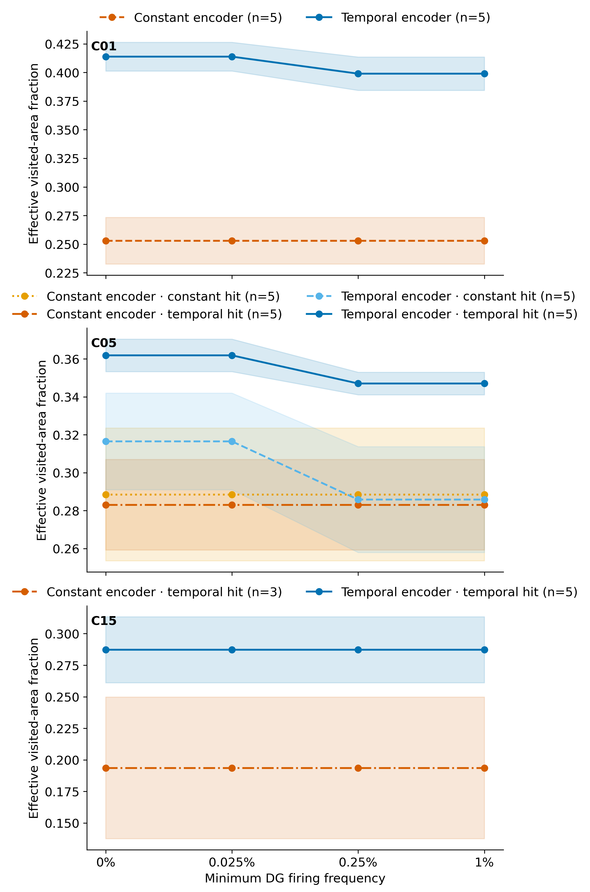
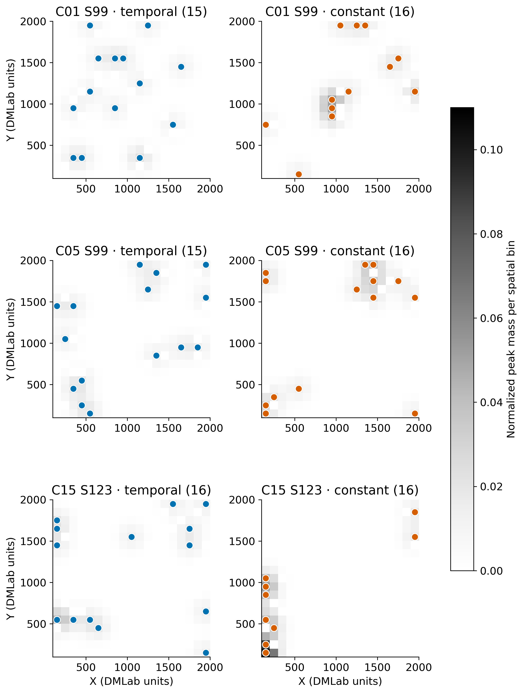

# COSYNE 2027: DG peak spread in retained training snapshots

**Status, 11 October 2026:** This is an interim analysis of the canonical latest-100k behavior snapshots at 5M, 25M, 50M, 75M, and 100M frames. It includes all 38 verified original fresh runs (190 snapshots, 3,040 unit records). The C15 matched-constant original seeds 8 and 99 failed before a final snapshot, so its paired terminal comparison has three seeds; their replacement training jobs were still running at collection. The separate 10k-decision checkpoint field sweeps were submitted on NEMO2 and are not interpreted here.

## Result at the proposed 0.25% cutoff

[Editable SVG](../results/cosyne_2027_snapshot_peak_spread/figures/gaussian_effective_area_by_cutoff.svg) · [paired terminal seed values](../results/cosyne_2027_snapshot_peak_spread/paired_terminal_by_seed.csv) · [all checkpoint and cutoff values](../results/cosyne_2027_snapshot_peak_spread/per_snapshot_cutoff_spread.csv)

Temporal minus mean-matched constant encoder credit, with the worker factor fixed, gives:

| Family; worker hit bonus | Paired seeds | Valid peaks, temporal / constant | Effective area difference | Mean pairwise peak-distance difference | Active-only map-cosine difference |
| --- | ---: | ---: | ---: | ---: | ---: |
| C01; inapplicable | 5 | 15 / 16 | +0.146, 5/5 positive | +105 DMLab units, 4/5 positive | −0.096, 4/5 lower |
| C05; temporal | 5 | 15 / 16 | +0.064, 4/5 positive | −36 units, 2/5 positive | −0.106, 4/5 lower |
| C05; constant | 5 | 15 / 16 | −0.003, 3/5 positive | +35 units, 4/5 positive | −0.116, 4/5 lower |
| C15; temporal | 3 | 16 / 16 | +0.067, 2/3 positive | +248 units, 3/3 positive | −0.099, 3/3 lower |

“Effective area” is the exponential Shannon entropy of the equal-mass, Gaussian-blurred eligible-peak density divided by the number of bins in a **fixed pooled visited-cell mask**. A value of 1 would distribute peak density evenly over that mask. The plotted width is 100 DMLab units, one 19-by-19 spatial bin; the mask contains 318 bins visited by at least one of the 38 terminal runs. [Width sensitivity](../results/cosyne_2027_snapshot_peak_spread/figures/gaussian_bandwidth_sensitivity.svg) at 50, 100, and 150 units preserves the sign in all five C01 pairs and keeps the C05 temporal-hit mean positive. The C05 constant-hit mean stays near zero. [Per-seed width values](../results/cosyne_2027_snapshot_peak_spread/bandwidth_paired_by_seed.csv) and [the Gini candidate](../results/cosyne_2027_snapshot_peak_spread/figures/gaussian_gini_by_cutoff.svg) expose the alternatives.

The area effect is **not universal across the factorial**. C01 is the cleanest fresh five-seed contrast. C05 differs by worker-bonus arm, and its mean pairwise distance does not agree with effective area in the temporal-hit arm. C15 is suggestive with only three paired seeds. Across all four contrasts, the active-only map cosine is lower with temporal encoder credit in 4/5, 4/5, 4/5, and 3/3 pairs. Lower cosine measures less similarity between unit maps on each run's visited bins, not better spatial coding by itself.

## Are the lost peaks practically silent?

The [valid-peak cutoff plot](../results/cosyne_2027_snapshot_peak_spread/figures/valid_peaks_by_cutoff.svg) and [mean pairwise-distance plot](../results/cosyne_2027_snapshot_peak_spread/figures/pairwise_distance_by_cutoff.svg) show every C01, C05, and C15 factor arm. At the final snapshot, all 16 units in every fresh run have an eligible dominant peak at 0% and 0.025%. At 0.25% and 1%, one unit in **each** temporal C01 and C05 run falls below cutoff; all matched-constant C01/C05 units pass. C15 retains 16 in both available arms.

The 15 low-frequency units across C01 and both C05 worker arms fire on 0.12–0.16% of the 100k samples (120–162 observations each), across 93–109 occupied bins. They pass the canonical field-eligibility rule of at least 20 active observations in at least three bins. They are **low-firing by the proposed practical cutoff, not dead or missing fields**. Using 0.025%, roughly two orders below the intended 2.5% firing frequency, detects no practically silent unit in these fresh runs. The main C01 area effect persists despite excluding its one low-frequency peak.

## Example peak locations and behavior check

[Editable example SVG](../results/cosyne_2027_snapshot_peak_spread/figures/example_valid_peaks_gaussian.svg). Each dot is one eligible DG unit above the 0.25% cutoff at the final snapshot; grayscale uses the same normalized 0–0.11 peak-mass scale in all six panels. C01 and C05 show seed 99, and C15 shows seed 123 because its constant seed 99 has no original terminal checkpoint. The C05 examples hold the temporal worker-hit arm fixed. Example selection is illustrative; paired tables above carry the replicated comparison.

The [paired behavior and graph check figure](../results/cosyne_2027_snapshot_peak_spread/figures/paired_behavior_graph_checks.svg) places visited fraction, active-only map cosine, physical step length, and stored graph efficiency beside their independent seed differences. The 100k-window visited-cell fraction is **not higher** under temporal encoder credit in any of the 18 available paired terminal cells (some tie), while the C01 peak-area comparison is 5/5 positive. This rules out a simple “more bins visited in that window” explanation, but it does not match the observations or occupancy distribution between policies. The exploratory trajectory measures and cached graph scores are in [the full paired table](../results/cosyne_2027_snapshot_peak_spread/paired_terminal_by_seed.csv). Graph efficiency is mixed, and its stored prospective scores are not executed command-control evidence.

## Methods, source boundary, and next gate

- [Regeneration script](analyze_snapshot_peak_spread.py) reads the seven archived canonical collect-spatial per-unit and per-snapshot [source tables](../results/cosyne_2027_snapshot_peak_spread/inputs/). Their StudySpec SHA-256, schema, completeness, and workflow version are retained in [source manifests and the derived manifest](../results/cosyne_2027_snapshot_peak_spread/analysis_manifest.json). The C15 three-seed source manifest correctly reports 20/30 expected snapshots.
- Each activity cutoff is applied to per-unit firing frequency in a retained 100k sample window; 0% means strictly positive activity. A valid peak must also pass the canonical eligibility rule and have finite coordinates. The cutoff curve is a sensitivity analysis, not a threshold chosen after seeing the contrast.
- The pooled [visited-bin mask](../results/cosyne_2027_snapshot_peak_spread/common_visited_mask.json) is shared across all factor arms for Gaussian-density normalization. It is an empirical union of visited bins, **not** a fixed-observation panel or an exact geometry mask. Each peak has equal weight and the displayed density is normalized to total mass one, so this tests spatial spread of valid peaks rather than response amplitude.
- Source CSVs and derived per-snapshot, paired-seed, bandwidth, and figure data are retained in [one results folder](../results/cosyne_2027_snapshot_peak_spread/). SVGs keep editable vector text and PNGs provide inspected previews with 12-point source labels.

**Claim gate:** These observations support *a temporal-credit association with less redundant, more distributed DG peaks in C01*, and a conditional lead in C05. The two training conditions have different learned policies and behavior samples. Complete the already submitted frozen-checkpoint 10k field/trajectory/graph sweeps, then compare both models on common observations before claiming that temporal credit changes the learned spatial code independently of behavior. The [COSYNE run catalog](training_runs.csv) and [main online analysis](online_and_behavior_analysis_20261011.md) provide the training and W&B context. Executed matched-start command interventions remain necessary for a goal-control payoff.

**Reusable lesson:** Canonical per-unit snapshot tables made cutoff and peak analyses cheap after the original collection. The first local command used NEMO2's bare Python, which lacked NumPy; the established dmlab_pack environment loaded the stored NPZ occupancy masks. Save the pooled mask and source manifests before revising blur widths, and keep the online-snapshot source boundary visible on every claim.
